# 链鉴 AML

> 面向反洗钱调查的可解释智能审查与证据链平台

链鉴 AML 是一个面向银行合规、反洗钱调查和风险分析人员的智能审查系统。它将交易数据、规则命中、账户画像、资金关系图谱、风险评分、反事实分析、Agent 辅助调查和人工审核串联为一条可追溯的证据链，帮助调查人员更快地完成：

**发现预警 → 理解原因 → 核验事实 → 形成报告 → 人工审核 → 留存审计痕迹**

当前版本定位为华为黑客松可运行演示版，支持本地 SQLite 数据仓库；当 Neo4j 不可用时，图谱查询会自动降级到 SQLite 事实数据，保证演示链路可用。

---

## 产品亮点

| 能力 | 说明 |
| --- | --- |
| 多规则风险检测 | 识别循环交易、拆分转账、资金归集、多跳路径、快速转移等风险模式 |
| 证据链审查 | 将告警、命中规则、关键交易、账户和资金路径组织成可追溯证据链 |
| 账户风险画像 | 汇总交易笔数、交易对手、活跃天数、金额和异常行为等特征 |
| 资金关系图谱 | 展示账户与交易之间的关系，支持风险节点、关键路径和多跳关系分析 |
| 可解释风险评分 | 拆解评分构成，说明规则、交易规模、关系复杂度和异常频率的影响 |
| 反事实分析 | 模拟移除某些风险因素后的评分变化，辅助调查人员理解风险来源 |
| Agent 辅助调查 | 调用交易、规则、图谱和报告工具，生成结构化调查结论 |
| 人工审核闭环 | 支持确认、驳回、补充调查、审核备注和审计记录 |
| 运营与评估 | 记录命中、任务、审核、数据质量和离线模型评估指标 |

## 系统工作流

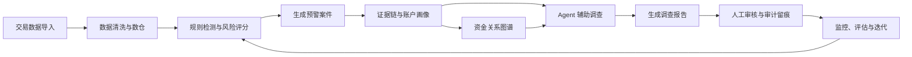

## 技术架构

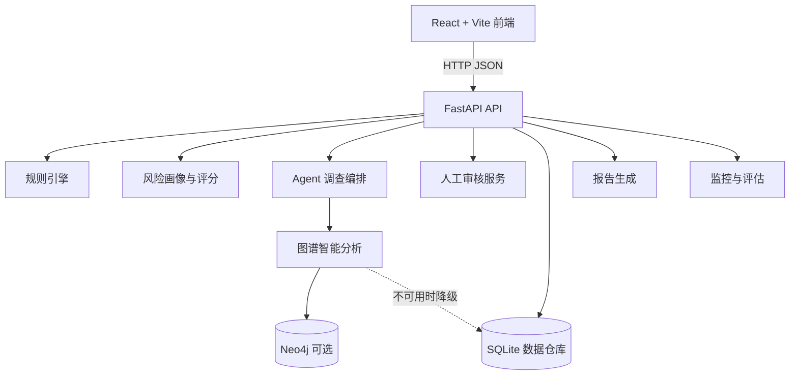

主要技术组件：

- **后端**：Python、FastAPI、Pandas、SQLite
- **前端**：React 19、Vite、Phosphor Icons
- **图谱分析**：Neo4j（可选）及 SQLite 降级查询
- **智能调查**：OpenAI Compatible LLM 接口、单 Agent / 多 Agent 编排
- **质量保障**：pytest、Vite build、前端 smoke test

## 项目结构

```text
chainjian-aml/
├── backend/              # FastAPI 后端
│   ├── api/              # 告警、报告、图谱、Agent、审核等接口
│   ├── core/             # 数据加载、数仓、风险引擎、实时处理
│   ├── material_review/  # 补充材料审查
│   └── main.py           # 服务入口
├── web/                  # React + Vite 前端
│   ├── src/              # 页面、组件与样式
│   └── scripts/          # 前端冒烟测试
├── rules/                # 反洗钱规则与规则引擎
├── app/                  # 告警、证据、审核、审计日志服务
├── agent/                # 调查 Agent、工具、提示词与报告生成
├── agents/               # 多 Agent 编排与任务存储
├── graph/                # 关系图谱构建与查询
├── graph_intelligence/   # 图谱智能分析与风险传播
├── risk_profile/         # 账户画像
├── explainability/       # 风险解释与证据构建
├── counterfactual/       # 反事实风险模拟
├── monitoring/           # 运行监控
├── evaluation/           # 离线评估与指标计算
├── reports/              # 调查报告和模板
├── data/                 # 演示数据、标签与补充材料
├── tests/                # 自动化测试
├── docs/                 # 产品、架构、规则和运营文档
└── run-logs/             # 本地运行日志
```

## 快速开始

### 1. 启动后端

在项目根目录 `chainjian-aml/` 下执行：

```powershell
python -m pip install -r backend/requirements.txt
python -m uvicorn main:app --app-dir backend --host 0.0.0.0 --port 8000
```

后端地址：<http://127.0.0.1:8000>

健康检查：<http://127.0.0.1:8000/health>

### 2. 启动前端

```powershell
cd web
npm install
npm run dev -- --host 0.0.0.0 --port 4173
```

前端地址：<http://127.0.0.1:4173>

### 3. 可选环境变量

如需启用 Neo4j 或大模型能力，可在本地配置环境变量：

```powershell
$env:NEO4J_URI = "bolt://localhost:7687"
$env:NEO4J_USERNAME = "neo4j"
$env:NEO4J_PASSWORD = "你的 Neo4j 密码"
$env:LLM_API_KEY = "你的模型 API Key"
```

密钥只应通过环境变量或本地 `.env` 管理，不要提交到 Git 仓库。

## 常用接口

| 功能 | 方法 | 地址 |
| --- | --- | --- |
| 健康检查 | `GET` | `/health` |
| 告警列表 | `GET` | `/alerts` |
| 告警详情 | `GET` | `/alerts/{alert_id}` |
| 风险解释 | `GET` | `/alerts/{alert_id}/explainability` |
| 反事实分析 | `GET` | `/alerts/{alert_id}/counterfactual` |
| 图谱智能分析 | `GET` | `/alerts/{alert_id}/graph-intelligence` |
| 调查报告 | `GET` | `/reports/{alert_id}` |
| 多 Agent 调查 | `POST` | `/agent/multi-investigate` |
| Agent 任务状态 | `GET` | `/agent/multi-investigate/{alert_id}/tasks` |
| 人工审核 | `POST` | `/alerts/{alert_id}/review` |
| 待审核案件 | `GET` | `/reviews/pending` |
| 监控指标 | `GET` | `/monitoring/metrics` |
| 补充材料上传 | `POST` | `/alerts/{alert_id}/materials` |

启动后端后，可访问 FastAPI 文档：<http://127.0.0.1:8000/docs>

## 数据说明

演示数据位于 `data/` 目录，主要包括：

- `accounts.csv`：账户信息
- `transactions.csv`：交易明细
- `cases.csv`：案例信息
- `labels.csv`：离线评估标签
- `manifest.json`：数据集清单
- `supplement_materials/`：案件补充材料

`labels.csv` 仅用于离线评估，不参与在线告警推理、图谱查询或调查工具路径，避免评估数据泄漏。

## 数据重建与图谱导入

```powershell
python backend/core/preprocess_ibm_aml.py
python backend/core/warehouse.py --replace
python graph/build_graph.py --data-dir data/cleaned
```

具体参数和数据处理规则请参考：[数据预处理文档](docs/data-preprocessing.md)。

## 测试与验证

```powershell
# 后端测试
python -m pytest -q

# 前端构建
cd web
npm run build

# 前端与后端接口冒烟测试
npm run test:smoke
```

## 文档导航

- [产品需求文档](docs/PRD.md)
- [总体架构说明](docs/architecture/aml-overall-architecture.md)
- [图谱智能分析方案](docs/architecture/链鉴AML_图谱智能分析方案.md)
- [规则引擎说明](docs/rule-engine.md)
- [Neo4j 图谱说明](docs/neo4j-graph.md)
- [调查 Agent 说明](docs/investigation-agent.md)
- [多 Agent 调查说明](docs/multi-agent-investigation.md)
- [解释性分析](docs/explainability-layer.md)
- [反事实分析与报告](docs/counterfactual-and-report.md)
- [审核与评估](docs/review-and-evaluation.md)
- [数据仓库](docs/data-warehouse.md)
- [数据清洗报告](docs/data-cleaning-report.md)
- [实时数据生成器](docs/realtime-generator.md)
- [上线监控指标表](docs/operations/上线监控指标表.md)
- [模型运行日报月报模板](docs/operations/模型运行日报月报模板.md)
- [自迭代 SOP](docs/operations/自迭代SOP.md)


## License

本项目用于华为黑客松项目演示与研发验证。正式对外发布前，请补充适用的开源许可证、第三方依赖声明和数据使用说明。

---

# 链鉴 AML 反洗钱证据链智能体审查平台

## 技术设计文档

## 1. 项目背景

在反洗钱工作中，预警只是调查的起点。真正耗时的工作通常发生在预警产生之后：调查人员需要从交易明细中找出关键交易，从账户关系中还原资金流向，再结合规则命中、账户行为和补充材料判断预警是否成立，最后形成一份能够被复核和留痕的调查记录。传统系统往往把这些内容分散在规则引擎、交易查询、图谱工具、材料系统和审核系统中，调查人员需要反复切换页面，容易出现证据遗漏、金额核对困难和报告口径差异等问题。

链鉴 AML 项目就是在这个背景下提出的。项目重点在于把“发现异常、组织证据、辅助调查、人工审核、记录过程和复盘改进”串成一条完整链路。系统使用 IBM AML 合成数据开展技术验证，围绕账户、交易、规则、图谱、风险解释和审核记录建立统一模型，形成面向反洗钱调查的工作台。

当前版本用于华为黑客松演示和研发验证，主链路由 React、Vite、FastAPI、PostgreSQL 和 Neo4j 组成。系统聚焦调查辅助、证据组织、报告起草和人工审核流程，演示环境与真实生产处置链路保持清晰边界。

## 2. 项目概述

链鉴 AML 的建设目标是提供一套以证据为中心的反洗钱调查辅助平台。系统需要完成数据导入和清洗，运行可解释的风险规则，生成可追溯的预警案件，关联账户画像和资金路径，提供评分解释和反事实分析，利用多个专业 Agent 组织调查过程，生成报告草稿，并由人工审核人员确认、驳回或要求补充调查。

从建设范围看，系统覆盖数据生产、分层数仓、规则引擎、风险评分、资金图谱、证据链、调查 Agent、补充材料审查、报告生成、人工审核、审计留痕、运行监控、离线评估和受控持续改进。真实客户身份识别、银行核心交易接入、生产级多租户、正式监管报送和账户处置能力安排在后续生产化建设阶段。

### 2.1 项目说明

链鉴 AML 的重点是解决反洗钱调查中最难落地的一件事：让机器发现的风险真正变成调查人员可以核对、审核人员可以复盘、系统可以长期积累的证据。我们把规则、图谱、解释性分析和 Agent 放在同一条案件证据链上，让每个技术模块都对应一个真实的调查动作。

项目可以用一句话概括为：链鉴 AML 是一套“规则发现风险、图谱还原关系、智能体组织调查、证据核验把关、人工审核定案”的反洗钱证据链智能审查系统。它的价值体现在把复杂资金行为转化为可追溯的事实链和可执行的调查流程。

| 评审关注点 | 链鉴 AML 的回答 |
|---|---|
| 解决什么问题 | 解决预警产生后，调查人员快速还原交易、账户和资金关系效率较低的问题 |
| 与普通告警系统的区别 | 系统除生成告警外，还能把规则、交易、图谱、评分、材料和审核组织成一条案件证据链 |
| 与普通 Agent 应用的区别 | Agent 通过受限工具读取事实，经过 Evidence Judge 核验后进入报告 |
| 技术难度在哪里 | 同时处理结构化交易、账户关系图谱、风险解释、多 Agent 任务编排和人工审核留痕 |
| 现场能展示什么 | 从数据导入、规则命中、资金路径、评分解释、Agent 调查到人工审核的完整闭环 |
| 项目规模依据 | 4,756 笔交易、3,157 个账户、6 个案例、6 类资金行为模式，后端 20 项测试通过，前端生产构建通过 |

### 2.2 项目技术亮点（重点）

第一项亮点是基于证据的多智能体协同。普通 Agent 应用往往直接让模型回答“这个账户是否可疑”，很难说明依据来自哪里。链鉴 AML 采用 Supervisor Agent 统筹、Rule Agent 解释规则、Transaction Agent 分析交易、Graph Agent 还原路径、Evidence Judge 核验证据、Report Agent 组织报告的分工方式。每个 Agent 只能通过受限工具读取案件事实，最终报告中的账户、金额、交易和路径都必须能够回指具体证据。

第二项亮点是规则分析和资金关系图谱协同。规则擅长发现明确的行为模式，图谱擅长还原账户之间的关系和资金传播路径。系统把图谱用于资金关系分析，把规则命中作为风险入口，再由图谱补全上下文，最后由证据链把两类结果合并到案件中。这使系统能够处理单笔交易看起来正常、但多跳关系明显异常的案件。

第三项亮点是可解释评分与反事实分析。系统同时展示风险分数及其组成，把分数拆解为规则命中、交易行为和账户画像等贡献项，并通过移除关键因素模拟风险变化。调查人员可以看到“为什么是这个分数”，也可以继续追问“哪些因素真正改变了结论”，这比单纯输出一个高风险标签更接近真实审核工作。

第四项亮点是从数据批次到案件审核的全链路可追溯。ODS、DWD、DWS 和 ADS 分层保证数据口径逐步收敛，案件 ID、证据 ID、任务 ID、数据批次 ID 和规则版本贯穿整个流程。评估标签被隔离在离线区域，在线规则、图谱和 Agent 推理使用事实数据，评估模块独立评价模型与规则效果，保证训练评价边界清晰。

第五项亮点是人机共治。模型负责整理事实、发现线索和生成报告草稿，人工审核负责最终案件判断。系统把审核人、审核意见、原状态、新状态、证据版本和操作时间写入审计记录，使自动化效率和人工责任边界同时得到保证。

第六项亮点是补充材料的证据化审查。对于身份证明、合同和交易凭证等材料，系统完成文件上传、清晰度检查、账户核验、金额核验和流水交叉核验，并把需要人工判断的材料路由到审核环节。材料结果最终回到案件证据链。

第七项亮点是受控的评估与持续改进闭环。系统能够从监控指标、离线评估和 Agent 质量中发现问题，形成规则、评分、提示词或报告策略的改进建议，并经过人工审批、验证、版本发布和回滚控制。这样既保留了系统持续改进的能力，也让每次变化都有清晰的依据和记录。

| 技术亮点 | 核心技术 | 解决的问题 | 比赛展示重点 |
|---|---|---|---|
| 有证据支撑的多智能体调查 | Supervisor、专业 Agent、Evidence Judge、Report Agent | 模型结论需要事实依据 | 展示任务分工、证据核验和报告生成 |
| 规则分析和资金关系图谱 | Python 规则引擎 + Neo4j 资金图谱 | 单笔交易难以还原复杂资金关系 | 展示规则命中和多跳资金路径联动 |
| 评分原因说明与关键因素分析 | 分项贡献、证据引用、因素移除模拟 | 风险分数缺少解释 | 展示分数来源和关键因素变化 |
| PostgreSQL 统一数据标准与全过程追溯 | ODS/DWD/DWS/ADS、批次 ID、案件 ID | 数据口径和证据来源存在差异 | 展示从数据批次到审核结论的关联 |
| 智能辅助、人工审核与全过程留痕 | 任务审计、人工审核、状态流转 | 自动化决策责任边界需要明确 | 展示审核闸门和审计记录 |
| 评估、改进与版本管理闭环 | 监控、评估、诊断、提案、验证环节 | 规则和 Agent 需要持续改进 | 展示提案审批和基线对比 |

### 2.2.1 技术亮点展开

#### 亮点一：有证据支撑的多智能体调查

链鉴 AML 的多智能体设计不是把多个模型并排放在页面上，而是把一次调查拆成计划、取证、核验和报告四个阶段。Supervisor Agent 根据案件 ID、调查问题和已有证据生成任务计划，Rule Agent 解释规则命中，Transaction Agent 提取关键交易，Graph Agent 还原资金路径，Evidence Judge 对各 Agent 的结果进行证据覆盖、一致性和来源检查，Report Agent 最后将已经核验的结构化事实组织成报告草稿。

这套机制的技术关键在于“工具受限、输出结构化、证据可回指”。Agent 通过工具接口获取账户、交易、规则和图谱事实，工具返回结果携带 `evidence_id`、数据来源、时间范围和查询条件，Agent 输出按照固定字段保存到任务结果中。这样，模型负责调查组织和语言表达，事实来源仍然由数据服务和证据服务提供，报告中的每个关键结论都能回到具体交易、账户或规则记录。

| 组件 | 技术职责 | 形成的结果 |
|---|---|---|
| Supervisor Agent | 拆解调查问题、安排任务依赖、汇总任务状态 | 可追踪的调查计划 |
| Rule Agent | 查询规则命中、解释触发条件和规则版本 | 规则证据与适用性说明 |
| Transaction Agent | 查询时间、金额、付款方、收款方和行为特征 | 关键交易清单 |
| Graph Agent | 查询账户节点、交易边和多跳资金路径 | 资金路径证据 |
| Evidence Judge | 检查证据来源、覆盖范围和事实一致性 | 结构化证据判断 |
| Report Agent | 按固定模板组织事实、结论和待核查项 | 调查报告草稿 |

比赛展示时，这一亮点可以通过“输入一个案件—查看任务分工—查看证据引用—生成报告草稿”的连续过程体现，评委看到的是一条真正可执行的智能调查链路，而不是单纯的聊天窗口。

#### 亮点二：规则分析和资金关系图谱协同

规则引擎擅长识别循环交易、拆分转账、资金归集、快速转移和多跳转移等明确模式，Neo4j 图谱擅长描述账户节点、交易边、时间和金额之间的关系。链鉴 AML 将二者放在同一案件上下文中：规则先提供风险入口，图谱再沿账户关系补全资金路径，证据服务把规则命中和图谱路径统一写入案件证据链。

这解决了“单笔交易看起来正常，但放到关系网络中明显异常”的调查难题。系统既能展示规则为什么命中，也能展示资金经过哪些账户、发生了几次跳转、哪些交易构成同一条路径。规则结果和图谱结果通过案件 ID、账户 ID、交易 ID 和证据 ID 关联，最终在前端形成可点击、可回溯的调查上下文。

#### 亮点三：评分原因说明与关键因素分析

风险分数采用分项贡献方式组织，分别记录规则命中贡献、交易行为贡献和账户画像贡献，并为每项贡献保留来源。调查人员看到的不是孤立的 0 到 100 分，而是一个可以继续追问的评分结构：哪些规则增加了风险、哪些交易改变了风险、账户的哪些特征影响了结果。

反事实分析进一步模拟“移除某个关键因素后风险如何变化”。系统在独立的分析上下文中重新计算评分，展示当前分数、移除因素、分数变化和影响说明，原始交易事实、案件证据和审核记录保持稳定。这个设计让风险解释从静态描述升级为因素验证，能够直接支撑人工审核和补充调查。

#### 亮点四：评估、改进与版本管理闭环

持续改进闭环是项目最有比赛辨识度的部分。系统把运行监控、离线评估、指标诊断、改进提案、人工审批、验证发布和线上复盘串成闭环。它关注的不只是模型分数，还持续观察数据质量、规则命中量、预警量、Agent 工具成功率、证据覆盖率、报告质量、任务耗时和人工审核结果。

评估模块使用独立标签计算 Precision、Recall、F1、PR-AUC、Precision@20、Precision@50、TP、FP 和 FN，并支持下钻到规则级、账户群体级和任务级。诊断模块将当前结果与基线版本比较，识别误报增加、漏报加重、特征分布变化和 Agent 任务质量下降等问题。提案模块把问题转换为规则、权重、阈值、Prompt、报告结构或数据校验的改进建议，并记录触发原因、影响范围、验证数据和回滚路径。

| 持续改进阶段 | 关键技术 | 输出物 |
|---|---|---|
| 运行监控 | 指标采集、版本绑定、时间窗口 | 指标快照 |
| 离线评估 | 标签隔离、固定数据集、分类指标 | 评估报告 |
| 指标诊断 | 基线对比、规则下钻、分布分析 | 红线/黄线信号 |
| 迭代提案 | 影响分析、验证数据、回滚路径 | 提案编号 |
| 审批验证 | Harness、单测、回归、离线基准 | 验证结果 |
| 发布复盘 | 版本标签、基线快照、线上观察 | 下一轮评估输入 |

这意味着系统具备“发现问题—解释问题—提出改进—验证改进—沉淀经验”的工程化学习能力，形成了区别于普通规则系统和普通 Agent 应用的持续演进机制。

#### 亮点五：统一数据标准和全过程追溯

项目使用 PostgreSQL 承载 ODS、DWD、DWS、APP 和案件审计数据。数据批次 ID 记录数据从哪里来，案件 ID 记录风险如何进入调查，证据 ID 记录结论依据，任务 ID 记录 Agent 如何执行，规则版本和模型配置记录当时使用的策略。多个模块围绕统一数据标准协作，前端通过 API 获取案件对象，领域服务负责屏蔽底层表结构，图谱和模型服务可以在统一接口下独立演进。

这一设计让链鉴 AML 具备回放能力。面对一条历史案件，系统可以沿数据批次、规则版本、交易事实、图谱路径、Agent 任务、证据判断和人工审核记录还原完整过程，评委可以清楚看到每个结果从哪里产生、经过了哪些处理、最终由谁确认。

#### 亮点六：智能辅助、人工审核与全过程留痕

系统把人工审核设计成案件流程中的关键节点。模型负责事实整理、线索发现和报告起草，审核负责人基于证据链、评分解释、反事实结果和补充材料作出案件判断。审核人、审核意见、原状态、新状态、证据版本、操作时间和关联任务全部写入审计记录。

这不是简单增加一个“人工审核”按钮，而是把自动分析、证据核验和人工判断连接成一条可复核的业务链路。技术上，案件状态、任务状态和审核记录分别保存，通过稳定 ID 关联；产品上，审核人员可以清楚看到系统依据；比赛上，项目能够完整回答“系统如何分析、证据来自哪里、谁完成确认、过程如何留痕”。

### 2.3 关键难题与解决方法

第一个难题是复杂资金行为很难通过单笔交易解释。拆分转账、资金归集、循环回流和多跳转移往往跨越多个账户和时间窗口，单纯依赖 SQL 列表会丢失关系。项目采用“规则初筛加图谱深挖”的方式，先用规则锁定行为模式，再把账户和交易构造成图，查询 1 到 3 跳资金路径，并把路径上的交易 ID、时间和金额重新落回证据链。

第二个难题是大模型容易生成听起来合理、但缺少事实依据的调查结论。项目让模型通过受限工具、任务状态、证据引用和 Evidence Judge 组织调查。模型使用工具返回的事实组织语言，工具执行结果显式记录，带有证据引用的内容进入最终调查结论。

第三个难题是风险评分容易变成一个难以解释的黑盒数字。项目把评分拆成规则贡献、交易行为贡献和账户画像贡献，并为每项贡献保留来源。通过反事实分析模拟移除关键交易或风险因素后的分数变化，让调查人员能够识别真正影响案件的因素。

第四个难题是数据评估和在线推理容易互相污染。项目将 `labels.csv` 保留在 ODS 评估隔离区，在线规则、图谱、Agent 工具和报告生成只读取事实数据。离线评估单独使用标签计算 Precision、Recall、F1 和规则级指标，从架构上阻断标签泄漏。

第五个难题是自动化越强，责任边界越容易模糊。项目把人工审核设计成案件流程的最终闸门，Agent 负责调查和起草，风险确认、账户处置和报送由人工审核流程承接。每次审核都写入审计记录，保证系统可以回答“谁在什么时间基于哪些证据做了什么决定”。

第六个难题是图谱、模型和外部服务都属于独立技术组件，项目需要让它们在同一案件中保持事实口径一致。项目将 PostgreSQL 作为统一数据基础，Neo4j 负责关系分析，Agent 通过统一工具接口读取数据，所有分析结果都回写案件、证据和任务记录。这样即使各模块采用差异化技术实现，最终仍然围绕同一套案件事实协作。

| 实际难题 | 采用的方法 | 形成的技术结果 |
|---|---|---|
| 多跳资金行为难以通过单笔交易解释 | 规则初筛，图谱深挖，路径回落到交易事实 | 形成可核对的资金路径证据 |
| 大模型输出需要事实核验 | 受限工具、结构化输出、Evidence Judge | 报告内容具备证据引用和事实边界 |
| 风险评分缺少解释 | 分项贡献和反事实模拟 | 可以说明分数来源和关键影响因素 |
| 评估标签可能污染在线推理 | 评估标签独立隔离，在线链路只读取事实 | 避免数据泄漏和“用答案推理” |
| 多模块之间存在数据口径差异 | PostgreSQL 统一数据基础，稳定 ID 贯通 | 案件、证据、任务和审核可回放 |
| 自动化系统容易越过责任边界 | Agent 只调查和起草，人工审核最终确认 | 形成可控的人机协同流程 |

### 2.4 技术创新点

链鉴 AML 的第一个创新点，是把“证据”作为 Agent 协作的最小单位。传统多 Agent 方案通常以任务完成为目标，链鉴 AML 进一步要求每个任务产出证据引用、来源和状态，Evidence Judge 负责检查证据覆盖范围、一致性和回溯能力。这样，Agent 的输出从一段文本变成了可以进入案件审核的结构化调查结果。

第二个创新点，是把规则命中和资金关系图谱放进同一个风险解释框架。规则回答“哪些行为触发了预警”，图谱回答“这些行为如何通过账户关系串起来”，评分解释回答“这些因素对风险分数贡献多少”，反事实分析回答“移除某个因素后结论是否变化”。四个维度共同构成从发现、关联、解释到验证的完整链路。

第三个创新点，是把人机协同做成可审计的流程，而非只在页面上增加一个聊天框。Agent 的调查任务有明确的规划、执行、裁判和报告阶段，人工审核作为流程节点，所有自动分析和人工决定都通过案件 ID、证据 ID、任务 ID 和审核记录关联起来。

第四个创新点，是将数据隔离和持续迭代前置到架构层。评估标签与在线推理从数据表层面隔离，规则、评分和提示词的变化通过监控、评估、诊断、提案、审批和验证环节进入系统，形成“可学习、可控制、可审计”的演进机制。

### 2.5 功能介绍

从使用者视角看，链鉴 AML 的功能可以按一条案件处理路径来理解。系统首先从账户、交易和案例数据中完成标准化处理，规则引擎生成预警案件并给出风险等级。调查人员进入预警中心后，可以查看案件列表和风险分布，选择具体案件进入调查工作台。

在调查工作台中，左侧是关键交易时间线，中间是证据链、评分解释、反事实分析和材料审查，右侧是风险评分、报告入口和相关案件。调查人员既可以直接查看事实，也可以输入调查问题启动多智能体分析。分析编排页面会展示 Rule Agent、Transaction Agent、Graph Agent 和 Report Agent 的运行状态、时间线和证据结果。

当案件需要进一步核验时，调查人员可以查看账户画像、查询资金图谱、上传补充材料或要求 Agent 继续调查。报告服务将已经确认的事实组织成 Markdown 调查报告草稿，审核负责人在案件审核页面中填写审核人和审核意见，选择确认风险、驳回预警或要求补充调查。最终结果进入审核中心和审计日志，监控与评估页面则负责观察规则、数据和 Agent 的运行质量。

这套功能安排体现了项目的技术路线：前端围绕一条真实的调查流程组织页面；后端把数据、规则、图谱、Agent、报告和审核拆成可验证的服务模块。

### 2.6 比赛演示主线

| 演示阶段 | 展示页面或模块 | 需要让评委看到的结果 |
|---|---|---|
| 第一步 | 数据生产和预警中心 | 原始账户、交易数据经过清洗后形成可查询案件 |
| 第二步 | 案件证据链工作台 | 一个案件同时呈现关键交易、规则命中、账户画像和风险评分 |
| 第三步 | 图谱调查和反事实分析 | 系统能够还原多跳资金关系，并说明哪些因素真正影响评分 |
| 第四步 | 分析编排页面 | Supervisor Agent 能够拆分任务，专业 Agent 能够并行调查 |
| 第五步 | Evidence Judge 和调查报告 | Agent 输出先经过证据核验，再生成结构化报告草稿 |
| 第六步 | 人工审核页面 | 审核人员确认、驳回或要求补充调查，过程形成审计记录 |
| 第七步 | 评估监控和持续改进中心 | 系统能够发现规则或 Agent 质量问题，并形成需要审批的改进提案 |

## 3. 需求分析

### 3.1 业务需求

调查人员首先需要看到一个清晰的案件入口，能够知道案件涉及哪个账户、命中了哪些规则、风险评分是多少、有哪些关键交易，以及目前处于什么处理状态。进入案件后，系统要把交易时间线、账户行为、资金路径和证据引用放在同一个调查上下文中，避免调查人员重新拼接信息。

审核人员关注系统给出的评分依据、真正影响结论的交易、证据完整度和补充材料需求。因此，系统需要提供评分分项解释、反事实分析、证据质量判断和人工审核入口。审核动作必须记录审核人、审核意见、案件状态变化和时间信息，便于后续复核。

风险分析和运维人员需要观察规则命中量、预警量、任务运行情况、数据质量和离线评估指标。系统应当能够把指标异常定位到具体的数据批次、规则版本或任务记录，并将总体指标继续拆解到具体原因。

### 3.2 用户需求

系统的主要用户包括合规调查人员、审核负责人、风险分析人员和技术运维人员。合规调查人员使用调查工作台、预警中心、账户画像、图谱调查和分析编排功能；审核负责人使用审核中心和案件审核页面；风险分析人员使用规则结果、评分解释、评估监控和持续改进中心；技术运维人员使用系统设置、数据批次、运行日志和服务健康信息。

用户最关心的使用结果可以概括为一句话：系统要帮助调查人员更快地理解一个预警，但所有关键判断都必须能够回到事实证据。围绕这个要求，平台把案件 ID、证据 ID、数据批次 ID、规则版本和调查任务 ID 作为贯穿全流程的关联标识。

### 3.3 用例分析

#### 3.3.1 调查取证用例图

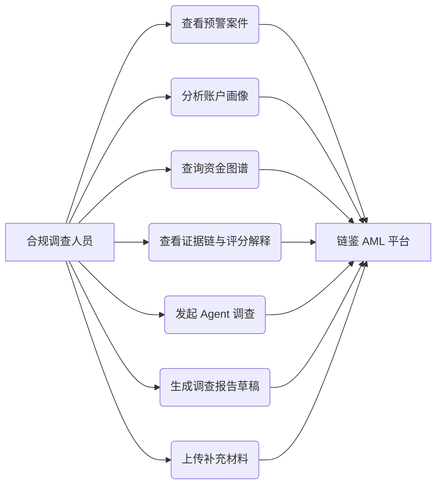

#### 3.3.2 审核与审计用例图

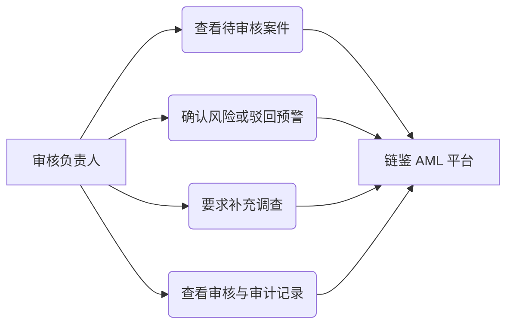

#### 3.3.3 风险分析与策略优化用例图

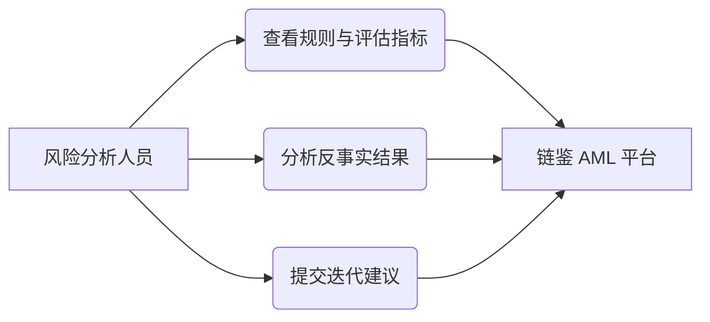

#### 3.3.4 数据与运行维护用例图

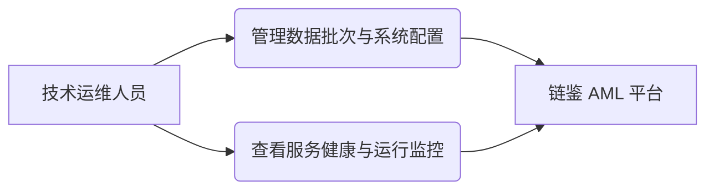

从用例关系看，调查人员负责事实查看和调查组织，审核负责人负责高影响结论的最终确认，风险分析人员负责规则和评估结果的解释与改进，运维人员负责数据、配置和运行环境。系统为这些角色提供统一的案件上下文，生产化阶段继续细化角色权限和操作范围。

### 3.4 功能性需求

系统应支持账户、交易、案例和评估数据的导入、清洗、批次登记和质量检查，并将标准化数据写入 PostgreSQL 数仓。系统应能够根据交易事实、账户特征和资金关系运行规则，生成包含案件编号、主体账户、命中规则、风险评分、风险等级、关键交易和生成时间的预警案件。

系统应支持从案件进入账户画像、关键交易时间线、资金图谱、证据链、评分解释和反事实分析。调查人员可以针对案件发起单 Agent 或多 Agent 调查，系统需要保存任务计划、任务状态、工具调用、证据引用、输出摘要和报告草稿，并允许调查人员对结果进行复核和补充。

系统应支持补充材料上传、材料质量检查、账户和金额交叉核验，以及需要人工确认的材料处理。系统应支持人工审核人员确认风险、驳回预警或要求补充调查，并将审核人、审核意见、状态变化、证据版本和操作时间写入审计记录。

系统应提供预警中心、调查工作台、账户画像、图谱调查、分析编排、人工审核、评估监控和系统设置等功能页面。系统还应提供健康检查、案件查询、证据查询、报告查询、审核记录查询、监控指标查询和离线评估查询等服务接口。

| 功能域 | 主要功能 | 关键输入 | 主要输出 |
|---|---|---|---|
| 数据生产 | 文件导入、字段清洗、批次登记、质量检查 | 账户、交易、案例、评估数据 | 标准化数据批次 |
| 预警检测 | 规则计算、风险评分、案件生成 | DWD 明细、DWS 特征、规则配置 | 预警案件、命中规则、风险等级 |
| 证据分析 | 交易时间线、账户画像、资金路径、评分解释 | 案件 ID、账户 ID、交易事实 | 证据链、解释结果、反事实结果 |
| 智能调查 | 任务规划、专业 Agent 协作、证据核验 | 案件 ID、调查问题、工具结果 | 调查任务、证据摘要、报告草稿 |
| 材料审查 | 材料上传、质量检查、账户金额核验 | 案件材料、案件上下文 | 材料记录、核验结果、审核路由 |
| 人工审核 | 确认风险、驳回预警、补充调查 | 案件证据、审核人、审核意见 | 审核记录、状态变化、审计事件 |
| 运营评估 | 指标监控、离线评估、迭代提案 | 运行数据、评估数据、版本信息 | 质量指标、诊断结果、提案记录 |

### 3.5 非功能性需求

系统需要具备可解释性。所有风险评分必须能够拆解到规则、交易行为或账户画像，所有报告结论必须能够关联到案件事实和证据 ID。系统需要具备可审计性，数据批次、规则版本、任务过程、审核动作和报告版本都应保留可查询记录。

系统需要具备稳定性和一致性。数据导入、预警生成、任务写入和审核提交应保持事务一致，重复请求保持幂等，避免产生重复案件或重复状态变更。系统需要具备可维护性，规则、图谱、评分、Agent 和前端页面之间通过明确接口协作，前端通过业务接口访问数据。

系统需要具备安全性。系统为调查、审核、分析和运维角色配置差异化访问权限，敏感凭证通过环境变量或密钥服务管理，Agent 通过受限工具访问当前案件所需的数据。系统需要具备可扩展性，PostgreSQL、Neo4j、模型服务、材料服务和监控服务应当能够独立演进，各模块通过统一的数据标准保持兼容。

系统需要具备可验证性。核心规则、评分、解释、图谱、Agent 规划、材料审查、监控指标和持续改进逻辑应有自动化测试，前端应有构建验证和接口冒烟验证，评估指标必须注明数据集、标签版本、规则版本和运行时间。

| 非功能目标 | 具体要求 | 验证方式 |
|---|---|---|
| 可解释性 | 评分可拆解，报告结论可关联证据 ID | 评分解释测试、证据核验测试 |
| 可审计性 | 数据批次、规则版本、任务过程、审核动作和报告版本可查询 | 审计记录检查、案件回放 |
| 一致性 | 预警、任务和审核状态保持事务一致，重复请求具备幂等性 | 单元测试、接口集成测试 |
| 安全性 | 角色分离、最小权限、敏感凭证通过受控配置管理 | 权限测试、配置审查 |
| 可维护性 | 规则、图谱、Agent、前端通过 API 和统一数据标准协作 | 接口检查、模块测试 |
| 可扩展性 | PostgreSQL、Neo4j、模型和监控服务可独立演进 | 架构评审、替换验证 |
| 可验证性 | 核心模块有自动化测试，前端有构建和冒烟测试 | pytest、Vite build、smoke test |

## 4. 可行性分析

### 4.1 技术可行性

项目采用的技术栈成熟、资料丰富，且与当前代码结构匹配。React 和 Vite 适合构建交互密集的调查工作台，FastAPI 适合快速搭建清晰的 HTTP API，PostgreSQL 能够支撑事务处理、数据分析和多用户并发访问，Neo4j 适合表达账户与交易之间的多跳关系。规则、图谱、解释性分析和 Agent 都被拆成相对独立的模块，后续可以分别替换和扩展，保持整体架构连续演进。

### 4.2 业务可行性

反洗钱调查本身具有较强的规则性和证据性，交易、账户、时间、金额、路径和审核意见都可以被结构化保存。系统先用规则发现异常，再用图谱和 Agent 辅助调查，最后由人工审核把关，符合调查工作的实际习惯。系统输出调查辅助结果和报告草稿，最终审核由授权人员完成，业务使用边界比较清楚。

### 4.3 数据可行性

当前项目已经具备账户、交易、案例、清洗数据、离线标签和评估基准数据，并通过 `manifest.json` 记录数据集信息。数据可以经过 ODS、DWD、DWS 和 ADS 分层，规则与图谱使用标准化事实，评估标签隔离在离线区域，能够支持规则验证和指标计算。

### 4.4 经济与实施可行性

演示阶段使用本地文件、PostgreSQL 和可选 Neo4j，部署结构清晰，适合快速验证和比赛演示。项目代码已经划分出规则、数仓、图谱、解释性分析、Agent、监控和评估模块，功能可以按模块逐步建设。PostgreSQL 作为统一事务与数仓基础，后续可以独立扩展材料、日志、指标和图谱服务，保持用户熟悉的案件工作流。

## 5. 技术选型

### 5.1 前端技术

前端选择 React 和 Vite。React 适合构建调查工作台中大量的状态切换、案件卡片、评分面板和证据时间线，Vite 提供较快的开发和构建速度。当前前端代码位于 `web/`，页面通过 HTTP JSON 接口访问后端。

### 5.2 后端技术

后端选择 Python 和 FastAPI。Python 便于处理 CSV、数据清洗、规则计算、评估指标和模型调用，FastAPI 提供类型化请求模型、路由组织和接口文档。当前后端入口位于 `backend/main.py`，路由主要分布在 `backend/api/`。

### 5.3 数据库与图谱技术

系统统一选择 PostgreSQL 作为主要存储和数仓基础，原因是它具备成熟的事务能力、并发控制、索引体系、约束机制和备份恢复能力，能够同时承载 ODS、DWD、DWS、ADS、案件、审核和审计数据。图谱选择 Neo4j，是因为资金路径和账户关联天然适合图模型；PostgreSQL 与 Neo4j 通过账户、交易、案件和证据标识保持数据关联。

### 5.4 规则、Agent 与测试技术

规则层采用 Python 规则模块，规则代码位于 `rules/`，通过统一规则引擎输出标准命中结果。Agent 层采用受限工具和专业角色拆分，代码位于 `agent/` 与 `agents/`；模型只负责组织已经查询到的事实。测试采用 pytest，前端通过 Vite 构建，接口冒烟脚本位于 `web/scripts/smoke.mjs`。

| 技术领域 | 选型 | 在本项目中的作用 | 选型理由 |
|---|---|---|---|
| 前端 | React + Vite | 调查工作台、案件详情、预警中心和监控页面 | 组件化开发，适合高密度交互和快速构建 |
| 后端 | Python + FastAPI | API 服务、业务编排和接口文档 | 便于数据处理、规则计算和模型调用 |
| 事务与数仓 | PostgreSQL | ODS、DWD、DWS、ADS、案件、审核和审计 | 事务、约束、索引、并发和备份能力完整 |
| 关系图谱 | Neo4j | 账户关联、资金路径和多跳关系分析 | 适合表达账户节点和交易边 |
| 规则计算 | Python Rule Engine | 循环、拆分、归集、多跳和快速转移识别 | 规则可读、可调试、便于版本管理 |
| 智能体 | Supervisor + 专业 Agent | 调查计划、事实查询、证据判断和报告编排 | 任务分工明确，输出可追踪 |
| 测试 | pytest + Vite build + smoke test | 后端逻辑、前端构建和接口验证 | 覆盖模块、构建和服务链路 |

## 6. 总体架构设计

### 6.1 业务技术链路

#### 6.1.1 核心业务链路


#### 6.1.2 智能分析链路

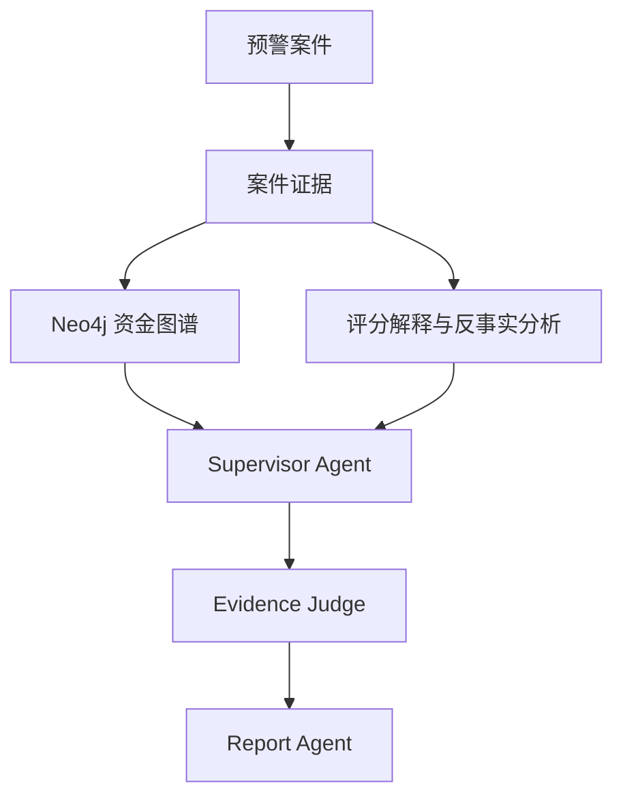

#### 6.1.3 运行治理链路


### 6.2 分层架构职责

系统可以分成数据层、领域服务层、智能分析层、工作台层和治理层。数据层负责沉淀事实和特征，领域服务层负责预警、证据、报告、材料和审核，智能分析层负责规则、图谱和 Agent，工作台层负责用户操作，治理层负责身份、权限、审计、监控、评估和发布控制。各层通过统一的数据标准协作，前端通过业务接口访问数据。

| 架构层 | 主要职责 | 代表模块 | 关键数据 |
|---|---|---|---|
| 数据层 | 事实沉淀、清洗、建模和特征计算 | 数据导入、PostgreSQL 数仓、账户画像 | 账户、交易、案例、风险特征 |
| 领域服务层 | 承载案件业务流程 | 预警、证据、报告、材料、审核服务 | 案件、证据、报告、审核记录 |
| 智能分析层 | 完成风险识别和调查推理 | 规则引擎、Neo4j、评分、Agent | 规则命中、路径、解释、任务 |
| 工作台层 | 面向调查、审核、分析和运维角色提供操作界面 | 预警中心、调查工作台、审核中心、监控页 | 查询条件、操作动作、展示结果 |
| 治理层 | 控制身份、权限、审计和版本 | 认证、权限、审计、评估、发布控制 | 用户、版本、日志、指标、提案 |

### 6.3 技术架构框架

技术架构图可以按照“数据进入系统—形成标准事实—完成风险分析—进入案件调查—人工审核—评估改进”的顺序理解。各层通过 PostgreSQL 中的标准数据和案件标识连接起来。下表列出了架构图中每一层对应的组件、主要输入、主要输出和代码位置。

| 架构层 | 核心组件 | 主要输入 | 主要输出 | 当前代码或目录 |
|---|---|---|---|---|
| 数据接入层 | CSV 导入、数据清洗、实时交易生成 | `accounts.csv`、`transactions.csv`、`cases.csv` | 清洗数据、数据质量结果、导入批次 | `backend/core/data_cleaning.py`、`backend/core/preprocess_ibm_aml.py`、`data/` |
| 数据存储层 | PostgreSQL、ODS、DWD、DWS、ADS | 原始文件、清洗结果、批次信息 | 账户维度、交易明细、账户特征、应用数据 | `backend/core/warehouse.py`、`backend/core/database.py` |
| 风险分析层 | 规则引擎、风险评分、解释性分析、反事实分析 | DWD 交易、DWS 特征、规则配置 | 规则命中、风险评分、评分解释、反事实结果 | `rules/`、`app/risk_score.py`、`explainability/`、`counterfactual/` |
| 关系分析层 | Neo4j、图查询、路径分析、风险传播 | 账户、交易、案件证据 | 资金路径、关联账户、证据子图、关系解释 | `graph/`、`graph_intelligence/` |
| 智能调查层 | Supervisor Agent、Rule Agent、Transaction Agent、Graph Agent、Evidence Judge、Report Agent | 案件 ID、调查问题、规则和图谱结果 | 调查任务、证据核验、报告草稿 | `agent/`、`agents/`、`reports/` |
| 案件服务层 | 预警服务、证据服务、材料审查、审核服务、审计服务 | 风险分析结果、调查结果、补充材料 | 案件、证据、材料记录、审核结论、审计日志 | `app/`、`backend/api/`、`backend/material_review/` |
| 工作台层 | 预警中心、调查工作台、账户画像、图谱调查、分析编排、审核中心 | API 返回的案件和任务数据 | 用户查询、调查操作、审核动作、报告查看 | `web/src/` |
| 运营治理层 | 监控、离线评估、持续改进、认证和配置 | 运行指标、评估数据、版本信息、用户操作 | 指标结果、改进提案、审批记录、运行审计 | `monitoring/`、`evaluation/`、`backend/api/iteration.py`、`backend/api/auth.py` |

从调用关系看，前端通过 FastAPI 提供的业务接口获取案件数据；领域服务负责把底层数据转换成案件、证据和任务对象；Agent 通过工具访问领域服务和数据查询服务；审核、监控和评估读取带有版本和时间信息的业务结果。这样设计可以让数据库、图谱或模型服务独立调整，同时保持前端使用的案件接口稳定。

## 7. 数据生产与数据库设计

### 7.1 数据生产流程

数据从 `accounts.csv`、`transactions.csv`、`cases.csv` 和 `labels.csv` 进入预处理流程。预处理模块负责字段清洗、时间统一、账户标识构造、金额字段转换和数据质量检查，清洗后的账户、交易和案例进入在线数仓；`labels.csv` 进入独立评估区域，在线规则和 Agent 工具路径使用账户、交易和案例事实。

#### 7.1.1 数据进入与标准化

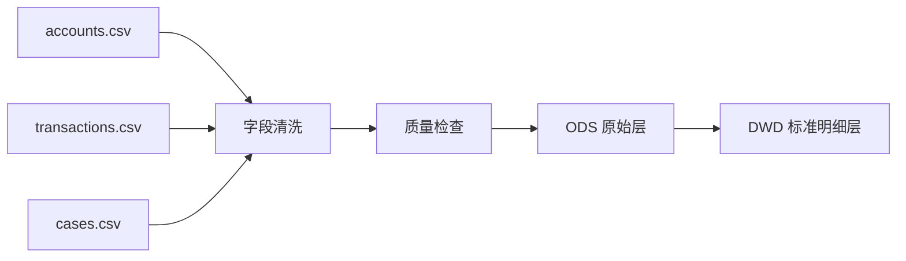

#### 7.1.2 特征加工与应用数据

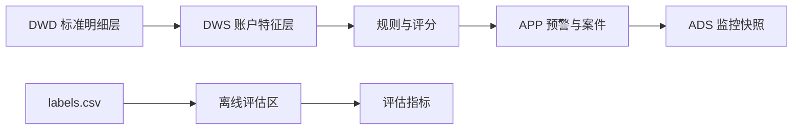

数仓初始化和表结构主要由 `backend/core/warehouse.py` 负责。ODS 层保存源数据形态和导入批次，DWD 层保存标准化账户、交易和案例，DWS 层保存账户日度聚合和账户风险特征，APP 层保存预警、证据、审核和报告，ADS 层保存看板所需的汇总结果。

| 数据层 | 主要表或对象 | 保存内容 | 使用方 |
|---|---|---|---|
| ODS | `ods_import_batches`、`ods_accounts_raw`、`ods_transactions_raw`、`ods_cases_raw` | 原始数据、文件来源、导入批次和质量状态 | 数据清洗、审计、回放 |
| ODS 评估隔离区 | `ods_evaluation_labels_raw` | 交易标签、案例标签和评估用途 | 离线评估 |
| DWD | `dim_account`、`dwd_transaction_detail`、`dwd_case_detail` | 标准化账户、交易和案例明细 | 规则、图谱、Agent 工具 |
| DWS | `dws_account_daily`、`dws_account_risk_features` | 账户日度行为和风险特征 | 评分、画像、监控 |
| APP | `app_alerts`、`app_rule_hits`、`app_alert_evidence`、`app_reports` | 预警、命中规则、证据和报告 | 调查工作台、审核人员 |
| 案件审计层 | `alert_case`、`alert_evidence`、`review_record`、`audit_log` | 标准案件、证据、审核和审计事件 | 审核、回放、合规留痕 |
| ADS | `ads_dashboard_summary`、`ads_account_activity_rank` | 看板快照和账户活动排名 | 监控页面、运营分析 |

### 7.2 数据库实体关系

#### 7.2.1 ODS 原始数据关系

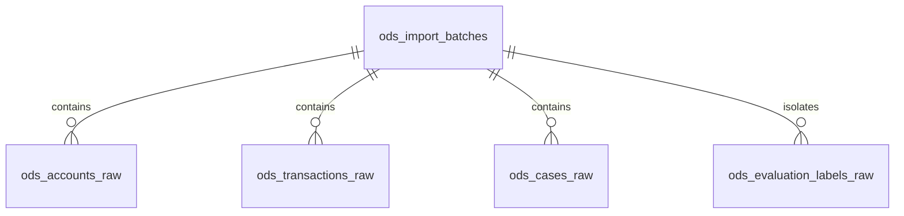

#### 7.2.2 DWD 与 DWS 标准数据关系

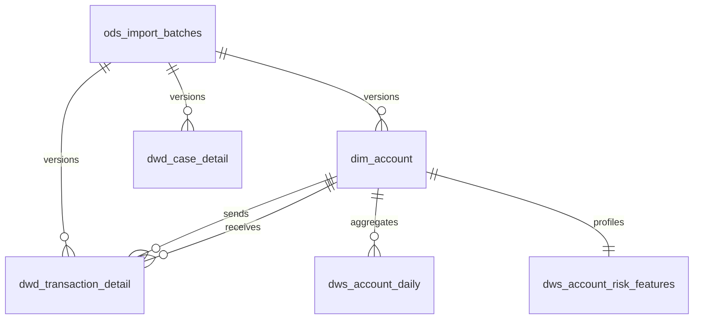

#### 7.2.3 APP 应用数据关系

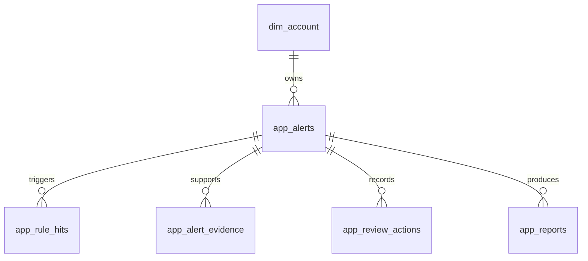

#### 7.2.4 案件审计关系

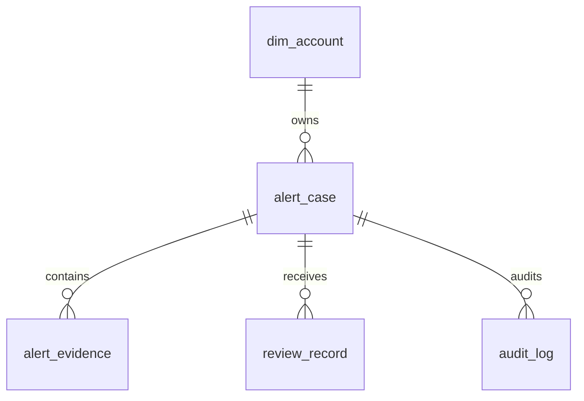

### 7.3 核心表设计

`ods_import_batches` 是数据批次主表，记录来源名称、原始文件路径、清洗文件路径、导入时间和质量状态。`ods_accounts_raw`、`ods_transactions_raw` 和 `ods_cases_raw` 保留源数据形态，便于核对原始数据。`ods_evaluation_labels_raw` 是评估专用隔离表，在线数据处理使用事实表，评估模块单独读取标签字段。

`dim_account` 保存账户主数据和账户标识，`dwd_transaction_detail` 保存标准化交易明细，包含交易时间、付款方、收款方、金额、币种、交易方式和数据批次，`dwd_case_detail` 保存数据集中的案例信息。账户和交易的主键、外键和唯一约束用于保证数据关系完整。

`dws_account_daily` 按账户和日期保存交易次数、交易金额、交易对手数量和自转账数量，`dws_account_risk_features` 保存账户活跃天数、总交易次数、收付款金额和交易对手数量等可重复使用的特征。规则引擎、账户画像和评分解释都从这些标准化特征读取数据。

`app_alerts` 保存应用侧预警，`app_rule_hits` 保存规则命中，`app_alert_evidence` 保存交易证据，`app_review_actions` 保存审核动作，`app_reports` 保存报告草稿。`alert_case`、`alert_evidence`、`review_record` 和 `audit_log` 组成当前案件层的标准案件、证据、审核和审计记录。`ads_dashboard_summary` 和 `ads_account_activity_rank` 为前端监控和看板提供快照数据。

数据库索引主要覆盖交易日期、交易付款方、交易收款方、预警状态、风险分数、案件账户、证据案件和审核时间，用于提高案件列表、账户交易和审核历史查询效率。生产化时应进一步补充数据库迁移、备份恢复、分区策略和敏感字段加密方案。

| 表名 | 主键 | 关键字段 | 关系与用途 |
|---|---|---|---|
| `ods_import_batches` | `batch_id` | `source_name`、`raw_data_path`、`cleaned_data_path`、`quality_status`、`imported_at` | 记录每次数据导入和质量状态 |
| `dim_account` | `account_id` | `bank_id`、`account_number`、`entity_id`、`effective_batch_id` | 账户维度，与交易和案件关联 |
| `dwd_transaction_detail` | `transaction_id` | `transaction_time`、`from_account_id`、`to_account_id`、`amount_paid`、`amount_received`、`payment_format` | 保存可供规则和图谱使用的交易事实 |
| `dws_account_daily` | `transaction_date + account_id` | 收付款笔数、收付款金额、`counterparty_count`、`self_transfer_count` | 保存账户日度行为聚合 |
| `dws_account_risk_features` | `account_id` | `active_days`、`total_transaction_count`、收付款金额、交易对手数 | 保存账户级风险特征 |
| `alert_case` | `alert_id` | `case_fingerprint`、`account_id`、`risk_score`、`risk_level`、`status` | 当前案件主表 |
| `alert_evidence` | `evidence_id` | `alert_id`、`evidence_type`、`evidence_content` | 保存案件证据和引用内容 |
| `review_record` | `review_id` | `alert_id`、`reviewer`、`action`、`comment`、`created_time` | 保存人工审核结论 |
| `audit_log` | `log_id` | `alert_id`、`operation`、`operator`、`timestamp`、`detail` | 保存案件操作审计事件 |

## 8. 系统功能设计

### 8.1 数据导入与质量门

数据导入由预处理脚本和数仓构建模块完成。系统先检查账户、交易、案例和标签文件是否齐全，再对交易 ID、时间、账户、金额、币种和支付方式进行字段级校验。校验通过后写入导入批次和标准化数据；校验失败时记录失败原因，并保留当前可用数据基线。

### 8.2 规则预警与风险评分

预警生成接口读取 DWD 交易和 DWS 特征，调用 `rules/` 下的规则实现，识别循环交易、拆分转账、资金归集、多跳转移、快速转移和行为组合等模式。规则引擎将命中结果统一转换为规则编号、严重程度、解释文本和证据引用，风险评分模块再根据规则贡献、交易行为和账户画像计算 0 到 100 的风险分数，并生成风险等级。

### 8.3 证据链、画像与图谱

证据服务根据案件 ID 聚合命中规则、关键交易和账户特征。图谱服务将账户作为节点、交易作为带时间和金额属性的边，支持 1 到 3 跳资金路径查询、关联账户识别和风险传播分析。解释性模块为每项评分生成来源说明，反事实模块通过移除特定风险因素模拟评分变化，原始交易和案件事实保持原样。

#### 8.3.1 案件证据组成

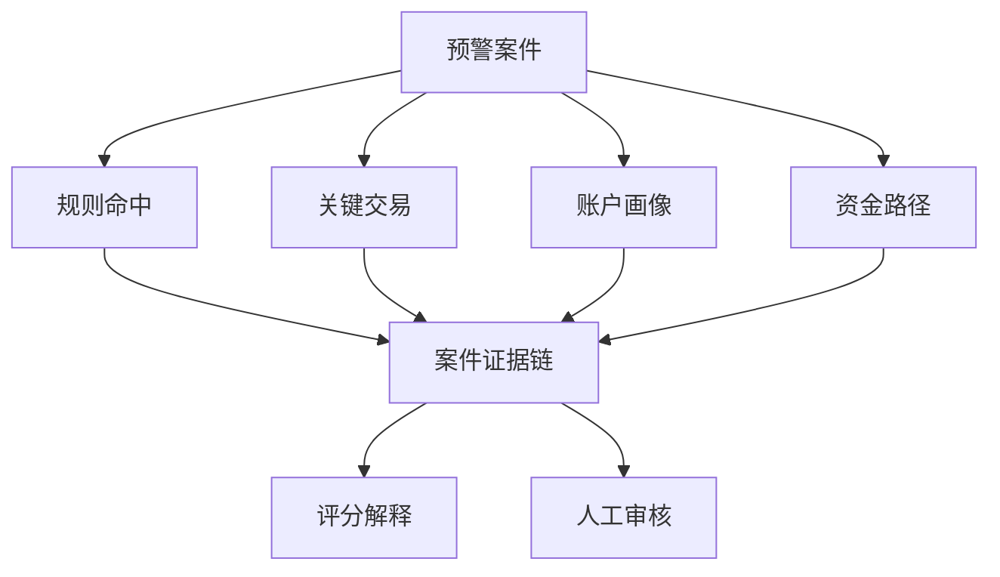

#### 8.3.2 证据链到审核结论


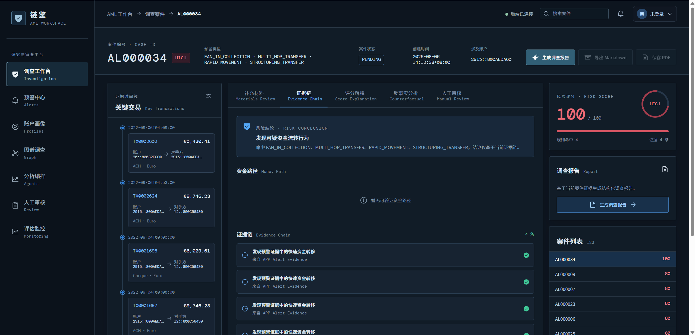

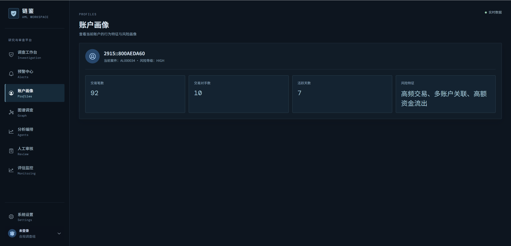

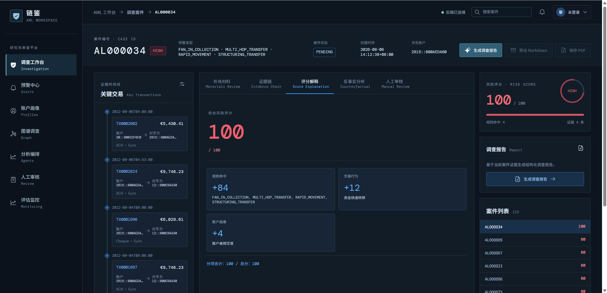

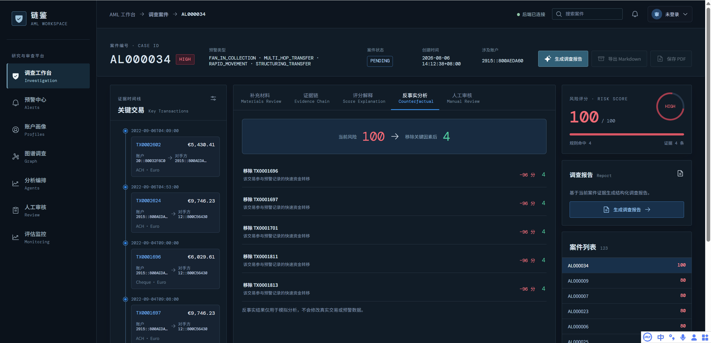

### 8.4 Agent 调查与报告生成

调查接口接收案件 ID 和调查问题，Planner 生成调查步骤，Rule Agent、Transaction Agent 和 Graph Agent 分别调用受限工具查询规则、交易、账户特征和资金路径，Evidence Judge 对结果进行完整性检查，Report Agent 将结构化事实生成 Markdown 报告草稿。每个任务保存开始时间、结束时间、状态、工具结果和失败原因，可查询到的事实进入报告结论，其他内容列为待核查项。

#### 8.4.1 多智能体任务编排

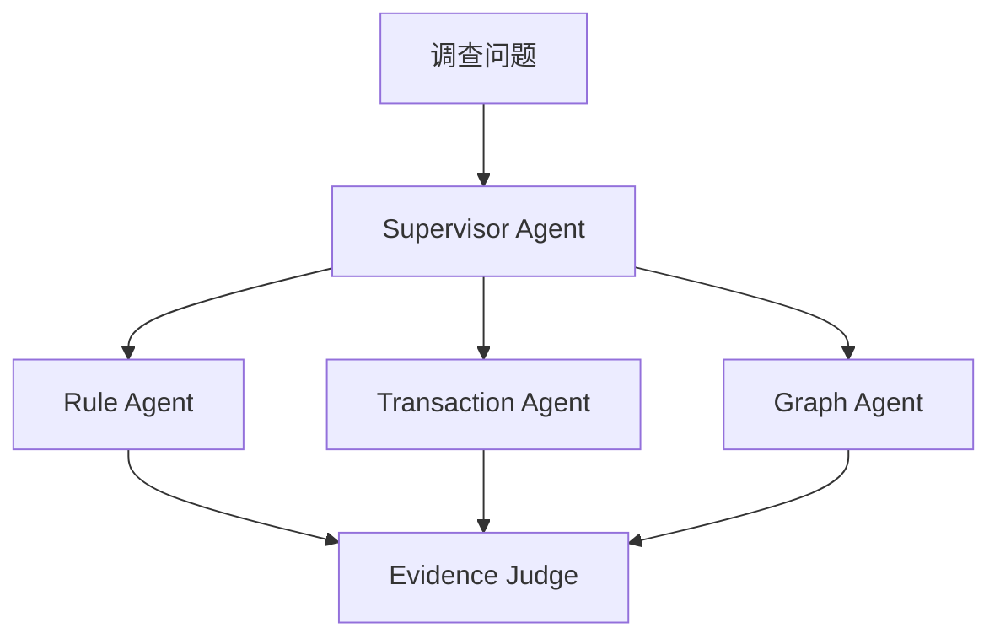

#### 8.4.2 证据判断与报告生成

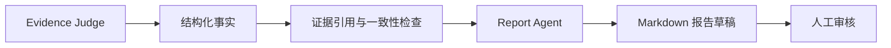

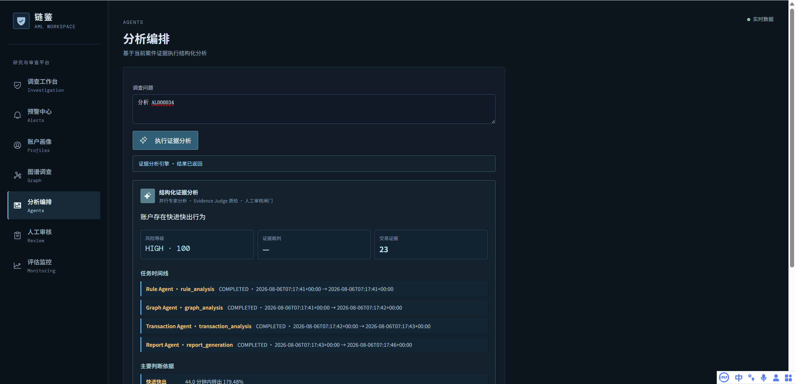

#### 8.4.3 多智能体调查的执行机制

多智能体调查采用任务编排方式，由一个明确的任务编排器把调查问题拆成可执行、可检查、可追踪的专业任务。用户提交案件 ID 和调查问题后，Supervisor Agent 先读取案件摘要、风险评分、命中规则和已有证据，再根据调查目标生成任务计划。计划中明确每个任务需要查询的事实范围、执行顺序、输入参数、输出格式和完成条件。

Rule Agent 负责回答“触发了什么规则以及规则为什么适用”。它读取规则命中记录、规则版本、触发条件和关联交易，把规则结果转换成调查人员能够理解的解释，并为每项解释生成证据引用。Transaction Agent 负责回答“具体发生了什么交易”。它从 DWD 交易明细和 DWS 账户特征中查询时间、金额、付款方、收款方、交易频率、交易对手和时间窗口行为，形成关键交易清单和行为摘要。Graph Agent 负责回答“资金如何在账户之间流动”。它查询 Neo4j 中的账户节点和交易关系，识别 1 到 3 跳路径、资金归集、资金发散、循环回流和关联账户，并将图谱路径还原为可核对的交易事实。

Evidence Judge 是整个协同链路的关键控制点。它负责检查每个 Agent 的结果是否包含事实来源、证据 ID、账户或交易关联、时间范围和结论依据。对于多个 Agent 返回的同一账户、金额或交易，Evidence Judge 还要进行一致性检查；缺少对应事实的解释内容列为待核查项，完成证据核验的内容进入风险结论。这个设计把 Agent 的评价标准从“表达是否流畅”提升为“证据是否完整、引用是否准确、结论是否可复核”。

Report Agent 只接收经过证据判断的结构化结果，按照案件概况、风险摘要、命中规则、关键交易、资金路径、评分解释、反事实结果和待核查事项组织报告草稿。报告生成阶段沿用已经确认的事实和证据，保持报告文字与调查结果一致。人工审核人员看到的是已经完成事实整理和证据引用的调查材料。

#### 8.4.4 调查任务执行时序

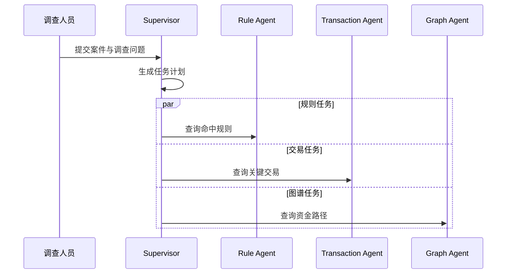

#### 8.4.5 证据核验与审核时序

```mermaid
sequenceDiagram
    participant R as Rule Agent
    participant T as Transaction Agent
    participant G as Graph Agent
    participant J as Evidence Judge
    participant P as Report Agent
    participant H as 人工审核

    R-->>J: 规则解释与证据
    T-->>J: 交易事实与特征
    G-->>J: 路径与交易映射
    J->>J: 完整性与一致性检查
    J-->>P: 结构化证据
    P-->>H: 调查报告草稿
    H-->>J: 审核意见或补充调查
```

任务状态、工具调用和证据结果通过 `task_id`、`run_id` 和 `alert_id` 关联。专业任务可以并行执行，报告任务在证据判断完成后执行；如果审核人员要求补充调查，系统创建新的调查任务并保留上一轮任务结果。这样既能缩短调查时间，又能保留每一轮调查的过程记录。

| Agent 角色 | 负责问题 | 主要数据来源 | 输出结果 | 是否直接形成结论 |
|---|---|---|---|---|
| Supervisor Agent | 这次调查应该查什么 | 案件摘要、风险评分、已有证据 | 任务计划、任务依赖、执行顺序 | 否 |
| Rule Agent | 哪些规则被触发，为什么适用 | 规则命中、规则版本、触发条件 | 规则解释、规则证据引用 | 否 |
| Transaction Agent | 具体发生了什么交易行为 | DWD 交易明细、DWS 账户特征 | 关键交易、行为摘要、时间窗口 | 否 |
| Graph Agent | 资金如何在账户之间流动 | Neo4j 账户节点、交易关系 | 资金路径、关联账户、图谱证据 | 否 |
| Evidence Judge | 证据是否完整、一致、可回溯 | 各 Agent 结构化结果、证据 ID | 证据核验结果、缺口说明、待核查项 | 负责证据准入 |
| Report Agent | 如何把事实组织成报告 | 通过裁判的结构化证据 | 调查报告草稿、证据索引 | 否 |

### 8.5 补充材料审查

材料审查接口接收案件材料，服务检查文件类型、内容质量、账户信息和金额信息，并生成可追溯的材料记录。确定性检查可以直接返回结果，识别清晰度、信息一致性或人工判断需求进入人工审核流程。材料审查结果作为证据记录，案件风险等级由审核流程确定。

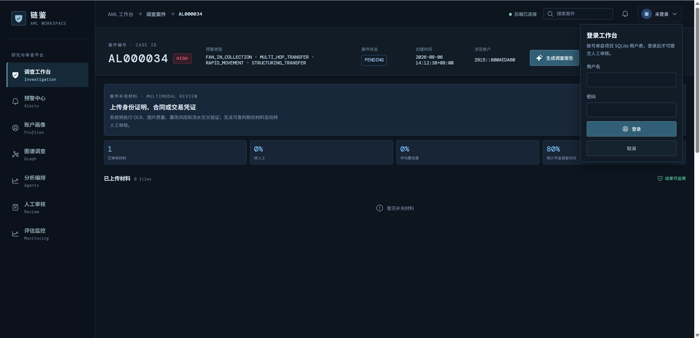

### 8.6 人工审核与审计

人工审核接口要求提供审核人、审核动作和审核备注。审核动作包括确认风险、驳回预警和要求补充调查，服务写入审核记录并生成审计事件。审核中心用于集中处理待审核案件，案件详情页用于在完整证据上下文中完成具体决定。

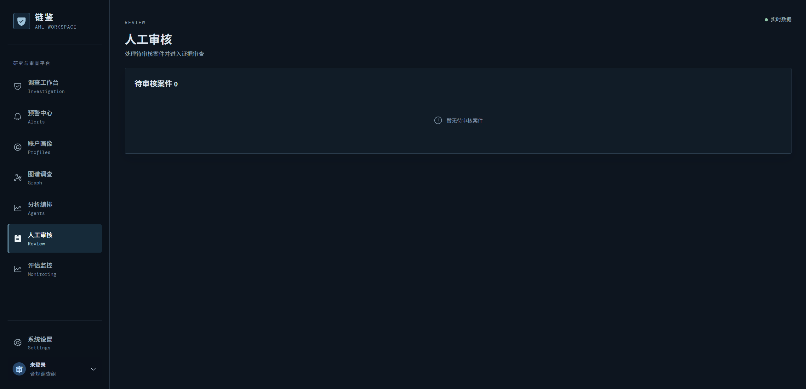

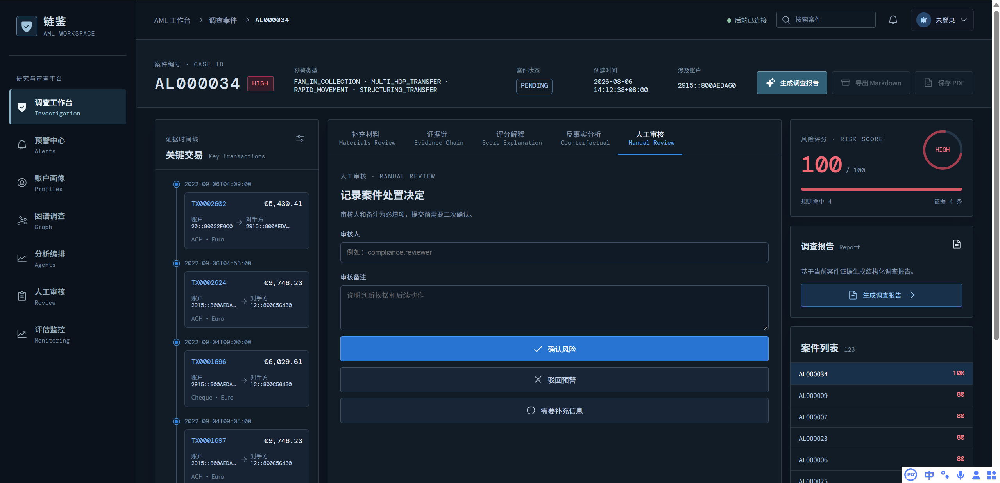

### 8.7 预警中心、监控和系统设置

预警中心提供案件检索、风险筛选和状态查看；监控页面展示数据质量、规则质量和评估指标；系统设置页面展示当前 PostgreSQL 数据源、图谱服务、模型服务和登录方式。所有环境统一使用 PostgreSQL，开发、演示和生产仅通过连接地址、数据库和权限配置区分。

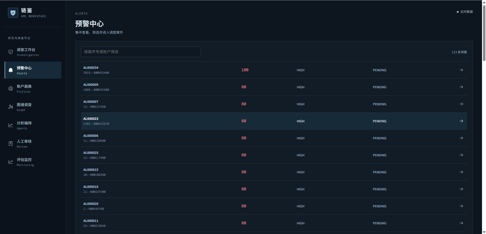

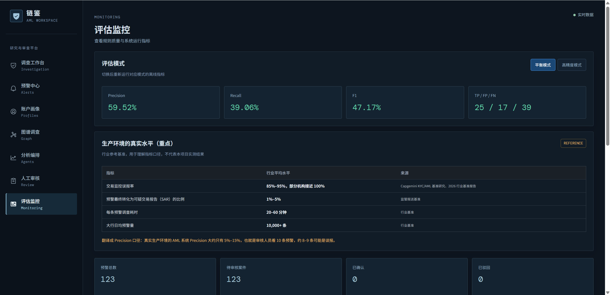

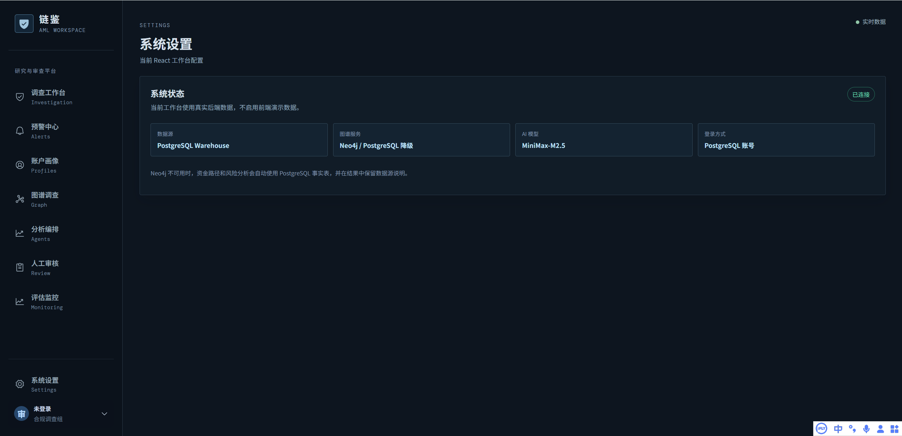

## 9. 具体技术实现

### 9.1 后端服务实现

FastAPI 应用由 `backend/main.py` 启动，并在启动时注册预警、Agent、图谱、报告、材料、监控、评估、迭代和认证等路由。API 层只负责请求参数校验和服务调用，业务逻辑分布在 `app/`、`backend/core/`、`graph_intelligence/`、`explainability/`、`counterfactual/` 和 `agents/` 中，避免把复杂计算直接写在路由函数里。

### 9.2 规则和评分实现

规则模块以独立 Python 文件实现具体检测逻辑，再由 `rules/rule_engine.py` 统一调度。规则读取标准化交易和账户特征，输出结构化命中结果。风险评分模块将命中规则和行为特征转换为分项贡献，评分解释模块使用同一份分项结果生成前端展示内容，确保页面上的分项相加后可以还原总分。

### 9.3 图谱实现

`graph/build_graph.py` 负责把标准化交易写入图谱，`graph/graph_query.py` 负责基础关系查询，`graph_intelligence/` 负责证据子图、时序流、角色识别、风险传播和反事实分析。查询结果同时保留账户、交易、金额、时间和数据来源，前端只展示经过服务层整理后的结构化结果。

### 9.4 Agent 实现

Agent 通过工具函数读取案件、规则、交易、账户特征、图谱和解释性结果。`investigation_planner.py` 负责生成任务计划，`agents/supervisor_agent.py` 负责任务协调，Rule Agent、Transaction Agent、Graph Agent 和 Report Agent 负责专业步骤，`agents/evidence_judge.py` 负责证据判断，`agents/task_store.py` 保存任务状态。调查任务的过程数据和结果数据均通过任务 ID 与案件建立关联。

### 9.5 前端实现

前端代码位于 `web/src/`，通过统一的数据访问层请求后端接口。案件详情页将关键交易时间线、证据链、评分解释、反事实分析、材料审查和人工审核组织为标签页；预警中心和审核中心提供面向队列的操作；分析编排页展示任务时间线和 Agent 运行结果；评估监控页展示离线指标和运行状态。

## 10. 关键接口设计

### 10.1 接口范围

系统提供 `/health` 健康检查接口，`/alerts/generate` 预警生成接口，`/alerts` 和 `/alerts/{alert_id}` 案件查询接口，`/alerts/{alert_id}/explainability` 风险解释接口，`/alerts/{alert_id}/counterfactual` 反事实分析接口，`/alerts/{alert_id}/graph-intelligence` 图谱智能分析接口，`/agent/investigate` 和 `/agent/multi-investigate` 调查接口，`/reports/{alert_id}` 报告接口，`/alerts/{alert_id}/review` 审核接口，`/alerts/{alert_id}/materials` 材料接口，以及监控、评估和迭代相关接口。

| 方法 | 路径 | 功能 | 关键输入 | 主要输出 |
|---|---|---|---|---|
| GET | `/health` | 服务健康检查 | 无 | 服务状态 |
| POST | `/alerts/generate` | 运行规则并生成案件 | 数据批次、规则配置 | 案件数量、案件列表 |
| GET | `/alerts` | 查询预警列表 | 状态、风险等级、时间 | 预警列表 |
| GET | `/alerts/{alert_id}` | 查询案件详情 | `alert_id` | 案件、账户、规则和证据摘要 |
| GET | `/alerts/{alert_id}/explainability` | 查询评分解释 | `alert_id` | 总分、分项贡献、证据引用 |
| GET | `/alerts/{alert_id}/counterfactual` | 反事实分析 | `alert_id` | 因素移除后的评分变化 |
| GET | `/alerts/{alert_id}/graph-intelligence` | 图谱智能分析 | `alert_id` | 路径、关联账户、图谱证据 |
| POST | `/agent/multi-investigate` | 发起多 Agent 调查 | `alert_id`、调查问题 | `task_id`、任务计划 |
| GET | `/agent/multi-investigate/{alert_id}/tasks` | 查询调查任务 | `alert_id` | 任务状态、输出和时间线 |
| GET | `/reports/{alert_id}` | 查询报告草稿 | `alert_id` | Markdown 报告内容 |
| POST | `/alerts/{alert_id}/review` | 提交人工审核 | 审核人、动作、备注 | 审核记录和案件状态 |
| GET/POST | `/alerts/{alert_id}/materials` | 查询或上传材料 | 案件材料、案件上下文 | 材料记录和核验结果 |
| GET | `/monitoring/metrics` | 查询运行指标 | 时间范围、版本 | 监控指标 |
| GET | `/evaluation/metrics` | 查询离线评估 | 数据集、规则版本 | Precision、Recall、F1 等 |

### 10.2 接口契约要求

接口返回结果必须包含稳定的案件标识、数据来源和必要的时间信息。涉及评分和报告的接口需要同时返回证据引用或引用 ID；涉及审核的接口必须校验审核人、动作和备注。

## 11. 测试用例与测试结果

### 11.1 测试方法

项目采用单元测试、模块级集成测试、前端构建验证和接口冒烟测试相结合的方式。后端测试放在 `tests/` 目录，覆盖评分、账户画像、快速转移、图谱智能分析、解释性分析、证据判断、反事实分析、Agent 规划、多 Agent 调查、监控指标和持续改进流程。前端通过 `npm run build` 检查生产构建链路，接口冒烟脚本用于检查页面、健康检查、预警、证据、反事实、报告和审核参数校验。

### 11.2 测试用例

| 用例编号 | 测试内容 | 预期结果 | 实际结果 |
|---|---|---|---|
| TC-01 | 风险评分与分项解释 | 分项贡献能够计算，总分保持一致 | 通过 |
| TC-02 | 账户画像与快速转移识别 | 能够生成账户行为特征并识别快速转移 | 通过 |
| TC-03 | 图谱证据子图与反事实分析 | 能够返回关联关系，并能模拟关键因素移除 | 通过 |
| TC-04 | Evidence Judge 证据判断 | 能够判断证据覆盖和任务状态 | 通过 |
| TC-05 | Investigation Planner 任务规划 | 能够根据调查问题生成任务步骤 | 通过 |
| TC-06 | Multi-Agent 调查 | 多个专业 Agent 能够完成协作任务 | 通过 |
| TC-07 | 监控指标计算 | 能够计算规则、任务和审核相关指标 | 通过 |
| TC-08 | 评估与持续改进流程 | 能够生成评估结果和人工审核提案 | 通过 |
| TC-09 | 前端生产构建 | Vite 能够完成生产构建并输出静态资源 | 通过 |
| TC-10 | 接口冒烟测试 | 服务启动后健康检查、案件、证据、报告和审核校验接口可用 | 需启动前后端服务后执行 |

### 11.3 已执行结果

在项目目录执行 `python -m pytest -q`，结果为 `20 passed in 1.25s`。在 `web/` 目录执行 `npm run build`，Vite 完成 4570 个模块转换并成功输出生产构建文件，构建过程通过。接口冒烟脚本依赖运行中的 FastAPI 服务和前端预览服务，本次记录为待执行项；启动服务后执行 `npm run test:smoke` 完成接口层验证。

测试结果说明当前核心计算模块、Agent 规划与前端构建链路已经具备可重复验证基础。测试仍然主要集中在模块级逻辑，生产化前还需要补充完整的 API 集成测试、数据库迁移测试、权限测试、并发测试、异常恢复测试和浏览器端交互测试。

## 12. 安全、可靠性与运行要求

### 12.1 安全与权限

系统采用调查、审核、分析和运维角色分离的权限模型。模型 API Key、Neo4j 密码和登录密钥通过环境变量或密钥服务注入，日志通过敏感信息过滤。Agent 使用受限工具访问当前案件所需事实，权限由工具层统一控制。

### 12.2 一致性与审计

预警生成、审核提交和任务写入需要保持数据一致性。规则重复运行应使用稳定案件键避免重复预警，审核重复请求保持幂等，Agent 重复调查创建新任务并保留历史任务结果。案件事实、任务过程和审核记录保持独立存储，并通过稳定标识进行关联。

## 13. 后续展望

### 13.1 工程完善方向

下一阶段首先完善服务层集成测试和接口冒烟测试，补齐数据库迁移、权限、任务重试、取消和并发控制，再对大数据量下的案件列表、交易查询和图谱查询进行性能验证。系统配置、规则版本、评分权重和提示词也需要建立正式的审批与回滚流程。

### 13.2 评估与持续改进方向

系统的评估与持续改进流程由运行监控、离线评估、指标诊断、改进提案、人工审批、验证环节、版本发布和复盘回流组成。这个流程把每一次规则或策略变化都放回可比较的基线中，完成验证后再进入使用阶段，人工确认作为线上策略变更的前置条件。

| 评估层级 | 指标或信号 | 作用 | 关联版本 |
|---|---|---|---|
| 数据质量 | 缺失率、重复率、时间范围、批次状态 | 判断输入数据是否适合进入分析 | 数据批次 |
| 规则质量 | 命中量、预警量、Precision、Recall、F1 | 判断规则识别能力和误报漏报变化 | 规则版本 |
| 排序质量 | PR-AUC、Precision@20、Precision@50 | 判断高风险案件是否排在前面 | 评分配置 |
| 分类结果 | TP、FP、FN | 定位误报和漏报来源 | 数据集、标签版本 |
| Agent 质量 | 任务完成率、工具成功率、证据覆盖率、事实一致性 | 判断智能调查是否可靠 | Agent 配置、Prompt 版本 |
| 审核运营 | 待审核量、处理时长、确认率、补充调查率 | 判断调查流程是否顺畅 | 案件状态、时间窗口 |
| 系统运行 | API 响应、任务耗时、数据库连接、图谱查询耗时 | 判断平台运行状态 | 服务版本 |

#### 13.2.1 指标评估链路

```mermaid
flowchart LR
    M[运行监控] --> D[数据质量与运行指标]
    D --> E[离线评估]
    E --> K[Precision / Recall / F1]
    K --> R[规则级与 Agent 级诊断]
```

#### 13.2.2 提案验证链路

```mermaid
flowchart LR
    R[指标诊断] --> P[迭代提案]
    P --> A[人工审批]
    A --> H[Harness 验证]
    H --> V[版本标签与基线快照]
    V --> F[线上效果复盘]
    F --> M[运行监控]
```

持续改进中心用于查看当前阶段、评估信号、提案内容和审批状态。系统可以自动发现指标异常并生成提案，提案经过人工审批和验证后进入版本发布流程。

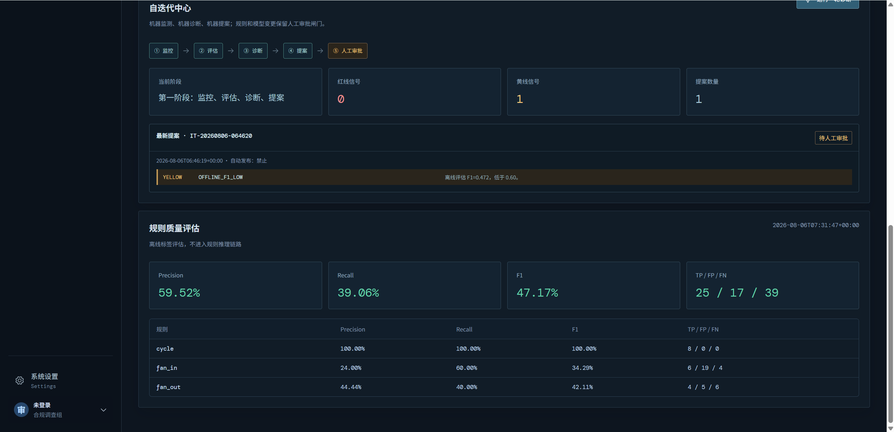

#### 13.2.3 持续改进闭环的技术机制

链鉴 AML 的持续改进以可审核的改进提案为输出，把系统运行中产生的数据转化为规则、评分、Prompt 和报告策略的优化依据。第一步是运行监控，系统持续记录数据质量、交易量、规则命中量、预警量、待审核量、Agent 工具成功率、证据覆盖率、报告生成质量和任务完成情况。每个指标都绑定数据批次、规则版本、模型配置和时间窗口，保证指标变化能够找到上下文。

第二步是离线评估。评估模块使用独立的评估标签和固定的数据集计算 Precision、Recall、F1、PR-AUC、Precision@20、Precision@50、TP、FP 和 FN，并进一步下钻到规则级别。这样既能观察整体效果变化，也能定位误报增加的规则、漏报严重的规则和分布发生变化的账户群体。在线推理使用事实数据，离线评估使用标签评价效果，二者职责分离。

第三步是指标诊断。系统将本次评估结果与基线版本进行比较，分析规则命中数量、风险分布、账户特征分布、任务完成率和证据质量的变化，形成红线信号和黄线信号。红线信号表示可能影响风险判断的重大变化，黄线信号表示需要关注但可以继续观察的变化。诊断阶段形成问题描述和影响范围，后续由提案流程处理。

第四步是迭代提案。提案可以针对规则条件、评分权重、风险阈值、提示词、报告结构或数据质量校验提出建议。每份提案必须说明触发原因、涉及版本、预期影响、验证数据、风险范围和回滚方式，并生成唯一的提案编号。提案可以由系统自动生成，也可以由风险分析人员手工提交，但都要进入同一套审批流程。

第五步是人工审批和验证环节。涉及新规则、评分权重、风险阈值、Prompt 或报告口径的变更，由指定人员审批。审批通过后，变更进入验证环境，执行单元测试、回归测试、离线基准评测、规则级指标对比和 Harness 运行。验证结果满足预设条件后生成新的版本标签和基线快照；其他提案保留记录，在线配置保持当前版本。

第六步是发布与复盘。发布记录包含版本号、变更内容、数据批次、评估结果、审批人和回滚路径。发布后继续观察在线指标，并在复盘阶段将实际效果与提案中的预期影响进行比较。复盘结果可以关闭提案，也可以形成下一轮诊断输入。整个过程形成“运行数据—评估结果—问题诊断—改进提案—人工审批—验证发布—效果复盘”的闭环。

持续改进的技术亮点在于把“模型改进效果”转化为“系统用证据证明改进”。它同时覆盖数据质量、规则效果、Agent 质量和人工审核结果，既能发现传统规则系统的问题，也能发现智能体调查过程中的问题；同时通过审批、验证和版本控制，让自动化系统始终处于业务责任边界内。

在智能分析方面，后续重点是提高证据覆盖率、事实一致性、工具调用可靠性和调查报告质量。可以继续扩展规则组合、时间窗口分析、跨账户关联和行业化风险特征，同时通过离线评估、人工审核和回放数据验证每次策略变化的实际影响。

### 13.3 长期价值

从长期看，链鉴 AML 可以从比赛演示平台发展为面向机构的反洗钱调查基础平台，逐步支持多机构数据隔离、规则运营、案件协同、知识检索、审计报表和生产级灾备。系统持续扩展的同时，事实可追溯、证据可复核和人工责任边界保持稳定。

## 14. 结论

### 14.1 技术亮点与项目价值

本项目的比赛重点集中在六项技术能力：

| 核心亮点 | 技术实现 | 直接价值 |
|---|---|---|
| 有证据支撑的多智能体调查 | Supervisor、Rule、Transaction、Graph、Evidence Judge、Report Agent 协同 | 让智能调查过程可追踪、可核验、可生成报告 |
| 规则分析和资金关系图谱 | Python 规则引擎识别模式，Neo4j 还原多跳路径 | 同时解释“触发了什么”和“资金如何流动” |
| 评分原因说明与关键因素分析 | 规则/交易/账户分项贡献，移除因素后重算风险 | 让评分能说明原因，支撑人工判断 |
| 评估、改进与版本管理闭环 | 监控、离线评估、诊断、提案、审批、Harness 验证、复盘 | 让系统具备持续改进能力和版本控制能力 |
| PostgreSQL 统一数据标准与全过程追溯 | PostgreSQL 分层数仓，批次 ID、案件 ID、证据 ID、任务 ID 贯通 | 让结果可以回放，来源可以追溯 |
| 智能辅助、人工审核与全过程留痕 | 证据闸门、人工审核、状态流转、审核审计记录 | 让自动化效率与业务责任同时落地 |

链鉴 AML 的核心价值，是把反洗钱系统从“产生一条告警”推进到“完成一次可复核的调查”。项目以 PostgreSQL 分层数仓统一数据口径，以规则分析发现异常行为，以 Neo4j 资金关系图谱还原多跳路径，以评分原因说明和关键因素分析回答风险从何而来，再由有证据支撑的多智能体协同完成调查组织和报告编排，最后通过人工审核和全过程留痕保证结论可复核。

真正体现项目技术含量的地方，在于把规则分析、资金关系图谱和大模型组合成一条有统一数据标准、有证据引用、有任务过程、有人工审核节点的完整链路。系统既能提高调查人员定位关键交易和资金路径的效率，又能把待核验内容列入待核查事项；既能通过评估和持续改进提升效果，又能通过审核流程控制线上策略变化。

因此，链鉴 AML 的参赛价值可以归纳为三个方面：它让复杂资金关系看得见，让风险评分讲得清，让智能调查管得住。当前版本已经完成核心模块、界面工作台、后端测试和前端构建验证，具备完整展示“数据进入、风险发现、证据组织、智能调查、人工审核和持续评估”的比赛闭环，也为后续面向机构级反洗钱调查的扩展留下了清晰的技术基础。

---

# 链鉴 AML 商业化说明

## 商业化摘要

**面向中小金融机构的可解释反洗钱智能审查系统，帮助审核人员更快发现可疑交易、还原资金链路并完成合规留痕。**

系统结合规则检测、资金图谱和大模型调查能力，对预警进行风险排序、证据整理和报告辅助生成，最终由人工完成审核和处置。客户购买的是一条能够减少重复查询、支撑事实复核并保留审核依据的调查工作流程。

本说明围绕“客户为什么买”展开。先说明核心客户和业务痛点，再介绍产品解决方案与差异化能力，随后说明当前产品和商业化进展、POC 验收方式、获客销售、收费交付、成本盈利、市场测算、三年路线图以及仍需验证的商业假设。详细技术实现、数据模型和系统架构见配套技术设计文档。

| 客户问题 | 产品能力 | 给客户带来的价值 |
|---|---|---|
| 多跳、循环和拆分交易难以人工识别 | 规则检测与资金图谱 | 更快还原复杂资金关系 |
| 预警数量多，审核效率低 | 风险排序与 Agent 辅助调查 | 减少重复查询和资料整理 |
| 结论难以解释 | 证据链、交易明细与评分解释 | 方便内部复核和监管检查 |
| 处理过程缺少留痕 | 人工审核与审计日志 | 保留完整处置记录 |
| 规则长期不更新 | 监控、评估与人工审批迭代 | 及时发现规则效果下降 |


## 产品成熟度

下表区分当前已经完成的演示和 POC 能力、仍需真实数据验证的能力，以及后续建设内容。成熟度判断以当前项目实现和已完成的技术验证为依据，不把规划能力作为现阶段交付承诺。

| 能力 | 当前状态 | 说明 |
|---|---|---|
| 规则检测 | 已实现 | 支持循环交易、拆分转账、快进快出等典型模式 |
| 资金图谱 | 已实现 | 可展示账户及多跳资金关系 |
| Agent 辅助调查 | 已实现 | 可辅助整理风险理由、证据材料和调查结论草稿 |
| 人工审核留痕 | 已实现 | 支持确认、驳回、补查和审计记录 |
| 真实金融数据验证 | 待验证 | 当前主要使用 AMLSim 合成数据，真实效果需通过客户授权数据 POC 验证 |
| 多租户 SaaS | 规划中 | 需补充租户管理、细粒度权限和数据隔离能力 |
| SAR 模板对接 | 规划中 | 当前提供报告草稿和审核材料，报送流程按客户现有制度执行 |
| 标准化机构接口 | 待建设 | 需要适配不同客户的数据结构、字段口径和接入方式 |


## 当前产品及商业化进展

### 当前进展

| 事项 | 当前状态 |
|---|---|
| 产品演示链路 | 已完成规则检测、资金图谱、Agent 辅助调查、报告草稿和人工审核的完整演示链路 |
| 交付准备 | 已形成私有化部署方案、基础产品文档、数据字段说明和 POC 验收材料 |
| 功能验证 | 已使用 AMLSim 合成数据完成系统功能验证和主要流程联调 |
| 真实数据验证 | 尚未完成真实金融机构数据验证，真实效果仍需通过客户授权数据 POC 确认 |
| 商业收入 | 尚未形成正式付费客户和稳定收入，当前处于客户访谈和 POC 准备阶段 |

### 下一阶段目标

| 目标 | 计划结果 |
|---|---|
| 客户访谈 | 完成 3—5 家目标客户访谈，确认预算、数据条件和采购流程 |
| 联合测试 | 获取 1 家机构的脱敏数据或联合测试机会 |
| 首个真实数据 POC | 使用客户授权数据完成规则效果、调查效率和证据质量验证 |
| 产品与报价确定 | 根据 POC 结果确定标准版功能范围、交付边界和正式报价依据 |
| 经验沉淀 | 将首个项目中的定制工作整理为标准接口、数据映射和规则模板 |


## 本说明的阅读顺序

| 阅读顺序 | 章节 | 重点回答的问题 |
|---:|---|---|
| 1 | 核心客户与痛点 | 谁会买，为什么现在需要 |
| 2 | 产品与服务 | 产品具体怎样解决问题 |
| 3 | 核心差异化 | 为什么选择链鉴 AML |
| 4 | 当前产品及商业化进展 | 目前已经做到什么程度 |
| 5 | POC 与客户验收方式 | 怎样判断是否值得采购 |
| 6 | 获客与销售路径 | 如何接触客户并完成转化 |
| 7 | 收费及交付模式 | 客户买什么，团队交付什么 |
| 8 | 成本与盈利逻辑 | 项目能否复制并形成利润 |
| 9 | 市场空间与测算依据 | 市场数字从哪里来 |
| 10 | 商业化路线图 | 三年内怎样推进 |
| 11 | 风险与待验证事项 | 哪些判断还需要真实数据确认 |

## 1. 商业化对象

链鉴 AML 第一阶段面向城商行、农商行和村镇银行，重点服务有反洗钱合规要求、每日预警量较大，但数据分析和规则运营力量有限的中小金融机构。这类客户通常已经具备核心交易系统或基础反洗钱系统，但预警产生之后的调查、证据整理、审核协同和规则维护仍然需要较多人工投入。

支付机构、消费金融、民营银行、跨境支付、虚拟资产和大型银行属于后续扩展市场。中小银行场景完成客户验证、规则模板和交付流程沉淀后，再根据不同机构的交易特点扩展行业规则和专项模块。

客户内部通常有四类决策角色。合规部门关注证据、解释和审核效率；科技部门关注部署方式、权限、性能和维护成本；管理层关注合规风险和人员投入；采购与财务部门关注项目价格、交付范围和持续服务费用。商业沟通时需要分别回应这些问题，不能只展示技术架构。

### 1.1 商业化进展与目标客户

目前链鉴 AML 处于产品演示和 POC 准备阶段。系统已经串起数据导入、规则分析、资金关系图谱、评分原因说明、Agent 调查、报告草稿和人工审核等主要环节，并完成了 PostgreSQL 数据设计、前端工作台、后端接口、测试用例和商业化材料整理。下一步的重点是把现有演示能力整理成标准 POC 交付包，使用客户授权的样例数据验证调查效率、证据完整度和规则效果。

第一批目标客户建议锁定城商行、农商行和村镇银行，尤其是预警量较大、合规人员有限、已有基础反洗钱系统但缺少调查分析工具的机构。这类客户的问题相对集中，也更适合围绕一个具体案件开展 POC。销售时可以先从“预警之后怎么查、证据怎么整理、审核怎么留痕”切入，暂不推动整体系统替换。

| 客户层级 | 目标客户 | 主要需求 | 当前切入方式 |
|---|---|---|---|
| 核心客户 | 城商行、农商行、村镇银行 | 预警调查、证据整理、人工审核和规则维护 | 以具体案件 POC 切入，评估私有化部署 |
| 生态合作方 | 系统集成商、金融科技服务商 | 联合交付、环境适配和客户培训 | 在核心客户 POC 成熟后开展合作 |

支付机构、消费金融、民营银行、跨境支付、虚拟资产和大型银行模块化采购属于后续扩展市场，具体进入时间取决于规则库、数据适配、客户需求和合规要求的验证结果。

商业化推进可以按照“目标客户名单—样例数据沟通—POC 验证—项目签约—持续改进服务”的顺序进行。当前阶段的重点是完成第一批客户的真实数据验证，逐步整理数据接入模板、规则配置模板、部署文档和验收指标。随着标准化材料增加，后续客户的交付成本有望下降，项目复制会更容易。

```mermaid
flowchart LR
    A[确定中小银行目标客户] --> B[沟通业务痛点]
    B --> C[接入授权样例数据]
    C --> D[开展 POC 验证]
    D --> E[签订软件与实施合同]
    E --> F[上线持续改进服务]
```

## 2. 客户痛点

### 2.1 预警之后仍然依赖人工查数据

传统系统能够按照规则产生预警，但调查人员通常还要在交易系统、账户系统、图谱工具和文件系统之间反复切换，手工查找关键交易、关联账户和资金路径。案件一多，时间就会消耗在重复查询和整理材料上，较复杂的资金关系也更容易被遗漏。

### 2.2 风险分数和规则命中缺少说明

很多系统能够给出风险分数和命中规则，但审核人员还需要进一步回答“为什么是这个账户”“哪些交易影响最大”“资金经过了哪些账户”。当监管检查或内部复核要求说明理由时，简单的高风险标签通常还需要补充交易和账户依据。

### 2.3 调查过程分散，审核记录不完整

调查人员的查询结果、截图、补充材料、报告草稿和审核意见可能分散在不同位置。案件最终虽然有一个处理结果，但从哪批数据产生、使用了什么规则、看过哪些证据、谁在什么时候作出决定，往往需要重新拼接。

### 2.4 规则上线后缺少持续维护

客户的交易结构、账户群体和风险手法会发生变化，规则上线以后可能出现误报增加、漏报加重或指标逐渐失效的问题。中小机构通常没有专门的数据科学团队，难以长期完成数据质量检查、规则评估和版本复盘。

## 3. 产品与服务

链鉴 AML 的产品定位是反洗钱调查辅助系统。系统接在客户原有核心交易系统之后，承接“预警产生之后”的调查和审核工作，最终审核责任由客户承担。

### 3.1 产品边界与人工审核责任

系统承担的是辅助识别、辅助调查和辅助生成报告的工作。它通过规则、交易关系、证据引用和调查任务帮助工作人员更快整理事实、定位风险和形成审核材料，案件的最终结论由客户授权的人工审核人员作出。

账户处置、交易拦截、账户冻结和正式报送按照客户现有的业务制度、审批流程和相关系统执行，当前产品提供案件事实、证据链、评分解释和报告草稿作为决策依据。系统不自动冻结账户、不自动报送，也不替代人工判断。产品定位、销售材料、演示口径和合同条款统一采用这一边界。

| 事项 | 链鉴 AML 提供的能力 | 最终责任归属 |
|---|---|---|
| 可疑行为识别 | 规则分析、账户画像、资金关系分析和风险提示 | 系统辅助识别，人工复核 |
| 案件调查 | 交易查询、证据整理、智能调查任务和反事实分析 | 调查人员核验事实 |
| 报告形成 | 结构化报告草稿、证据引用和评分原因说明 | 审核人员审核、修改和确认 |
| 风险结论 | 展示调查依据和待核查事项 | 客户授权人员作出最终结论 |
| 账户及交易处置 | 提供处置所需的调查材料 | 由客户现有流程和授权系统执行 |

### 3.2 基础产品

系统从账户、交易、案例和评估数据开始，完成字段清洗、批次登记、质量检查和 PostgreSQL 分层存储。规则分析识别循环交易、拆分转账、资金归集、快速转移和多跳转移等行为，生成包含案件编号、命中规则、风险分数、风险等级和关键交易的预警案件。

### 3.3 调查工作台

调查人员进入案件后，可以查看关键交易时间线、账户画像、资金关系、证据链、评分原因和关键因素分析。系统将账户、交易、规则和资金路径放进同一个案件上下文中，减少调查人员手工拼接信息的工作。

关键因素分析用于模拟移除某笔交易、某条规则或某项风险特征后评分如何变化，帮助审核人员判断主要影响风险的因素。分析过程使用独立的计算结果，原始案件事实和审核记录保持稳定。

### 3.4 有证据支撑的 Agent 调查

Supervisor Agent 负责安排调查任务，Rule Agent 负责解释规则命中，Transaction Agent 负责查询交易和账户行为，Graph Agent 负责分析资金路径，Evidence Judge 负责检查事实来源和证据引用，Report Agent 负责整理报告草稿。

Agent 通过受限工具读取账户、交易、规则和图谱数据，任务结果带有案件 ID、证据 ID、数据来源和时间范围。客户看到的是有事实依据的调查材料，而不是一段无法继续核对的模型文字。

### 3.5 人工审核和审计留痕

审核负责人可以在案件中查看调查结果、证据引用、评分原因、补充材料和报告草稿，并根据实际情况确认风险、驳回预警或要求补充调查。审核人、审核意见、案件状态、证据版本和操作时间统一保存，方便后续复核和监管检查。

### 3.6 持续改进服务

持续改进服务包括数据质量检查、规则效果评估、预警处理分析、Agent 任务质量分析、改进建议、验证测试和版本复盘。系统持续记录 Precision、Recall、F1、规则命中量、预警量、证据覆盖率、任务完成率和报告质量等指标。

当发现规则误报增加、账户特征发生变化或 Agent 任务质量下降时，服务团队可以提出规则、评分权重、风险阈值、提示词或报告结构的改进建议。每次调整都经过人工审批、测试验证和版本记录，再进入客户环境。

### 3.7 产品交付阶段

| 阶段 | 交付内容 | 客户得到的结果 |
|---|---|---|
| POC 验证 | 样例数据接入、规则配置、历史预警回放 | 判断系统是否适合客户业务 |
| 标准交付 | 私有化部署、数据处理、预警和调查工作台 | 建立可使用的调查流程 |
| 能力扩展 | 资金关系图谱、Agent 调查、关键因素分析 | 提升复杂案件调查能力 |
| 持续服务 | 监控、评估、规则改进和版本复盘 | 支持系统后续维护和调整 |

```mermaid
flowchart TB
    A[账户与交易数据] --> B[数据清洗与 PostgreSQL 分层]
    B --> C[规则预警与风险评分]
    C --> D[资金关系与账户分析]
    D --> E[Agent 调查与证据整理]
    E --> F[报告草稿与人工审核]
    F --> G[监控评估与改进建议]
    G -. 版本验证后优化 .-> C
```


当前版本已经实现数据导入、PostgreSQL 分层数据、规则预警、风险评分、账户画像、资金关系分析、证据链、Agent 调查、报告草稿、材料审查、人工审核、监控和离线评估等主要功能，适合比赛展示、客户交流和 POC 验证。

| 能力范围 | 当前版本已有能力 | 后续规划能力 |
|---|---|---|
| 数据处理 | CSV 数据接入、字段清洗、PostgreSQL 分层存储、数据批次记录 | 客户系统接口、更多数据格式、生产级备份恢复 |
| 风险分析 | 规则预警、风险评分、账户画像、资金关系分析 | 行业规则模板、更多风险特征和客户规则管理 |
| 智能调查 | 多 Agent 任务编排、证据判断、报告草稿 | 更多工具接入、模型适配和大规模并发优化 |
| 审核管理 | 案件查看、补充材料、人工审核、审计记录 | 统一身份认证、细化权限和多机构隔离 |
| 运营服务 | 运行监控、离线评估、改进提案和版本记录 | 面向客户的持续运营服务和标准化报告 |
| 交付形态 | 本地演示、POC 和私有化交付准备 | SaaS、多租户和正式报送接口 |

表中的后续规划代表产品方向，不代表当前版本已经具备生产可用能力。正式商务沟通时应以 POC 范围、客户环境和验收结果为准。

### 3.8 交付边界

正式项目开始前，需要通过项目范围说明书确认数据、环境、部署、培训和后续服务内容。下面的范围用于商务沟通时的初步划分，实际以合同、技术协议和 POC 结果为准。

| 交付事项 | 客户负责或提供 | 团队负责 | 默认是否包含 |
|---|---|---|---|
| 业务数据 | 提供经过授权的账户、交易、案例和必要标签数据，完成脱敏和使用审批 | 提供字段模板，协助数据接入和质量检查 | 包含标准字段范围，特殊数据源另行评估 |
| 部署环境 | 提供服务器、虚拟机、网络、数据库账号和访问权限 | 完成系统安装、配置和部署检查 | 软件部署包含，基础设施由客户提供 |
| 硬件设备 | 提供 CPU、内存、存储、网络和模型推理所需资源 | 提供资源规格建议和部署要求 | 默认不包含硬件采购 |
| 数据治理 | 负责数据授权、脱敏、字段含义确认和数据质量整改 | 提供数据质量检查工具和问题清单 | 工具和检查包含，客户源数据治理由客户负责 |
| 历史数据迁移 | 提供历史数据、字段说明和迁移窗口 | 按约定范围完成格式转换、导入和抽样核对 | 标准范围包含，超出范围另行报价 |
| 规则校准 | 提供现有规则、业务口径和审核样例 | 完成规则参数配置、初始校准和验证报告 | 首批规则校准包含，新增行业规则另行评估 |
| 培训 | 安排合规、科技和运维人员参加培训 | 提供系统操作、规则配置和审核流程培训材料 | 包含远程培训，专项培训可单独约定 |
| 驻场服务 | 提供现场办公条件和必要的网络访问 | 按合同安排部署、上线或问题处理人员 | 默认远程支持，驻场按人天或项目报价 |
| 新增规则 | 提供业务需求、样例案件和审核标准 | 完成需求分析、开发、测试和版本说明 | 标准规则调整包含，新增复杂规则或行业规则另行收费 |
| 后续维护 | 配合提供问题反馈和运行数据 | 提供约定周期内的监控、评估和版本支持 | 按持续服务合同执行 |

硬件采购、客户现有系统改造、外部数据购买、长期驻场、超出约定范围的历史数据迁移和大规模数据治理，不默认包含在软件 License 中。新增规则是否收费，需要根据规则复杂度、是否涉及新数据源、是否需要新增页面或接口以及测试工作量确定；简单阈值调整可以纳入持续服务，新增行业规则或复杂图谱规则通常按模块或项目报价。

## 4. 收费模式

链鉴 AML 当前收缩为三种商业模式。POC 是正式合作前的验证阶段，不单独作为一种商业模式；SaaS 尚未完成，不纳入当前销售方式，放入后续商业化路线图。下面的价格属于初步假设，后续需要通过客户访谈、POC 实施成本、同类软件报价和实际招投标情况进一步验证。

| 商业模式 | 适用客户 | 收费参考 | 主要内容 |
|---|---|---:|---|
| 私有化部署 | 城商行、农商行和村镇银行 | 初步假设 80–300 万元 | 软件授权、部署实施、数据接入、规则配置、人员培训和首年服务 |
| 持续运营服务 | 已完成部署的客户 | 初步假设为软件费用的 15%–25%/年 | 运行监控、规则评估、参数校准、版本升级和运维支持 |
| 模块化及定制交付 | 大型银行、支付和跨境场景 | 按项目评估 | 资金图谱、Agent 调查、行业规则、数据接口和专项功能扩展 |

实际价格需要结合账户数量、日交易量、预警数量、部署环境、规则数量、客户定制比例和服务范围确定。当前价格区间属于团队估算，尚未形成正式客户报价。持续服务包括数据和规则效果检查、改进方案提出、验证和版本记录。SaaS 形态待多租户、权限和数据隔离能力完成验证后，再根据客户需求评估。

### 4.1 产品定价参考

下表是当前用于商业沟通和 POC 设计的参考价格，不是已经验证的成交价格。最终报价需要结合客户规模、数据量、部署环境、规则数量、定制比例和服务范围确认。

| 产品 | 参考价格 | 包含内容 | 当前依据 |
|---|---:|---|---|
| POC 验证 | 5 万—10 万元 | 数据适配、规则验证、历史样例回放、演示和评估报告 | 团队初步测算，待结合实际实施工时验证 |
| 标准私有化版 | 80 万—150 万元 | 系统部署、基础规则、数据接入、操作培训和一年基础服务 | 初步假设，待结合客户访谈和同类项目报价验证 |
| 高级版 | 150 万—300 万元 | 资金图谱、Agent 辅助调查、评分解释和定制规则 | 初步假设，待参考同类软件招投标和 POC 成本 |
| 年度运营服务 | 首年合同额的 15%—25% | 运维支持、运行监控、效果评估、规则校准和版本升级 | 参考行业软件服务模式的团队估算，待客户续费意愿验证 |


## 5. 销售路径

### 5.1 以 POC 作为第一步

链鉴 AML 适合采用“先验证、再签约”的销售方式。第一阶段与客户确认数据字段、部署环境和业务规则，并接入一批经过授权的数据；第二阶段完成规则配置、预警生成和历史数据回放；第三阶段展示资金关系图谱、评分原因说明、关键因素分析、Agent 调查和报告草稿；第四阶段由客户审核人员试用，根据调查时间、证据完整度、报告可用性和规则效果完成验收。

POC 的交付结果包括数据接入说明、规则配置表、预警案件样例、调查报告样例、评估指标报告和后续改进建议。对于真实客户数据，应由客户完成授权、脱敏和接入审批。当前演示系统使用 AMLSim 合成数据，适合展示产品链路和完成技术验证，真实生产效果需要经过客户数据 POC 评估。


### 5.2 POC 验收指标

POC 的验收重点放在客户真实调查工作的改善情况。客户可以从历史预警中抽取一批样例，记录原有流程和使用链鉴 AML 后的处理时间，再由合规人员评价证据完整度、报告可用性和调查结果的一致性。

| 验收方向 | 建议指标 | 验收方式 |
|---|---|---|
| 调查效率 | 单个案件平均处理时间、关键交易定位时间 | 对比使用系统前后的同类案件 |
| 证据质量 | 关键结论证据引用完整率、交易和账户信息一致率 | 合规人员抽样复核 |
| 报告质量 | 报告草稿可采用比例、人工修改量 | 统计审核人员修改内容 |
| 规则效果 | Precision、Recall、F1、误报和漏报变化 | 使用客户授权的历史数据和标签 |
| 智能调查 | Agent 任务完成率、工具调用成功率、待核查项比例 | 查看任务记录和证据判断结果 |
| 审核过程 | 审核记录完整率、补充调查闭环率 | 检查案件、任务和审核日志 |

这些指标不预先承诺固定提升比例，具体目标由客户当前基线、数据质量和案件复杂度共同确定。这样既能体现系统价值，也能避免用未经验证的数字包装产品效果。

### 5.2.1 POC 成功判定标准

POC 成功的判断应当同时看识别效果、调查效率、证据质量和系统运行情况。建议在项目开始时由客户和项目团队共同确定历史基线，再使用同一批经过授权的样例数据进行前后对比。下面的目标属于初步验收口径，实际阈值需要结合客户现有系统、标签质量和案件数量调整。

| 验收指标 | 计算或观察方式 | 建议通过口径 |
|---|---|---|
| 可疑交易召回率 | 在客户提供标签或人工确认结果的样例中，系统识别出的可疑交易占全部已确认可疑交易的比例 | 不低于客户现有基线；若客户没有历史基线，则先完成可疑样例覆盖情况评估 |
| 误报率或预警压降比例 | 统计预警中被审核驳回的比例，并与客户原有流程进行比较 | 在召回率保持可接受的前提下，误报率较基线下降，或人工需要处理的预警量有所减少 |
| 单案例调查时间 | 从调查人员打开案件到形成审核材料的平均用时 | 相比客户现有流程有所缩短，具体目标由历史案件测时确定 |
| 报告生成时间 | 从调查任务完成到生成报告草稿的平均时间 | 能够在约定时间内生成结构化草稿，人工主要进行核对和补充 |
| 证据链完整率 | 抽样检查规则、交易、账户、资金路径和报告结论是否具备对应证据引用 | 关键结论均能找到来源，缺少依据的内容进入待核查项 |
| 审核人员认可率 | 审核人员对案件事实、评分原因、调查报告和证据组织结果的认可比例 | 通过问卷和抽样复核确认达到双方约定的认可水平 |
| 系统稳定性 | 观察数据导入、案件查询、图谱查询、Agent 任务和报告生成过程中的成功率、错误率和响应时间 | 核心流程连续运行稳定，异常任务有记录，测试期间没有影响验收的阻断问题 |

建议将 POC 通过条件写成三层。第一层是功能条件，数据导入、案件生成、证据查询、调查任务、报告草稿和人工审核流程能够跑通；第二层是效果条件，召回率、误报率、调查时间、报告时间、证据链完整率和审核人员认可率达到双方确认的目标；第三层是运行条件，系统在约定的数据量和并发范围内稳定运行。三层条件均达到后，再进入商务谈判和正式项目评估。

### 5.2.2 客户收益测算

客户收益测算主要看人工工作量减少了多少，以及这些时间可以转移到多少重点案件上。测算时应使用客户自己的预警量、平均处理时长、工作日数量和人员成本。系统带来的价值不等同于直接减少人员，更主要的表现是减少重复查询和材料整理，把合规人员的时间投入到重点案件和复杂关系分析上。

基本测算公式如下：

```text
每日节省人时 = 每日预警量 × 单条预警平均人工处理时间 × 重点审查预警下降比例
等效节省人天 = 每日节省人时 ÷ 8
月度节省人天 = 等效节省人天 × 月度工作日
人工工作量价值 = 月度节省人时 × 客户内部人时成本
年度可量化收益 = 人工工作量价值 × 12 + 可减少的重复开发和维护成本
```

例如，某机构每天产生 1 万条预警，每条预警平均需要人工处理 10 分钟。如果系统经过 POC 验证后，将需要人工重点审查的预警工作量降低 30%，则按 8 小时为 1 个工作日计算：

| 测算项目 | 计算过程 | 示例结果 |
|---|---|---:|
| 原始人工工作量 | 10,000 条 × 10 分钟 | 100,000 分钟/日 |
| 每日减少工作量 | 100,000 分钟 × 30% | 30,000 分钟/日 |
| 每日节省人时 | 30,000 ÷ 60 | 500 人时/日 |
| 等效节省人天 | 500 ÷ 8 | 62.5 人天/日 |
| 月度等效人天 | 62.5 × 20 个工作日 | 1,250 人天/月 |

上面的结果只是演示公式的示例，实际测算需要进一步确认“预警工作量降低”对应的是预警数量减少、单案处理时间缩短，还是重复查询时间减少。如果客户内部合规人员的综合人时成本为每小时 200 元，则示例中的月度人工工作量价值可以按 500 人时 × 20 个工作日 × 200 元进行估算；如果系统实际只减少其中一部分重复工作，则应按经 POC 验证的比例重新计算。

除了人工时间，客户收益还可以从报告编写时间、规则维护投入、外部定制开发费用和监管检查准备时间几个方面测算。最终建议在 POC 结束时形成一张客户收益表，分别记录系统上线前基线、POC 期间数据、验证后的变化和对应的估算金额，再作为正式采购和持续服务续费的参考。

### 5.3 客户内部推进方式

合规部门是业务发起方，负责确认场景和验收调查效果；科技部门负责环境、权限、数据接入和运行支持；分管领导关注合规风险和投入产出；采购与财务部门负责合同、预算和服务范围。销售过程中应先用一个真实案件讲清楚产品价值，再根据不同部门的关注点补充技术和商务材料。

```mermaid
flowchart TB
    A[合规部门提出调查问题] --> B[业务与科技联合评估]
    B --> C[POC 数据和规则确认]
    C --> D[试用案件与指标验收]
    D --> E[管理层评估投入产出]
    E --> F[采购合同与项目交付]
    F --> G[年度持续服务]
```

## 6. 竞争优势

### 6.1 与常见方案的区别

| 对比项 | 传统规则系统 | 通用大模型方案 | 链鉴 AML |
|---|---|---|---|
| 复杂资金链识别 | 主要依赖单笔规则，复杂关系识别较弱 | 依赖提示词和已有数据组织能力 | 规则分析与资金关系图谱结合 |
| 结果可解释 | 以规则编号和命中条件为主 | 需要人工核对，存在事实依据不足的风险 | 证据链、交易明细和资金路径共同说明 |
| 人工审核留痕 | 通常有审核功能，但调查材料可能分散 | 往往需要另行配置案件审核流程 | 案件、证据、任务和审核记录统一保存 |
| 调查报告生成 | 依赖人工整理和填写 | 生成速度快，但需要核对事实 | 基于已核验事实生成结构化报告草稿 |
| 规则和模型改进 | 主要依靠人工维护规则 | 主要调整提示词或模型配置 | 监控、评估、提案、审批、验证和版本记录 |

### 6.2 技术优势转化为业务优势

链鉴 AML 的竞争力来自统一的案件流程。规则负责发现异常行为，图谱负责补充账户关系，评分原因说明负责解释风险来源，Agent 负责组织调查，Evidence Judge 负责检查证据，人工审核负责最终判断。

这种组合针对的是客户实际工作中的衔接问题。调查人员可以在同一个案件中查看交易和账户信息，审核人员也可以结合证据和评分原因作判断。案件、证据、任务和审核记录统一保存后，系统可以按编号回看一次调查的来源和过程。

另一个优势是持续改进可以产品化。客户除了软件本身，还可以按服务范围获得数据质量检查、规则评估、问题诊断、改进建议、验证和版本复盘。对于缺少专门数据团队的中小机构，这项服务可以作为软件交付后的补充支持。

## 7. 成本与盈亏逻辑

### 7.1 主要成本

项目成本主要来自首次实施和后续服务两部分。首次实施成本包括需求沟通、数据字段梳理、数据接入、规则配置、部署测试、客户培训和验收支持；后续服务成本包括数据质量检查、规则分析、评估报告、改进开发、版本测试和客户支持。

技术成本还包括 PostgreSQL 和 Neo4j 的部署维护、模型推理资源、日志和监控资源、信创环境适配以及安全测试。POC 阶段可以使用较小规模环境控制成本，正式交付后再根据账户数量、交易量和并发需求扩容。

在实施人员配置上，一个标准 POC 可以先按产品负责人 1 人、后端或数据工程人员 1 至 2 人、规则与风险分析人员 1 人、实施支持人员 1 人的规模估算，具体人数取决于客户数据质量、接口复杂度和部署环境。标准私有化项目的实施周期可以先按 2 至 4 个月进行初步规划，其中数据接入和规则确认通常占用最多时间，正式周期需要通过首批客户项目验证。

项目还需要单独核算客户定制比例。若每个客户都重新开发数据接口、规则和页面，License 收入很难覆盖交付成本；如果能够把数据接入、规则配置、报告模板和部署文档标准化，定制工作主要集中在客户规则和环境适配，后续复制成本才会下降。

### 7.2 收入和利润来源

项目收入由软件 License、实施服务、年度持续服务和增量模块组成。License 和实施服务负责覆盖前期研发与交付成本，持续服务提供稳定的年度收入，增量规则和行业模块带来二次销售。随着规则模板、数据接入工具和部署文档逐步标准化，单个客户的交付工作量可以下降，项目利润率会随客户数量增加而改善。

| 收入来源 | 作用 | 成本特点 | 盈利逻辑 |
|---|---|---|---|
| License | 建立客户关系，回收产品研发投入 | 前期研发和产品维护成本较高 | 通过标准版本提高复用率 |
| 实施服务 | 完成数据接入、部署和规则配置 | 需要项目人员投入 | 以项目报价覆盖交付成本 |
| 持续改进服务 | 提供年度稳定收入 | 需要规则分析和客户支持人员 | 通过标准化报告和流程提高人效 |
| 增量模块 | 图谱、Agent、跨境或行业规则扩展 | 需要专项开发 | 在已有客户中进行二次销售 |

### 7.3 盈亏测算示例

以标准版客户为例，首年收入可以由软件和实施费用组成，第二年开始主要由续费和持续改进服务组成。若单客户首年合同金额暂按 100–150 万元估算，持续服务暂按 15%–25% 收取，项目需要重点控制数据接入、现场实施和定制开发的成本，避免每个客户都重新开发一套系统。上述金额和比例属于团队估算，需要通过首批 POC、客户访谈和同类项目报价继续验证。

早期阶段重点通过 2 至 3 个 POC 整理规则模板、数据接入模板、部署手册和验收指标，同时验证项目收入和交付成本。标准交付包逐步稳定后，再提高 POC 转正式合同的比例，降低实施人员投入，逐步提高单客户利润和续费收入占比。首年毛利率、续费毛利率和盈亏平衡点暂不写成确定结果，待获得真实实施工时、硬件与模型资源费用、客户定制比例和续费数据后再测算。

如果按每个客户 2 至 4 个月实施、4 至 5 人参与、首年合同 100–150 万元作为初步假设，项目能否盈利主要取决于三点：数据接入是否可以复用，客户规则定制是否控制在合理范围内，持续服务是否能够转化为稳定续费。标准化程度越高，后续客户的边际交付成本越有机会下降，License、持续服务和增量模块共同构成盈利空间。

```mermaid
flowchart LR
    A[研发与产品投入] --> B[POC 成本]
    B --> C[标准化交付包]
    C --> D[License 与实施收入]
    D --> E[持续改进服务收入]
    E --> F[规则与行业模块增购]
    C --> G[降低后续交付成本]
    G --> E
```

## 8. 市场空间

市场测算需要建立在明确假设上，不能把所有金融机构都直接当成潜在客户。当前“500 至 800 家可触达机构”“三年 5% 左右渗透率”“单客户 80 至 300 万元”等数字属于团队初步估算，并非已经核验的公开市场数据。后续需要通过客户访谈、目标机构名单、同类软件报价、行业招投标案例和 POC 转化率进一步验证。

在现阶段，市场空间可以先按“目标客户数量 × 预计合同金额”计算。若未来通过客户调研确认有 500 至 800 家中小金融机构具备相关预算，再以 5% 左右的三年渗透率进行情景测算，对应约 25 至 40 家客户；若单客户软件和实施收入最终验证为 80 至 300 万元，核心场景的潜在合同规模约为 0.2 至 1.2 亿元。这个结果是情景测算，不应直接表述为已经确定的市场规模。

这个估算用于制定销售目标和资源投入，不代表已经确认的订单规模。正式商务计划还需要根据客户名单、采购周期、POC 转化率、平均合同金额和续费比例进一步校准。中小银行是第一阶段市场，支付机构、消费金融、跨境支付和大型机构模块化采购可以作为后续增长空间。

## 9. 三年商业计划

三年计划以中小银行的预警调查场景为主线，先完成产品验证和标准化 POC，再形成可复制的私有化交付，最后通过持续改进服务和行业模块扩展收入。下面的客户数量、合同金额和收入区间属于当前规划假设，实际结果需要根据客户访谈、POC 转化率、采购周期和交付成本持续调整。

### 9.1 第一年：完成产品验证和首批客户突破

第一年的重点是在真实业务数据上验证链鉴 AML 对预警调查工作的帮助。团队需要把现有演示系统整理成标准 POC 包，明确数据字段、部署要求、规则配置、演示脚本和验收指标，并重点寻找城商行、农商行和村镇银行中的试点客户。

第一年计划完成 2 至 3 个 POC，争取形成 1 至 2 个正式付费项目，沉淀至少一套可以复用的数据接入模板、规则配置模板和私有化部署文档。收入主要来自 POC、实施服务和首批 License，重点控制现场实施、数据接入和客户定制成本。按照当前初步价格假设，第一年收入可以暂按 100 至 300 万元作为规划区间，具体金额以实际合同为准。

| 第一年重点 | 计划目标 |
|---|---|
| 产品 | 完成数据导入、规则预警、图谱调查、Agent 调查、人工审核和报告草稿的标准演示链路 |
| 客户 | 完成 2–3 个 POC，争取 1–2 个正式付费项目 |
| 交付 | 形成数据接入、部署、规则配置和验收标准模板 |
| 收入 | 初步规划 100–300 万元，依据客户合同和 POC 转化情况调整 |
| 经营重点 | 优先验证客户需求和交付成本，暂不追求大范围扩张 |

### 9.2 第二年：形成标准交付和持续服务收入

第二年的重点是把第一年的 POC 经验整理成较稳定的产品和服务。产品方面继续完善权限、备份恢复、性能测试、部署监控和客户规则管理；交付方面减少每个项目重新开发的内容，把客户差异集中在数据字段、规则参数和部署环境适配上；销售方面继续围绕中小银行扩展，并与金融科技服务商和系统集成商建立合作。

第二年可以把持续改进服务正式纳入合同，为已交付客户提供数据质量检查、规则效果评估、改进建议和版本复盘。按照首批项目能够顺利复制的前提，第二年可以规划累计 4 至 6 家付费客户，其中包括第一年的续费客户；收入以 License、实施服务和持续服务共同构成，初步规划区间为 400 至 800 万元。这个区间需要在第一年真实交付成本和续费意愿得到验证后再调整。

| 第二年重点 | 计划目标 |
|---|---|
| 产品 | 完善私有化交付、权限、备份、监控和客户规则配置 |
| 客户 | 累计 4–6 家付费客户，建立 1–2 个合作伙伴渠道 |
| 服务 | 为首批客户提供季度评估、规则改进和版本复盘 |
| 收入 | 初步规划 400–800 万元，重点提高续费收入占比 |
| 经营重点 | 降低单客户交付成本，提高 POC 转正式项目的比例 |

### 9.3 第三年：扩大客户覆盖和模块化销售

第三年的重点是提高产品复制能力，并在保持中小银行核心市场的基础上，选择性拓展支付机构、消费金融和跨境支付场景。产品可以将资金关系图谱、关键因素分析、Agent 调查和行业规则整理成可单独采购的模块，满足大型机构或已有反洗钱系统客户的增量需求。

第三年计划争取形成 License、持续服务和模块销售组合，累计服务客户可以按 8 至 12 家作为规划目标，持续服务收入逐步提高占比。按照前两年交付成本下降、标准模块复用率提高的假设，第三年收入可以暂按 800 至 1500 万元作为规划区间。团队需要根据实际客户数量、续费比例、人员规模和基础设施成本重新测算盈亏平衡点。

| 第三年重点 | 计划目标 |
|---|---|
| 产品 | 整理规则、图谱、Agent 调查和持续评估的模块化产品组合 |
| 客户 | 累计服务 8–12 家客户，保持中小银行为核心市场 |
| 市场 | 选择性拓展支付、消费金融和跨境支付场景 |
| 收入 | 初步规划 800–1500 万元，逐步提高续费和模块收入 |
| 经营重点 | 提高标准化复制能力，争取建立持续服务和合作伙伴渠道 |

### 9.4 三年经营指标

三年计划的观察指标包括合同金额、POC 转化率、客户续费率、标准化交付比例、单客户实施周期和持续服务收入占比。这些指标共同改善时，收入增长的稳定性会更好。

| 指标 | 第一年 | 第二年 | 第三年 |
|---|---:|---:|---:|
| POC 数量 | 2–3 个 | 累计 5–7 个 | 累计 8–10 个 |
| 付费客户 | 1–2 家 | 累计 4–6 家 | 累计 8–12 家 |
| 单客户实施周期 | 2–4 个月 | 2–3 个月 | 1–2 个月 |
| 持续服务客户 | 试点 | 2–4 家 | 6–10 家 |
| 标准化交付比例 | 整理模板 | 逐步提高 | 争取成为主要交付方式 |
| 收入结构 | License 和实施为主 | License、实施和服务并重 | 服务和模块收入占比提高 |

以上目标用于制定团队资源和销售节奏，不能替代正式财务预算。每个年度结束后，应根据真实合同、实施工时、模型和硬件费用、客户定制比例及续费情况重新校准下一年度目标。

```mermaid
flowchart LR
    Y1[第一年\n2–3 个 POC\n形成标准交付模板\n1–2 个付费项目]
    Y2[第二年\n累计 4–6 家付费客户\n建立持续改进服务\n发展合作伙伴]
    Y3[第三年\n累计服务 8–12 家客户\n推出模块化产品\n提高续费收入占比]
    Y1 --> Y2 --> Y3
```

## 10. 未来计划

### 10.1 近期计划：完成 POC 标准化

近期重点是把现有演示链路整理成可以重复交付的 POC 产品包，包括数据字段模板、规则配置模板、案件样例、演示脚本、部署文档、验收指标和问题反馈表。这样面对不同客户时，可以快速完成数据接入和效果验证，而不是每次从头准备材料。

### 10.2 中期计划：完善私有化交付和持续服务

中期重点是完善统一身份认证、权限细化、数据库备份恢复、性能测试、生产级监控和信创环境适配。同时建立持续服务流程，定期为客户输出数据质量报告、规则效果报告、Agent 任务质量报告和改进建议。

### 10.3 长期计划：扩大行业和产品范围

长期可以根据客户验证结果，逐步支持支付、消费金融、跨境支付和虚拟资产等场景，增加行业规则和场景模板；根据客户需求评估 SaaS 版本、多机构隔离和模块化采购；在客户自身审批和监管要求允许的前提下，再研究报告报送接口和更细的合规运营能力。

正式生产化需要根据客户环境继续完善安全评估、权限管理、数据授权、性能验证和灾备能力。当前演示系统使用 AMLSim 合成数据，适合比赛展示和 POC 验证，真实生产效果需要经过客户授权数据的独立评估。

## 11. 对外介绍摘要

链鉴 AML 面向有反洗钱合规压力、但调查和规则运营力量有限的中小金融机构。系统从账户和交易数据出发，通过规则分析发现异常行为，通过资金关系图谱还原账户之间的资金往来，再由有证据支撑的 Agent 协助完成交易查询、规则解释和调查报告整理。审核人员可以在同一个案件中查看事实、证据、评分原因和资金路径，并对案件作出最终判断。

如果客户只希望先解决复杂资金关系问题，可以从资金关系图谱和案件证据链开始；如果客户更关注调查效率，可以先使用 Agent 调查和报告草稿；如果客户已经有规则系统，则可以把链鉴 AML 作为预警之后的调查和审核模块接入。产品支持从小范围 POC 开始，经过数据验证和指标评估后，再扩展到私有化部署和持续改进服务。

销售沟通时可以用一句话介绍：链鉴 AML 帮助金融机构把反洗钱预警后的交易查询、资金分析、证据整理和人工审核放到同一条工作流程中，并通过持续评估让规则和调查方法保持有效。

## 12. 总结

链鉴 AML 的商业化方向可以概括为：先以中小银行的预警调查场景切入，用规则分析和资金关系图谱提高复杂行为识别能力，用 Agent 减少调查人员查数据和写报告的时间，用评分原因说明和证据链支撑人工审核，再通过持续评估和规则改进服务形成长期合作。

我们提供的是一套围绕“发现问题、整理证据、辅助调查、人工审核、持续改进”展开的反洗钱工作系统。客户购买内容包括软件 License、数据接入、规则配置、效果评估和后续运营支持。

## 13. 商业化验证与待确认问题

商业化说明中的价格、客户数量、续费比例和交付效率目前都属于阶段性假设，不能直接视为已经验证的市场事实。产品具备比赛展示和 POC 验证所需的主要能力，但真正进入采购和长期服务阶段，还需要通过客户访谈、样例数据测试、实施测算和商务沟通逐项确认。

| 待确认问题 | 当前判断 | 建议验证方式 |
|---|---|---|
| 客户是否愿意为持续迭代服务付费 | 客户可能愿意为规则评估、数据质量检查和版本复盘付费，但接受程度取决于服务内容和效果是否可量化 | 访谈合规负责人、科技负责人和采购人员，设计年度服务报价并观察续费意向 |
| 中小银行是否有 50 万元以上预算 | 不能一概而论，预算可能受机构规模、项目来源和采购方式影响 | 了解近年同类项目预算、招投标范围和客户内部立项流程 |
| 客户能否提供 POC 脱敏数据 | 数据授权、脱敏和跨部门审批可能影响 POC 周期 | 在 POC 前确认字段清单、脱敏方式、数据量、标签情况和审批责任人 |
| 误报率能否达到采购要求 | 当前演示数据不能代表客户真实效果，误报水平需要用客户历史数据验证 | 使用带标签的历史案件进行回放，比较召回率、误报率、重点审查量和审核耗时 |
| 昇腾适配是否增加实施成本 | 信创环境适配可能涉及模型推理、驱动、依赖库和运维方式调整 | 选取目标昇腾环境完成技术验证，记录适配工时、资源要求和性能差异 |
| 不同机构的数据结构能否标准化接入 | 账户、交易、案件和标签字段存在差异，标准字段可以减少重复工作，但不能消除所有定制 | 建立数据字典和映射模板，选取至少两类机构样例测算接入周期 |
| 一个客户实际需要多少定制工作 | 规则、接口、权限、历史数据和页面流程都可能产生定制需求 | 对每个 POC 记录实施人天、定制项、返工原因和客户参与工时，形成标准报价依据 |
