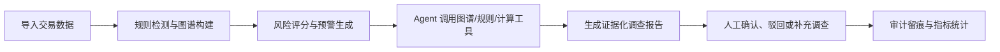
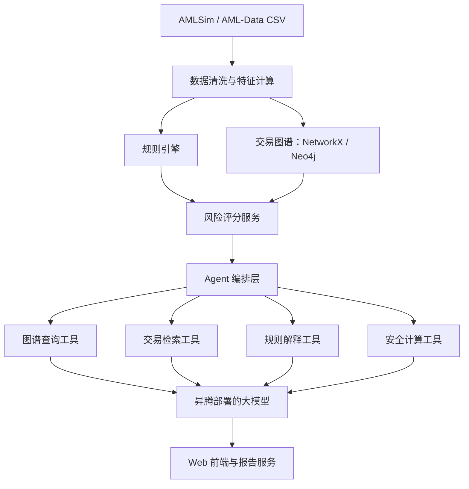

产品需求文档（PRD）
1. 产品名称
链鉴 AML：可解释反洗钱智能审查 Agent
2. 产品概述
链鉴 AML 是一款面向银行合规与反洗钱审核人员的智能审查 Agent。系统基于 IBM AMLSim 合成交易数据，对账户、交易流水与资金关系进行分析，自动识别拆分转账、循环交易、多跳归集等可疑洗钱模式；通过风险规则、交易图谱查询与大模型报告生成，输出可追溯、可解释、可人工审核的调查结论。
本产品定位为合规人员的调查辅助工具，不替代人工判断，不自动冻结账户、拒绝交易或提交监管报告。
3. 背景与痛点
传统反洗钱筛查主要依赖固定规则和人工排查，存在以下问题：
- 告警数量多，人工逐笔追踪资金路径耗时长；
- 单笔交易看似正常，复杂多跳、循环或拆分交易难以识别；
- 告警原因不透明，审核人员需手工整理证据；
- 调查报告依赖人工撰写，格式不统一、难以复核；
- 缺少从“异常发现—证据追溯—人工审核—调查留痕”的完整闭环。
4. 目标用户
暂时无法在飞书文档外展示此内容
5. 产品目标
5.1 核心目标
- 自动发现并排序可疑账户、交易与资金链路；
- 为每个预警提供可验证的交易证据和触发规则；
- 自动生成结构化调查报告；
- 支持人工确认、驳回和补充备注；
- 保留完整审计记录；
- 在昇腾环境中完成模型推理部署与演示。
5.2 非目标
- 不进行真实客户身份识别；
- 不接入真实银行核心系统；
- 不自动执行账户冻结、交易拦截或监管报送；
- 不提供投资、授信或法律结论。
6. 数据来源
使用 IBM AMLSim 或 IBM AML-Data 提供的合成反洗钱数据。
主要数据包括：
- 账户信息；
- 交易流水；
- 账户间资金关系；
- 已知可疑账户、可疑交易及洗钱模式标签。
数据仅用于模型验证和产品演示；测试标签不得参与预警推理，仅用于离线评估。
7. 核心业务流程

8. 功能需求
8.1 数据导入与管理
系统支持导入账户 CSV、交易 CSV 和标签文件。
功能要求：
- 展示导入记录、数据量、时间范围和状态；
- 校验必填字段，如账户 ID、交易时间、金额、付款方、收款方；
- 对异常格式进行提示；
- 数据导入后自动构建账户—交易关系图谱；
- 演示版支持预置样例数据一键加载。
8.2 可疑行为检测
系统根据规则与图谱特征生成预警。
首期支持以下规则：
暂时无法在飞书文档外展示此内容
每条预警须包含：预警编号、风险等级、涉及账户、涉及交易、命中规则、生成时间及状态。
8.3 风险排序
系统对预警进行风险评分与排序。
建议评分构成：
- 规则严重程度：40%
- 可疑交易数量和金额：25%
- 关联账户与路径复杂度：20%
- 近期异常频率：15%
风险等级划分：
- 高风险：80 分及以上；
- 中风险：50–79 分；
- 低风险：50 分以下。
8.4 资金图谱分析
用户可点击预警查看资金关系图。
功能要求：
- 以账户为节点、交易为边展示资金流向；
- 支持展示 1–3 跳关联路径；
- 高亮可疑账户、可疑交易和关键资金路径；
- 点击节点查看账户摘要；
- 点击边查看交易时间、金额、交易类型与风险标记；
- 支持按时间范围、金额和风险等级筛选。
8.5 智能调查 Agent
Agent 接收预警编号或自然语言问题，调用规则、图谱与交易查询工具后回答。
示例问题：
- “为什么账户 A001 被列为高风险？”
- “找出该账户近 7 天的主要资金流向。”
- “是否存在资金回流或循环交易？”
- “生成该预警的调查报告。”
- “列出支持该结论的全部交易证据。”
Agent 输出必须包含：
- 风险结论；
- 命中规则；
- 关键交易明细；
- 资金路径；
- 风险解释；
- 建议人工核查事项；
- 免责声明。
8.6 调查报告生成
系统可自动生成结构化调查报告。
报告字段：
1. 案件编号与生成时间；
2. 涉及账户；
3. 风险等级与风险评分；
4. 预警摘要；
5. 可疑行为描述；
6. 关键交易证据表；
7. 资金链路说明；
8. 命中规则；
9. 建议核查事项；
10. 审核结论与审核人备注；
11. 数据与模型免责声明。
支持网页预览和导出 Markdown/PDF。
8.7 人工审核与审计
审核人员可对预警执行：
- 确认风险；
- 驳回预警；
- 标记需补充调查；
- 添加审核备注；
- 修改处理状态。
系统必须记录：
- 操作人；
- 操作时间；
- 原状态与新状态；
- 审核意见；
- 所引用的预警与证据版本。
9. 页面设计
9.1 首页仪表盘
展示：
- 总交易数、账户数、预警数；
- 高/中/低风险预警数量；
- 风险趋势；
- 高风险账户 Top 10；
- 高频命中规则；
- 待审核预警列表。
9.2 预警中心
展示预警列表，支持按风险等级、规则类型、状态、时间范围筛选和排序。
9.3 预警详情页
页面分为三栏：
- 左侧：账户信息、风险分、命中规则；
- 中间：资金图谱与交易时间线；
- 右侧：Agent 分析结果、证据卡片、调查报告与人工审核操作。
9.4 数据管理页
用于导入数据、查看字段映射、加载演示数据及显示数据处理状态。
10. 技术方案

建议技术栈：
- 后端：Python + FastAPI；
- 数据处理：Pandas；
- 图谱分析：NetworkX；
- 前端：Streamlit 或 React；
- 大模型：部署在昇腾 NPU 上的 Qwen/DeepSeek/GLM；
- 数据库：SQLite 演示版，生产扩展至 PostgreSQL/Neo4j；
- 报告：Markdown 转 PDF。
11. 性能评估
11.1 检测效果
在独立测试集上计算：
- Precision；
- Recall；
- F1；
- PR-AUC；
- Precision@20、Precision@50。
11.2 链路定位效果
- 可疑交易覆盖率；
- 可疑账户覆盖率；
- 关键资金链路命中率；
- 平均链路查询耗时。
11.3 Agent 与报告质量
随机抽取至少 30 个预警，由人工评估：
- 证据正确率；
- 规则解释正确率；
- 报告完整率；
- 报告可审核率；
- 幻觉率。
11.4 工程指标
- 单条预警分析平均响应时间；
- 单份报告生成平均耗时；
- 数据导入成功率；
- Agent 工具调用成功率；
- 昇腾环境推理成功率。
12. 验收标准
MVP 验收应满足：
- 可成功导入预置 AMLSim 数据；
- 可生成不少于三类可疑行为预警；
- 可展示至少三跳资金图谱；
- 每条高风险预警均提供交易证据与命中规则；
- Agent 可回答预警原因、路径和交易明细；
- 可生成完整调查报告；
- 支持人工确认、驳回和审核留痕；
- 可输出测试集上的 Precision、Recall、F1；
- 完成昇腾环境部署说明和可运行 Demo。
13. 版本规划
MVP（比赛交付）
- 预置数据加载；
- 3–6 条反洗钱规则；
- 风险预警与排序；
- 资金图谱；
- Agent 问答；
- 报告生成；
- 人工审核；
- 性能评估页面。
后续版本
- 图神经网络风险评分；
- 实时流式交易检测；
- 多租户和权限管理；
- 规则配置后台；
- SAR 报送模板；
- 真实机构数据脱敏接入能力。
14. 风险与合规声明
系统基于合成数据进行技术验证，所有结论仅用于辅助调查与演示。模型输出不构成洗钱认定、法律意见或监管报送依据；所有高风险预警须由具备授权的合规人员复核后处置。