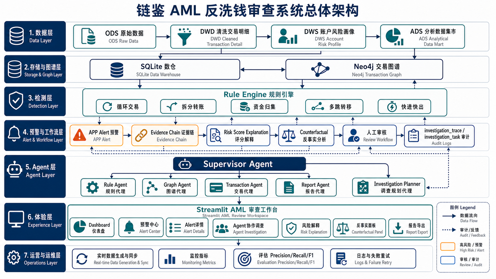

# 链鉴 AML 总体架构图

架构图覆盖当前项目的完整功能链路：

- ODS/DWD/DWS/ADS 数据仓库
- SQLite 数仓和 Neo4j 交易图谱
- AML Rule Engine 规则检测
- APP Alert 预警和人工审核
- Evidence Chain、Risk Score Explanation、Counterfactual Explanation
- Supervisor Agent、Rule Agent、Graph Agent、Transaction Agent、Report Agent
- Investigation Planner、调查追踪和任务审计
- Streamlit AML 审查工作台
- 实时数据同步、监控、评估、日志和失败重试
