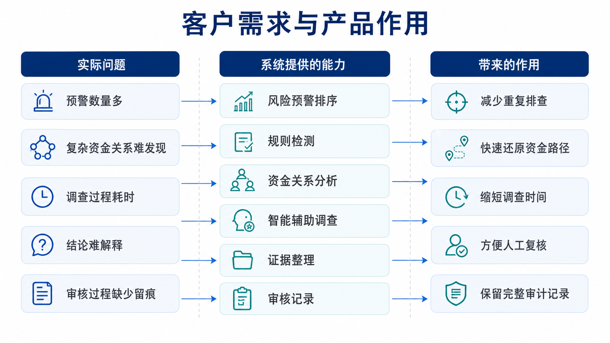
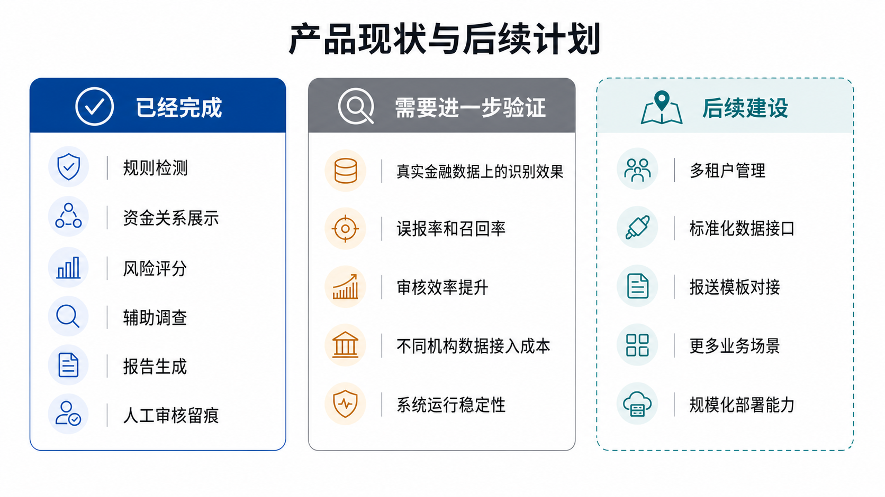
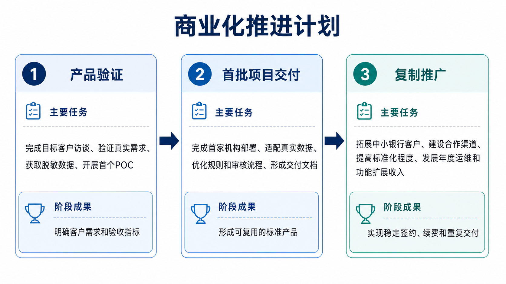
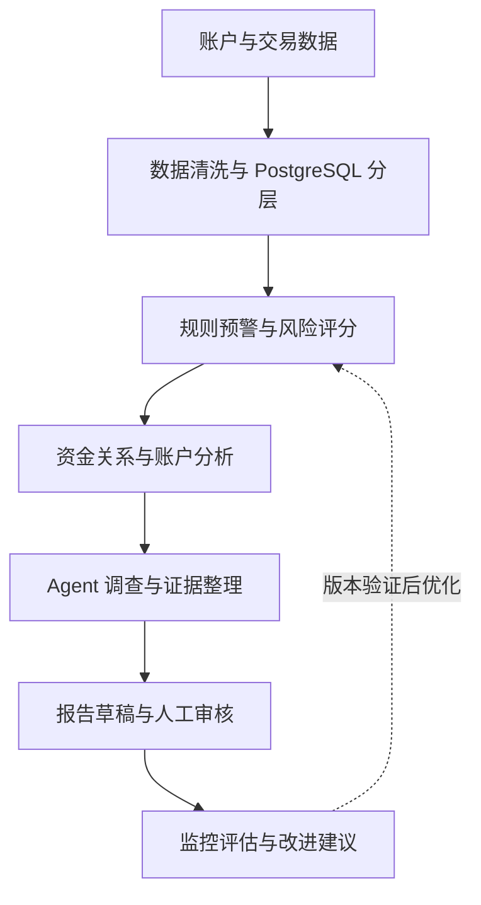
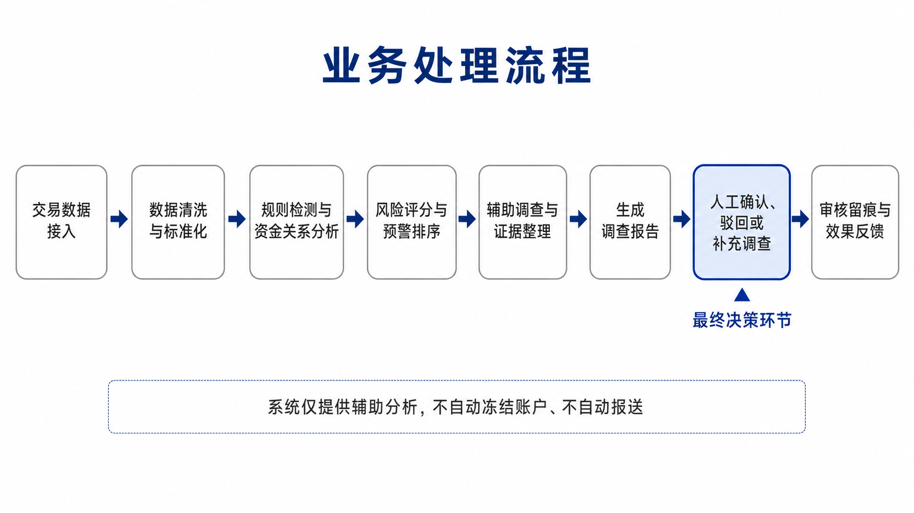
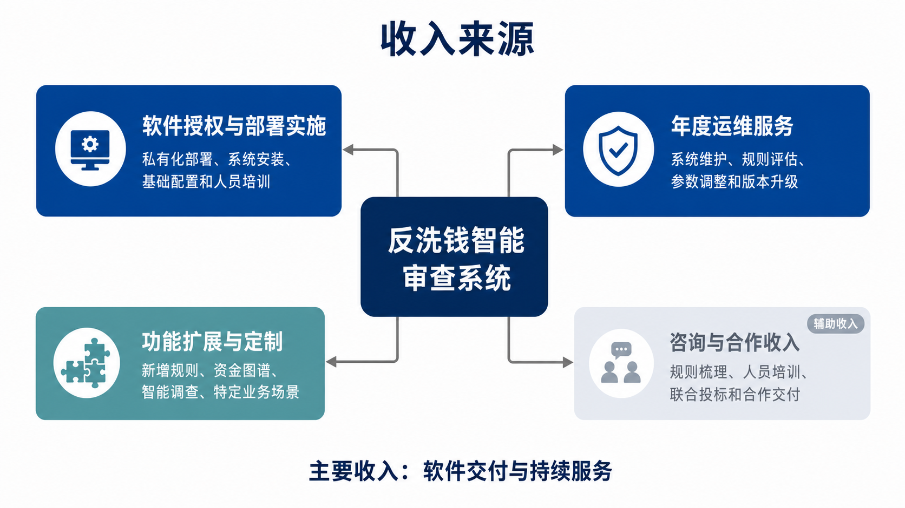
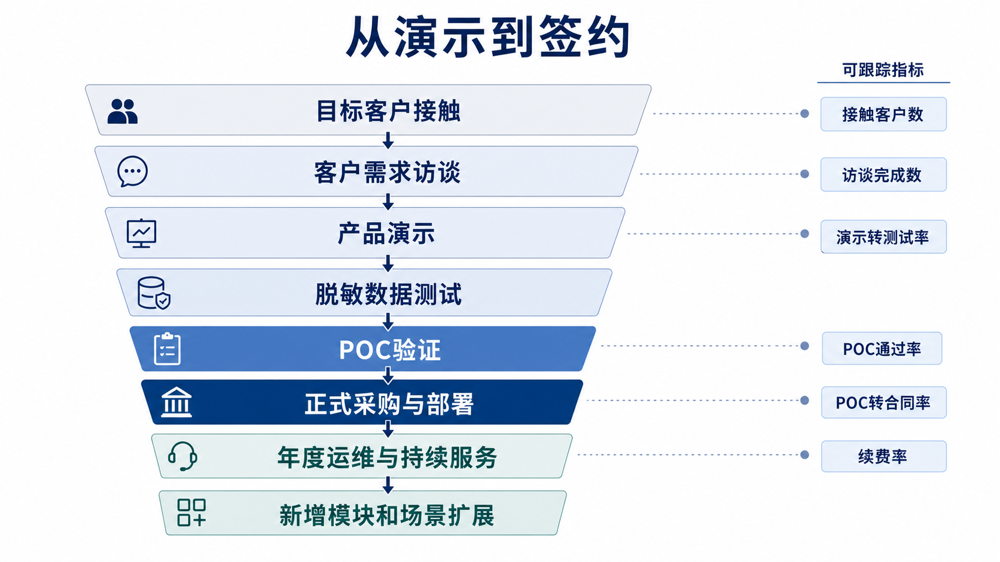
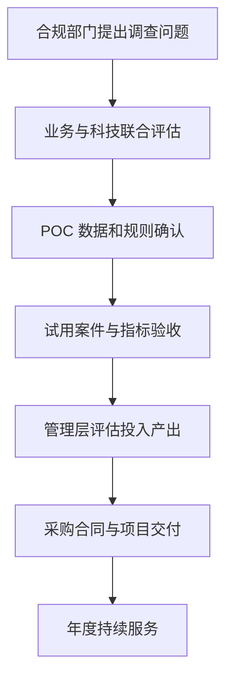
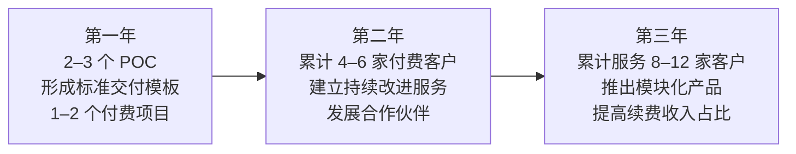

# 链鉴 AML 商业化说明

## 商业化摘要

**面向中小金融机构的可解释反洗钱智能审查系统，帮助审核人员更快发现可疑交易、还原资金链路并完成合规留痕。**

系统结合规则检测、资金图谱和大模型调查能力，对预警进行风险排序、证据整理和报告辅助生成，最终由人工完成审核和处置。客户购买的是一条能够减少重复查询、支撑事实复核并保留审核依据的调查工作流程。

本说明围绕“客户为什么买”展开。先说明核心客户和业务痛点，再介绍产品解决方案与差异化能力，随后说明当前产品和商业化进展、POC 验收方式、获客销售、收费交付、成本盈利、市场测算、三年路线图以及仍需验证的商业假设。详细技术实现、数据模型和系统架构见配套技术设计文档。

| 客户问题 | 产品能力 | 给客户带来的价值 |
|---|---|---|
| 多跳、循环和拆分交易难以人工识别 | 规则检测与资金图谱 | 更快还原复杂资金关系 |
| 预警数量多，审核效率低 | 风险排序与 Agent 辅助调查 | 减少重复查询和资料整理 |
| 结论难以解释 | 证据链、交易明细与评分解释 | 方便内部复核和监管检查 |
| 处理过程缺少留痕 | 人工审核与审计日志 | 保留完整处置记录 |
| 规则长期不更新 | 监控、评估与人工审批迭代 | 及时发现规则效果下降 |



## 产品成熟度

下表区分当前已经完成的演示和 POC 能力、仍需真实数据验证的能力，以及后续建设内容。成熟度判断以当前项目实现和已完成的技术验证为依据，不把规划能力作为现阶段交付承诺。

| 能力 | 当前状态 | 说明 |
|---|---|---|
| 规则检测 | 已实现 | 支持循环交易、拆分转账、快进快出等典型模式 |
| 资金图谱 | 已实现 | 可展示账户及多跳资金关系 |
| Agent 辅助调查 | 已实现 | 可辅助整理风险理由、证据材料和调查结论草稿 |
| 人工审核留痕 | 已实现 | 支持确认、驳回、补查和审计记录 |
| 真实金融数据验证 | 待验证 | 当前主要使用 AMLSim 合成数据，真实效果需通过客户授权数据 POC 验证 |
| 多租户 SaaS | 规划中 | 需补充租户管理、细粒度权限和数据隔离能力 |
| SAR 模板对接 | 规划中 | 当前提供报告草稿和审核材料，报送流程按客户现有制度执行 |
| 标准化机构接口 | 待建设 | 需要适配不同客户的数据结构、字段口径和接入方式 |



## 当前产品及商业化进展

### 当前进展

| 事项 | 当前状态 |
|---|---|
| 产品演示链路 | 已完成规则检测、资金图谱、Agent 辅助调查、报告草稿和人工审核的完整演示链路 |
| 交付准备 | 已形成私有化部署方案、基础产品文档、数据字段说明和 POC 验收材料 |
| 功能验证 | 已使用 AMLSim 合成数据完成系统功能验证和主要流程联调 |
| 真实数据验证 | 尚未完成真实金融机构数据验证，真实效果仍需通过客户授权数据 POC 确认 |
| 商业收入 | 尚未形成正式付费客户和稳定收入，当前处于客户访谈和 POC 准备阶段 |

### 下一阶段目标

| 目标 | 计划结果 |
|---|---|
| 客户访谈 | 完成 3—5 家目标客户访谈，确认预算、数据条件和采购流程 |
| 联合测试 | 获取 1 家机构的脱敏数据或联合测试机会 |
| 首个真实数据 POC | 使用客户授权数据完成规则效果、调查效率和证据质量验证 |
| 产品与报价确定 | 根据 POC 结果确定标准版功能范围、交付边界和正式报价依据 |
| 经验沉淀 | 将首个项目中的定制工作整理为标准接口、数据映射和规则模板 |



## 本说明的阅读顺序

| 阅读顺序 | 章节 | 重点回答的问题 |
|---:|---|---|
| 1 | 核心客户与痛点 | 谁会买，为什么现在需要 |
| 2 | 产品与服务 | 产品具体怎样解决问题 |
| 3 | 核心差异化 | 为什么选择链鉴 AML |
| 4 | 当前产品及商业化进展 | 目前已经做到什么程度 |
| 5 | POC 与客户验收方式 | 怎样判断是否值得采购 |
| 6 | 获客与销售路径 | 如何接触客户并完成转化 |
| 7 | 收费及交付模式 | 客户买什么，团队交付什么 |
| 8 | 成本与盈利逻辑 | 项目能否复制并形成利润 |
| 9 | 市场空间与测算依据 | 市场数字从哪里来 |
| 10 | 商业化路线图 | 三年内怎样推进 |
| 11 | 风险与待验证事项 | 哪些判断还需要真实数据确认 |

## 1. 商业化对象

链鉴 AML 第一阶段面向城商行、农商行和村镇银行，重点服务有反洗钱合规要求、每日预警量较大，但数据分析和规则运营力量有限的中小金融机构。这类客户通常已经具备核心交易系统或基础反洗钱系统，但预警产生之后的调查、证据整理、审核协同和规则维护仍然需要较多人工投入。

支付机构、消费金融、民营银行、跨境支付、虚拟资产和大型银行属于后续扩展市场。中小银行场景完成客户验证、规则模板和交付流程沉淀后，再根据不同机构的交易特点扩展行业规则和专项模块。

客户内部通常有四类决策角色。合规部门关注证据、解释和审核效率；科技部门关注部署方式、权限、性能和维护成本；管理层关注合规风险和人员投入；采购与财务部门关注项目价格、交付范围和持续服务费用。商业沟通时需要分别回应这些问题，不能只展示技术架构。

### 1.1 商业化进展与目标客户

目前链鉴 AML 处于产品演示和 POC 准备阶段。系统已经串起数据导入、规则分析、资金关系图谱、评分原因说明、Agent 调查、报告草稿和人工审核等主要环节，并完成了 PostgreSQL 数据设计、前端工作台、后端接口、测试用例和商业化材料整理。下一步的重点是把现有演示能力整理成标准 POC 交付包，使用客户授权的样例数据验证调查效率、证据完整度和规则效果。

第一批目标客户建议锁定城商行、农商行和村镇银行，尤其是预警量较大、合规人员有限、已有基础反洗钱系统但缺少调查分析工具的机构。这类客户的问题相对集中，也更适合围绕一个具体案件开展 POC。销售时可以先从“预警之后怎么查、证据怎么整理、审核怎么留痕”切入，暂不推动整体系统替换。

| 客户层级 | 目标客户 | 主要需求 | 当前切入方式 |
|---|---|---|---|
| 核心客户 | 城商行、农商行、村镇银行 | 预警调查、证据整理、人工审核和规则维护 | 以具体案件 POC 切入，评估私有化部署 |
| 生态合作方 | 系统集成商、金融科技服务商 | 联合交付、环境适配和客户培训 | 在核心客户 POC 成熟后开展合作 |

支付机构、消费金融、民营银行、跨境支付、虚拟资产和大型银行模块化采购属于后续扩展市场，具体进入时间取决于规则库、数据适配、客户需求和合规要求的验证结果。

商业化推进可以按照“目标客户名单—样例数据沟通—POC 验证—项目签约—持续改进服务”的顺序进行。当前阶段的重点是完成第一批客户的真实数据验证，逐步整理数据接入模板、规则配置模板、部署文档和验收指标。随着标准化材料增加，后续客户的交付成本有望下降，项目复制会更容易。


## 2. 客户痛点

### 2.1 预警之后仍然依赖人工查数据

传统系统能够按照规则产生预警，但调查人员通常还要在交易系统、账户系统、图谱工具和文件系统之间反复切换，手工查找关键交易、关联账户和资金路径。案件一多，时间就会消耗在重复查询和整理材料上，较复杂的资金关系也更容易被遗漏。

### 2.2 风险分数和规则命中缺少说明

很多系统能够给出风险分数和命中规则，但审核人员还需要进一步回答“为什么是这个账户”“哪些交易影响最大”“资金经过了哪些账户”。当监管检查或内部复核要求说明理由时，简单的高风险标签通常还需要补充交易和账户依据。

### 2.3 调查过程分散，审核记录不完整

调查人员的查询结果、截图、补充材料、报告草稿和审核意见可能分散在不同位置。案件最终虽然有一个处理结果，但从哪批数据产生、使用了什么规则、看过哪些证据、谁在什么时候作出决定，往往需要重新拼接。

### 2.4 规则上线后缺少持续维护

客户的交易结构、账户群体和风险手法会发生变化，规则上线以后可能出现误报增加、漏报加重或指标逐渐失效的问题。中小机构通常没有专门的数据科学团队，难以长期完成数据质量检查、规则评估和版本复盘。

## 3. 产品与服务

链鉴 AML 的产品定位是反洗钱调查辅助系统。系统接在客户原有核心交易系统之后，承接“预警产生之后”的调查和审核工作，最终审核责任由客户承担。

### 3.1 产品边界与人工审核责任

系统承担的是辅助识别、辅助调查和辅助生成报告的工作。它通过规则、交易关系、证据引用和调查任务帮助工作人员更快整理事实、定位风险和形成审核材料，案件的最终结论由客户授权的人工审核人员作出。

账户处置、交易拦截、账户冻结和正式报送按照客户现有的业务制度、审批流程和相关系统执行，当前产品提供案件事实、证据链、评分解释和报告草稿作为决策依据。系统不自动冻结账户、不自动报送，也不替代人工判断。产品定位、销售材料、演示口径和合同条款统一采用这一边界。

| 事项 | 链鉴 AML 提供的能力 | 最终责任归属 |
|---|---|---|
| 可疑行为识别 | 规则分析、账户画像、资金关系分析和风险提示 | 系统辅助识别，人工复核 |
| 案件调查 | 交易查询、证据整理、智能调查任务和反事实分析 | 调查人员核验事实 |
| 报告形成 | 结构化报告草稿、证据引用和评分原因说明 | 审核人员审核、修改和确认 |
| 风险结论 | 展示调查依据和待核查事项 | 客户授权人员作出最终结论 |
| 账户及交易处置 | 提供处置所需的调查材料 | 由客户现有流程和授权系统执行 |

### 3.2 基础产品

系统从账户、交易、案例和评估数据开始，完成字段清洗、批次登记、质量检查和 PostgreSQL 分层存储。规则分析识别循环交易、拆分转账、资金归集、快速转移和多跳转移等行为，生成包含案件编号、命中规则、风险分数、风险等级和关键交易的预警案件。

### 3.3 调查工作台

调查人员进入案件后，可以查看关键交易时间线、账户画像、资金关系、证据链、评分原因和关键因素分析。系统将账户、交易、规则和资金路径放进同一个案件上下文中，减少调查人员手工拼接信息的工作。

关键因素分析用于模拟移除某笔交易、某条规则或某项风险特征后评分如何变化，帮助审核人员判断主要影响风险的因素。分析过程使用独立的计算结果，原始案件事实和审核记录保持稳定。

### 3.4 有证据支撑的 Agent 调查

Supervisor Agent 负责安排调查任务，Rule Agent 负责解释规则命中，Transaction Agent 负责查询交易和账户行为，Graph Agent 负责分析资金路径，Evidence Judge 负责检查事实来源和证据引用，Report Agent 负责整理报告草稿。

Agent 通过受限工具读取账户、交易、规则和图谱数据，任务结果带有案件 ID、证据 ID、数据来源和时间范围。客户看到的是有事实依据的调查材料，而不是一段无法继续核对的模型文字。

### 3.5 人工审核和审计留痕

审核负责人可以在案件中查看调查结果、证据引用、评分原因、补充材料和报告草稿，并根据实际情况确认风险、驳回预警或要求补充调查。审核人、审核意见、案件状态、证据版本和操作时间统一保存，方便后续复核和监管检查。

### 3.6 持续改进服务

持续改进服务包括数据质量检查、规则效果评估、预警处理分析、Agent 任务质量分析、改进建议、验证测试和版本复盘。系统持续记录 Precision、Recall、F1、规则命中量、预警量、证据覆盖率、任务完成率和报告质量等指标。

当发现规则误报增加、账户特征发生变化或 Agent 任务质量下降时，服务团队可以提出规则、评分权重、风险阈值、提示词或报告结构的改进建议。每次调整都经过人工审批、测试验证和版本记录，再进入客户环境。

### 3.7 产品交付阶段

| 阶段 | 交付内容 | 客户得到的结果 |
|---|---|---|
| POC 验证 | 样例数据接入、规则配置、历史预警回放 | 判断系统是否适合客户业务 |
| 标准交付 | 私有化部署、数据处理、预警和调查工作台 | 建立可使用的调查流程 |
| 能力扩展 | 资金关系图谱、Agent 调查、关键因素分析 | 提升复杂案件调查能力 |
| 持续服务 | 监控、评估、规则改进和版本复盘 | 支持系统后续维护和调整 |





当前版本已经实现数据导入、PostgreSQL 分层数据、规则预警、风险评分、账户画像、资金关系分析、证据链、Agent 调查、报告草稿、材料审查、人工审核、监控和离线评估等主要功能，适合比赛展示、客户交流和 POC 验证。

| 能力范围 | 当前版本已有能力 | 后续规划能力 |
|---|---|---|
| 数据处理 | CSV 数据接入、字段清洗、PostgreSQL 分层存储、数据批次记录 | 客户系统接口、更多数据格式、生产级备份恢复 |
| 风险分析 | 规则预警、风险评分、账户画像、资金关系分析 | 行业规则模板、更多风险特征和客户规则管理 |
| 智能调查 | 多 Agent 任务编排、证据判断、报告草稿 | 更多工具接入、模型适配和大规模并发优化 |
| 审核管理 | 案件查看、补充材料、人工审核、审计记录 | 统一身份认证、细化权限和多机构隔离 |
| 运营服务 | 运行监控、离线评估、改进提案和版本记录 | 面向客户的持续运营服务和标准化报告 |
| 交付形态 | 本地演示、POC 和私有化交付准备 | SaaS、多租户和正式报送接口 |

表中的后续规划代表产品方向，不代表当前版本已经具备生产可用能力。正式商务沟通时应以 POC 范围、客户环境和验收结果为准。

### 3.8 交付边界

正式项目开始前，需要通过项目范围说明书确认数据、环境、部署、培训和后续服务内容。下面的范围用于商务沟通时的初步划分，实际以合同、技术协议和 POC 结果为准。

| 交付事项 | 客户负责或提供 | 团队负责 | 默认是否包含 |
|---|---|---|---|
| 业务数据 | 提供经过授权的账户、交易、案例和必要标签数据，完成脱敏和使用审批 | 提供字段模板，协助数据接入和质量检查 | 包含标准字段范围，特殊数据源另行评估 |
| 部署环境 | 提供服务器、虚拟机、网络、数据库账号和访问权限 | 完成系统安装、配置和部署检查 | 软件部署包含，基础设施由客户提供 |
| 硬件设备 | 提供 CPU、内存、存储、网络和模型推理所需资源 | 提供资源规格建议和部署要求 | 默认不包含硬件采购 |
| 数据治理 | 负责数据授权、脱敏、字段含义确认和数据质量整改 | 提供数据质量检查工具和问题清单 | 工具和检查包含，客户源数据治理由客户负责 |
| 历史数据迁移 | 提供历史数据、字段说明和迁移窗口 | 按约定范围完成格式转换、导入和抽样核对 | 标准范围包含，超出范围另行报价 |
| 规则校准 | 提供现有规则、业务口径和审核样例 | 完成规则参数配置、初始校准和验证报告 | 首批规则校准包含，新增行业规则另行评估 |
| 培训 | 安排合规、科技和运维人员参加培训 | 提供系统操作、规则配置和审核流程培训材料 | 包含远程培训，专项培训可单独约定 |
| 驻场服务 | 提供现场办公条件和必要的网络访问 | 按合同安排部署、上线或问题处理人员 | 默认远程支持，驻场按人天或项目报价 |
| 新增规则 | 提供业务需求、样例案件和审核标准 | 完成需求分析、开发、测试和版本说明 | 标准规则调整包含，新增复杂规则或行业规则另行收费 |
| 后续维护 | 配合提供问题反馈和运行数据 | 提供约定周期内的监控、评估和版本支持 | 按持续服务合同执行 |

硬件采购、客户现有系统改造、外部数据购买、长期驻场、超出约定范围的历史数据迁移和大规模数据治理，不默认包含在软件 License 中。新增规则是否收费，需要根据规则复杂度、是否涉及新数据源、是否需要新增页面或接口以及测试工作量确定；简单阈值调整可以纳入持续服务，新增行业规则或复杂图谱规则通常按模块或项目报价。

## 4. 收费模式

链鉴 AML 当前收缩为三种商业模式。POC 是正式合作前的验证阶段，不单独作为一种商业模式；SaaS 尚未完成，不纳入当前销售方式，放入后续商业化路线图。下面的价格属于初步假设，后续需要通过客户访谈、POC 实施成本、同类软件报价和实际招投标情况进一步验证。

| 商业模式 | 适用客户 | 收费参考 | 主要内容 |
|---|---|---:|---|
| 私有化部署 | 城商行、农商行和村镇银行 | 初步假设 80–300 万元 | 软件授权、部署实施、数据接入、规则配置、人员培训和首年服务 |
| 持续运营服务 | 已完成部署的客户 | 初步假设为软件费用的 15%–25%/年 | 运行监控、规则评估、参数校准、版本升级和运维支持 |
| 模块化及定制交付 | 大型银行、支付和跨境场景 | 按项目评估 | 资金图谱、Agent 调查、行业规则、数据接口和专项功能扩展 |

实际价格需要结合账户数量、日交易量、预警数量、部署环境、规则数量、客户定制比例和服务范围确定。当前价格区间属于团队估算，尚未形成正式客户报价。持续服务包括数据和规则效果检查、改进方案提出、验证和版本记录。SaaS 形态待多租户、权限和数据隔离能力完成验证后，再根据客户需求评估。

### 4.1 产品定价参考

下表是当前用于商业沟通和 POC 设计的参考价格，不是已经验证的成交价格。最终报价需要结合客户规模、数据量、部署环境、规则数量、定制比例和服务范围确认。

| 产品 | 参考价格 | 包含内容 | 当前依据 |
|---|---:|---|---|
| POC 验证 | 5 万—10 万元 | 数据适配、规则验证、历史样例回放、演示和评估报告 | 团队初步测算，待结合实际实施工时验证 |
| 标准私有化版 | 80 万—150 万元 | 系统部署、基础规则、数据接入、操作培训和一年基础服务 | 初步假设，待结合客户访谈和同类项目报价验证 |
| 高级版 | 150 万—300 万元 | 资金图谱、Agent 辅助调查、评分解释和定制规则 | 初步假设，待参考同类软件招投标和 POC 成本 |
| 年度运营服务 | 首年合同额的 15%—25% | 运维支持、运行监控、效果评估、规则校准和版本升级 | 参考行业软件服务模式的团队估算，待客户续费意愿验证 |



## 5. 销售路径

### 5.1 以 POC 作为第一步

链鉴 AML 适合采用“先验证、再签约”的销售方式。第一阶段与客户确认数据字段、部署环境和业务规则，并接入一批经过授权的数据；第二阶段完成规则配置、预警生成和历史数据回放；第三阶段展示资金关系图谱、评分原因说明、关键因素分析、Agent 调查和报告草稿；第四阶段由客户审核人员试用，根据调查时间、证据完整度、报告可用性和规则效果完成验收。

POC 的交付结果包括数据接入说明、规则配置表、预警案件样例、调查报告样例、评估指标报告和后续改进建议。对于真实客户数据，应由客户完成授权、脱敏和接入审批。当前演示系统使用 AMLSim 合成数据，适合展示产品链路和完成技术验证，真实生产效果需要经过客户数据 POC 评估。



### 5.2 POC 验收指标

POC 的验收重点放在客户真实调查工作的改善情况。客户可以从历史预警中抽取一批样例，记录原有流程和使用链鉴 AML 后的处理时间，再由合规人员评价证据完整度、报告可用性和调查结果的一致性。

| 验收方向 | 建议指标 | 验收方式 |
|---|---|---|
| 调查效率 | 单个案件平均处理时间、关键交易定位时间 | 对比使用系统前后的同类案件 |
| 证据质量 | 关键结论证据引用完整率、交易和账户信息一致率 | 合规人员抽样复核 |
| 报告质量 | 报告草稿可采用比例、人工修改量 | 统计审核人员修改内容 |
| 规则效果 | Precision、Recall、F1、误报和漏报变化 | 使用客户授权的历史数据和标签 |
| 智能调查 | Agent 任务完成率、工具调用成功率、待核查项比例 | 查看任务记录和证据判断结果 |
| 审核过程 | 审核记录完整率、补充调查闭环率 | 检查案件、任务和审核日志 |

这些指标不预先承诺固定提升比例，具体目标由客户当前基线、数据质量和案件复杂度共同确定。这样既能体现系统价值，也能避免用未经验证的数字包装产品效果。

### 5.2.1 POC 成功判定标准

POC 成功的判断应当同时看识别效果、调查效率、证据质量和系统运行情况。建议在项目开始时由客户和项目团队共同确定历史基线，再使用同一批经过授权的样例数据进行前后对比。下面的目标属于初步验收口径，实际阈值需要结合客户现有系统、标签质量和案件数量调整。

| 验收指标 | 计算或观察方式 | 建议通过口径 |
|---|---|---|
| 可疑交易召回率 | 在客户提供标签或人工确认结果的样例中，系统识别出的可疑交易占全部已确认可疑交易的比例 | 不低于客户现有基线；若客户没有历史基线，则先完成可疑样例覆盖情况评估 |
| 误报率或预警压降比例 | 统计预警中被审核驳回的比例，并与客户原有流程进行比较 | 在召回率保持可接受的前提下，误报率较基线下降，或人工需要处理的预警量有所减少 |
| 单案例调查时间 | 从调查人员打开案件到形成审核材料的平均用时 | 相比客户现有流程有所缩短，具体目标由历史案件测时确定 |
| 报告生成时间 | 从调查任务完成到生成报告草稿的平均时间 | 能够在约定时间内生成结构化草稿，人工主要进行核对和补充 |
| 证据链完整率 | 抽样检查规则、交易、账户、资金路径和报告结论是否具备对应证据引用 | 关键结论均能找到来源，缺少依据的内容进入待核查项 |
| 审核人员认可率 | 审核人员对案件事实、评分原因、调查报告和证据组织结果的认可比例 | 通过问卷和抽样复核确认达到双方约定的认可水平 |
| 系统稳定性 | 观察数据导入、案件查询、图谱查询、Agent 任务和报告生成过程中的成功率、错误率和响应时间 | 核心流程连续运行稳定，异常任务有记录，测试期间没有影响验收的阻断问题 |

建议将 POC 通过条件写成三层。第一层是功能条件，数据导入、案件生成、证据查询、调查任务、报告草稿和人工审核流程能够跑通；第二层是效果条件，召回率、误报率、调查时间、报告时间、证据链完整率和审核人员认可率达到双方确认的目标；第三层是运行条件，系统在约定的数据量和并发范围内稳定运行。三层条件均达到后，再进入商务谈判和正式项目评估。

### 5.2.2 客户收益测算

客户收益测算主要看人工工作量减少了多少，以及这些时间可以转移到多少重点案件上。测算时应使用客户自己的预警量、平均处理时长、工作日数量和人员成本。系统带来的价值不等同于直接减少人员，更主要的表现是减少重复查询和材料整理，把合规人员的时间投入到重点案件和复杂关系分析上。

基本测算公式如下：

```text
每日节省人时 = 每日预警量 × 单条预警平均人工处理时间 × 重点审查预警下降比例
等效节省人天 = 每日节省人时 ÷ 8
月度节省人天 = 等效节省人天 × 月度工作日
人工工作量价值 = 月度节省人时 × 客户内部人时成本
年度可量化收益 = 人工工作量价值 × 12 + 可减少的重复开发和维护成本
```

例如，某机构每天产生 1 万条预警，每条预警平均需要人工处理 10 分钟。如果系统经过 POC 验证后，将需要人工重点审查的预警工作量降低 30%，则按 8 小时为 1 个工作日计算：

| 测算项目 | 计算过程 | 示例结果 |
|---|---|---:|
| 原始人工工作量 | 10,000 条 × 10 分钟 | 100,000 分钟/日 |
| 每日减少工作量 | 100,000 分钟 × 30% | 30,000 分钟/日 |
| 每日节省人时 | 30,000 ÷ 60 | 500 人时/日 |
| 等效节省人天 | 500 ÷ 8 | 62.5 人天/日 |
| 月度等效人天 | 62.5 × 20 个工作日 | 1,250 人天/月 |

上面的结果只是演示公式的示例，实际测算需要进一步确认“预警工作量降低”对应的是预警数量减少、单案处理时间缩短，还是重复查询时间减少。如果客户内部合规人员的综合人时成本为每小时 200 元，则示例中的月度人工工作量价值可以按 500 人时 × 20 个工作日 × 200 元进行估算；如果系统实际只减少其中一部分重复工作，则应按经 POC 验证的比例重新计算。

除了人工时间，客户收益还可以从报告编写时间、规则维护投入、外部定制开发费用和监管检查准备时间几个方面测算。最终建议在 POC 结束时形成一张客户收益表，分别记录系统上线前基线、POC 期间数据、验证后的变化和对应的估算金额，再作为正式采购和持续服务续费的参考。

### 5.3 客户内部推进方式

合规部门是业务发起方，负责确认场景和验收调查效果；科技部门负责环境、权限、数据接入和运行支持；分管领导关注合规风险和投入产出；采购与财务部门负责合同、预算和服务范围。销售过程中应先用一个真实案件讲清楚产品价值，再根据不同部门的关注点补充技术和商务材料。



## 6. 竞争优势

### 6.1 与常见方案的区别

| 对比项 | 传统规则系统 | 通用大模型方案 | 链鉴 AML |
|---|---|---|---|
| 复杂资金链识别 | 主要依赖单笔规则，复杂关系识别较弱 | 依赖提示词和已有数据组织能力 | 规则分析与资金关系图谱结合 |
| 结果可解释 | 以规则编号和命中条件为主 | 需要人工核对，存在事实依据不足的风险 | 证据链、交易明细和资金路径共同说明 |
| 人工审核留痕 | 通常有审核功能，但调查材料可能分散 | 往往需要另行配置案件审核流程 | 案件、证据、任务和审核记录统一保存 |
| 调查报告生成 | 依赖人工整理和填写 | 生成速度快，但需要核对事实 | 基于已核验事实生成结构化报告草稿 |
| 规则和模型改进 | 主要依靠人工维护规则 | 主要调整提示词或模型配置 | 监控、评估、提案、审批、验证和版本记录 |

### 6.2 技术优势转化为业务优势

链鉴 AML 的竞争力来自统一的案件流程。规则负责发现异常行为，图谱负责补充账户关系，评分原因说明负责解释风险来源，Agent 负责组织调查，Evidence Judge 负责检查证据，人工审核负责最终判断。

这种组合针对的是客户实际工作中的衔接问题。调查人员可以在同一个案件中查看交易和账户信息，审核人员也可以结合证据和评分原因作判断。案件、证据、任务和审核记录统一保存后，系统可以按编号回看一次调查的来源和过程。

另一个优势是持续改进可以产品化。客户除了软件本身，还可以按服务范围获得数据质量检查、规则评估、问题诊断、改进建议、验证和版本复盘。对于缺少专门数据团队的中小机构，这项服务可以作为软件交付后的补充支持。

## 7. 成本与盈亏逻辑

### 7.1 主要成本

项目成本主要来自首次实施和后续服务两部分。首次实施成本包括需求沟通、数据字段梳理、数据接入、规则配置、部署测试、客户培训和验收支持；后续服务成本包括数据质量检查、规则分析、评估报告、改进开发、版本测试和客户支持。

技术成本还包括 PostgreSQL 和 Neo4j 的部署维护、模型推理资源、日志和监控资源、信创环境适配以及安全测试。POC 阶段可以使用较小规模环境控制成本，正式交付后再根据账户数量、交易量和并发需求扩容。

在实施人员配置上，一个标准 POC 可以先按产品负责人 1 人、后端或数据工程人员 1 至 2 人、规则与风险分析人员 1 人、实施支持人员 1 人的规模估算，具体人数取决于客户数据质量、接口复杂度和部署环境。标准私有化项目的实施周期可以先按 2 至 4 个月进行初步规划，其中数据接入和规则确认通常占用最多时间，正式周期需要通过首批客户项目验证。

项目还需要单独核算客户定制比例。若每个客户都重新开发数据接口、规则和页面，License 收入很难覆盖交付成本；如果能够把数据接入、规则配置、报告模板和部署文档标准化，定制工作主要集中在客户规则和环境适配，后续复制成本才会下降。

### 7.2 收入和利润来源

项目收入由软件 License、实施服务、年度持续服务和增量模块组成。License 和实施服务负责覆盖前期研发与交付成本，持续服务提供稳定的年度收入，增量规则和行业模块带来二次销售。随着规则模板、数据接入工具和部署文档逐步标准化，单个客户的交付工作量可以下降，项目利润率会随客户数量增加而改善。

| 收入来源 | 作用 | 成本特点 | 盈利逻辑 |
|---|---|---|---|
| License | 建立客户关系，回收产品研发投入 | 前期研发和产品维护成本较高 | 通过标准版本提高复用率 |
| 实施服务 | 完成数据接入、部署和规则配置 | 需要项目人员投入 | 以项目报价覆盖交付成本 |
| 持续改进服务 | 提供年度稳定收入 | 需要规则分析和客户支持人员 | 通过标准化报告和流程提高人效 |
| 增量模块 | 图谱、Agent、跨境或行业规则扩展 | 需要专项开发 | 在已有客户中进行二次销售 |

### 7.3 盈亏测算示例

以标准版客户为例，首年收入可以由软件和实施费用组成，第二年开始主要由续费和持续改进服务组成。若单客户首年合同金额暂按 100–150 万元估算，持续服务暂按 15%–25% 收取，项目需要重点控制数据接入、现场实施和定制开发的成本，避免每个客户都重新开发一套系统。上述金额和比例属于团队估算，需要通过首批 POC、客户访谈和同类项目报价继续验证。

早期阶段重点通过 2 至 3 个 POC 整理规则模板、数据接入模板、部署手册和验收指标，同时验证项目收入和交付成本。标准交付包逐步稳定后，再提高 POC 转正式合同的比例，降低实施人员投入，逐步提高单客户利润和续费收入占比。首年毛利率、续费毛利率和盈亏平衡点暂不写成确定结果，待获得真实实施工时、硬件与模型资源费用、客户定制比例和续费数据后再测算。

如果按每个客户 2 至 4 个月实施、4 至 5 人参与、首年合同 100–150 万元作为初步假设，项目能否盈利主要取决于三点：数据接入是否可以复用，客户规则定制是否控制在合理范围内，持续服务是否能够转化为稳定续费。标准化程度越高，后续客户的边际交付成本越有机会下降，License、持续服务和增量模块共同构成盈利空间。


## 8. 市场空间

市场测算需要建立在明确假设上，不能把所有金融机构都直接当成潜在客户。当前“500 至 800 家可触达机构”“三年 5% 左右渗透率”“单客户 80 至 300 万元”等数字属于团队初步估算，并非已经核验的公开市场数据。后续需要通过客户访谈、目标机构名单、同类软件报价、行业招投标案例和 POC 转化率进一步验证。

在现阶段，市场空间可以先按“目标客户数量 × 预计合同金额”计算。若未来通过客户调研确认有 500 至 800 家中小金融机构具备相关预算，再以 5% 左右的三年渗透率进行情景测算，对应约 25 至 40 家客户；若单客户软件和实施收入最终验证为 80 至 300 万元，核心场景的潜在合同规模约为 0.2 至 1.2 亿元。这个结果是情景测算，不应直接表述为已经确定的市场规模。

这个估算用于制定销售目标和资源投入，不代表已经确认的订单规模。正式商务计划还需要根据客户名单、采购周期、POC 转化率、平均合同金额和续费比例进一步校准。中小银行是第一阶段市场，支付机构、消费金融、跨境支付和大型机构模块化采购可以作为后续增长空间。

## 9. 三年商业计划

三年计划以中小银行的预警调查场景为主线，先完成产品验证和标准化 POC，再形成可复制的私有化交付，最后通过持续改进服务和行业模块扩展收入。下面的客户数量、合同金额和收入区间属于当前规划假设，实际结果需要根据客户访谈、POC 转化率、采购周期和交付成本持续调整。

### 9.1 第一年：完成产品验证和首批客户突破

第一年的重点是在真实业务数据上验证链鉴 AML 对预警调查工作的帮助。团队需要把现有演示系统整理成标准 POC 包，明确数据字段、部署要求、规则配置、演示脚本和验收指标，并重点寻找城商行、农商行和村镇银行中的试点客户。

第一年计划完成 2 至 3 个 POC，争取形成 1 至 2 个正式付费项目，沉淀至少一套可以复用的数据接入模板、规则配置模板和私有化部署文档。收入主要来自 POC、实施服务和首批 License，重点控制现场实施、数据接入和客户定制成本。按照当前初步价格假设，第一年收入可以暂按 100 至 300 万元作为规划区间，具体金额以实际合同为准。

| 第一年重点 | 计划目标 |
|---|---|
| 产品 | 完成数据导入、规则预警、图谱调查、Agent 调查、人工审核和报告草稿的标准演示链路 |
| 客户 | 完成 2–3 个 POC，争取 1–2 个正式付费项目 |
| 交付 | 形成数据接入、部署、规则配置和验收标准模板 |
| 收入 | 初步规划 100–300 万元，依据客户合同和 POC 转化情况调整 |
| 经营重点 | 优先验证客户需求和交付成本，暂不追求大范围扩张 |

### 9.2 第二年：形成标准交付和持续服务收入

第二年的重点是把第一年的 POC 经验整理成较稳定的产品和服务。产品方面继续完善权限、备份恢复、性能测试、部署监控和客户规则管理；交付方面减少每个项目重新开发的内容，把客户差异集中在数据字段、规则参数和部署环境适配上；销售方面继续围绕中小银行扩展，并与金融科技服务商和系统集成商建立合作。

第二年可以把持续改进服务正式纳入合同，为已交付客户提供数据质量检查、规则效果评估、改进建议和版本复盘。按照首批项目能够顺利复制的前提，第二年可以规划累计 4 至 6 家付费客户，其中包括第一年的续费客户；收入以 License、实施服务和持续服务共同构成，初步规划区间为 400 至 800 万元。这个区间需要在第一年真实交付成本和续费意愿得到验证后再调整。

| 第二年重点 | 计划目标 |
|---|---|
| 产品 | 完善私有化交付、权限、备份、监控和客户规则配置 |
| 客户 | 累计 4–6 家付费客户，建立 1–2 个合作伙伴渠道 |
| 服务 | 为首批客户提供季度评估、规则改进和版本复盘 |
| 收入 | 初步规划 400–800 万元，重点提高续费收入占比 |
| 经营重点 | 降低单客户交付成本，提高 POC 转正式项目的比例 |

### 9.3 第三年：扩大客户覆盖和模块化销售

第三年的重点是提高产品复制能力，并在保持中小银行核心市场的基础上，选择性拓展支付机构、消费金融和跨境支付场景。产品可以将资金关系图谱、关键因素分析、Agent 调查和行业规则整理成可单独采购的模块，满足大型机构或已有反洗钱系统客户的增量需求。

第三年计划争取形成 License、持续服务和模块销售组合，累计服务客户可以按 8 至 12 家作为规划目标，持续服务收入逐步提高占比。按照前两年交付成本下降、标准模块复用率提高的假设，第三年收入可以暂按 800 至 1500 万元作为规划区间。团队需要根据实际客户数量、续费比例、人员规模和基础设施成本重新测算盈亏平衡点。

| 第三年重点 | 计划目标 |
|---|---|
| 产品 | 整理规则、图谱、Agent 调查和持续评估的模块化产品组合 |
| 客户 | 累计服务 8–12 家客户，保持中小银行为核心市场 |
| 市场 | 选择性拓展支付、消费金融和跨境支付场景 |
| 收入 | 初步规划 800–1500 万元，逐步提高续费和模块收入 |
| 经营重点 | 提高标准化复制能力，争取建立持续服务和合作伙伴渠道 |

### 9.4 三年经营指标

三年计划的观察指标包括合同金额、POC 转化率、客户续费率、标准化交付比例、单客户实施周期和持续服务收入占比。这些指标共同改善时，收入增长的稳定性会更好。

| 指标 | 第一年 | 第二年 | 第三年 |
|---|---:|---:|---:|
| POC 数量 | 2–3 个 | 累计 5–7 个 | 累计 8–10 个 |
| 付费客户 | 1–2 家 | 累计 4–6 家 | 累计 8–12 家 |
| 单客户实施周期 | 2–4 个月 | 2–3 个月 | 1–2 个月 |
| 持续服务客户 | 试点 | 2–4 家 | 6–10 家 |
| 标准化交付比例 | 整理模板 | 逐步提高 | 争取成为主要交付方式 |
| 收入结构 | License 和实施为主 | License、实施和服务并重 | 服务和模块收入占比提高 |

以上目标用于制定团队资源和销售节奏，不能替代正式财务预算。每个年度结束后，应根据真实合同、实施工时、模型和硬件费用、客户定制比例及续费情况重新校准下一年度目标。



## 10. 未来计划

### 10.1 近期计划：完成 POC 标准化

近期重点是把现有演示链路整理成可以重复交付的 POC 产品包，包括数据字段模板、规则配置模板、案件样例、演示脚本、部署文档、验收指标和问题反馈表。这样面对不同客户时，可以快速完成数据接入和效果验证，而不是每次从头准备材料。

### 10.2 中期计划：完善私有化交付和持续服务

中期重点是完善统一身份认证、权限细化、数据库备份恢复、性能测试、生产级监控和信创环境适配。同时建立持续服务流程，定期为客户输出数据质量报告、规则效果报告、Agent 任务质量报告和改进建议。

### 10.3 长期计划：扩大行业和产品范围

长期可以根据客户验证结果，逐步支持支付、消费金融、跨境支付和虚拟资产等场景，增加行业规则和场景模板；根据客户需求评估 SaaS 版本、多机构隔离和模块化采购；在客户自身审批和监管要求允许的前提下，再研究报告报送接口和更细的合规运营能力。

正式生产化需要根据客户环境继续完善安全评估、权限管理、数据授权、性能验证和灾备能力。当前演示系统使用 AMLSim 合成数据，适合比赛展示和 POC 验证，真实生产效果需要经过客户授权数据的独立评估。

## 11. 对外介绍摘要

链鉴 AML 面向有反洗钱合规压力、但调查和规则运营力量有限的中小金融机构。系统从账户和交易数据出发，通过规则分析发现异常行为，通过资金关系图谱还原账户之间的资金往来，再由有证据支撑的 Agent 协助完成交易查询、规则解释和调查报告整理。审核人员可以在同一个案件中查看事实、证据、评分原因和资金路径，并对案件作出最终判断。

如果客户只希望先解决复杂资金关系问题，可以从资金关系图谱和案件证据链开始；如果客户更关注调查效率，可以先使用 Agent 调查和报告草稿；如果客户已经有规则系统，则可以把链鉴 AML 作为预警之后的调查和审核模块接入。产品支持从小范围 POC 开始，经过数据验证和指标评估后，再扩展到私有化部署和持续改进服务。

销售沟通时可以用一句话介绍：链鉴 AML 帮助金融机构把反洗钱预警后的交易查询、资金分析、证据整理和人工审核放到同一条工作流程中，并通过持续评估让规则和调查方法保持有效。

## 12. 总结

链鉴 AML 的商业化方向可以概括为：先以中小银行的预警调查场景切入，用规则分析和资金关系图谱提高复杂行为识别能力，用 Agent 减少调查人员查数据和写报告的时间，用评分原因说明和证据链支撑人工审核，再通过持续评估和规则改进服务形成长期合作。

我们提供的是一套围绕“发现问题、整理证据、辅助调查、人工审核、持续改进”展开的反洗钱工作系统。客户购买内容包括软件 License、数据接入、规则配置、效果评估和后续运营支持。

## 13. 商业化验证与待确认问题

商业化说明中的价格、客户数量、续费比例和交付效率目前都属于阶段性假设，不能直接视为已经验证的市场事实。产品具备比赛展示和 POC 验证所需的主要能力，但真正进入采购和长期服务阶段，还需要通过客户访谈、样例数据测试、实施测算和商务沟通逐项确认。

| 待确认问题 | 当前判断 | 建议验证方式 |
|---|---|---|
| 客户是否愿意为持续迭代服务付费 | 客户可能愿意为规则评估、数据质量检查和版本复盘付费，但接受程度取决于服务内容和效果是否可量化 | 访谈合规负责人、科技负责人和采购人员，设计年度服务报价并观察续费意向 |
| 中小银行是否有 50 万元以上预算 | 不能一概而论，预算可能受机构规模、项目来源和采购方式影响 | 了解近年同类项目预算、招投标范围和客户内部立项流程 |
| 客户能否提供 POC 脱敏数据 | 数据授权、脱敏和跨部门审批可能影响 POC 周期 | 在 POC 前确认字段清单、脱敏方式、数据量、标签情况和审批责任人 |
| 误报率能否达到采购要求 | 当前演示数据不能代表客户真实效果，误报水平需要用客户历史数据验证 | 使用带标签的历史案件进行回放，比较召回率、误报率、重点审查量和审核耗时 |
| 昇腾适配是否增加实施成本 | 信创环境适配可能涉及模型推理、驱动、依赖库和运维方式调整 | 选取目标昇腾环境完成技术验证，记录适配工时、资源要求和性能差异 |
| 不同机构的数据结构能否标准化接入 | 账户、交易、案件和标签字段存在差异，标准字段可以减少重复工作，但不能消除所有定制 | 建立数据字典和映射模板，选取至少两类机构样例测算接入周期 |
| 一个客户实际需要多少定制工作 | 规则、接口、权限、历史数据和页面流程都可能产生定制需求 | 对每个 POC 记录实施人天、定制项、返工原因和客户参与工时，形成标准报价依据 |

这些问题不会削弱产品价值，反而决定了产品能否从比赛演示走向真实项目。后续商业化应把验证结果沉淀到 POC 验收标准、报价模型、交付范围和三年计划中；在数据、预算或实施条件尚未确认前，相关数字均应保持为估算区间。
