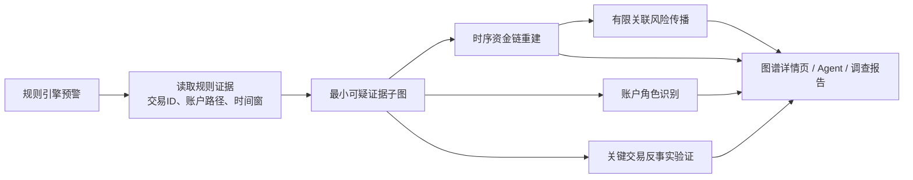

# 链鉴 AML：证据化时序资金图谱智能分析方案（比赛 MVP）

## 1. 方案结论

本方案不把“图谱智能分析”做成一个展示节点和边的页面，也不把 PageRank、中心性等通用指标包装为核心创新。系统的目标是：**将规则预警压缩为一个可验证的最小可疑证据子图，自动还原资金的时序转移过程，识别账户在链路中的业务角色，并在严格边界内给出关联待核查范围与关键交易反事实验证。**

面向评委与合规人员的一句话表述：

> 链鉴 AML 将分散的交易预警自动还原为可回放、可归因、可验证的资金证据链；系统不替代人工定性，而是明确指出“为什么可疑、关键交易是什么、下一步优先核查什么”。

比赛期建议完成四项能力：

1. **最小可疑证据子图（必须）**：从预警相关的 1–3 跳图中筛掉无关日常交易，只保留足以解释规则命中的账户、交易和路径。
2. **时序资金链重建与回放（必须）**：按时间、金额连续性和路径关系串联交易，支持按分钟/小时播放资金如何“归集—中转—拆分—回流”。
3. **账户角色标注（必须）**：给账户标注“资金源头、归集、中转、分散、回流、桥接”等可解释角色，而不是只给抽象风险分。
4. **有限、可归因的关联风险传播与关键交易反事实验证（推荐）**：关联账户仅标为“待核查”，每个传播结果都必须附路径证据；移除一笔关键交易后重新计算链路完整度和风险影响。

不建议在比赛期实现 GNN、无约束社区检测或无限扩散的风险传播：样本小、时间有限，而且会削弱可解释性与合规边界。

---

## 2. 当前 MVP 基线与缺口

以下结论基于当前 `my_Customer-master/chainjian-aml` 代码，不将规划能力表述为已实现能力。

| 项目 | 当前已具备 | 当前缺口 |
| --- | --- | --- |
| 图数据 | Neo4j 中有 `Account` 节点和带时间、金额、币种、交易 ID 的 `TRANSFER` 边；演示集为 3,157 个账户、4,756 笔交易 | 未持久化图特征、账户角色、证据子图或传播结果 |
| 规则证据 | 循环、拆分、归集、多跳规则均输出 `transaction_ids`、`account_path` 和规则细节 | 规则证据未被组织为统一的案件图谱对象 |
| 查询 | 已能查单一账户的出向 1–3 跳路径 | 仅按账户出向展开；没有时间、金额、证据优先级筛选，也无法显示闭环或关键边 |
| 可视化 | 预警详情页可用 Graphviz 画出路径 | 节点/边同质化，没有风险颜色、角色、时间回放、证据模式或交互 |
| 评分 | 当前风险分主要为规则权重之和 | 图结构特征不参与评分，也无法解释某条边的贡献 |
| 标签边界 | `labels.csv` 没有导入图数据库，避免标签泄漏 | 新模块必须继续保持此边界 |

因此，本方案不是推翻现有架构，而是增加一个 `graph_intelligence` 领域层，消费**规则证据 + 已清洗交易图**，再向页面、Agent、报告提供结构化结果。

---

## 3. 业务对象与硬约束

### 3.1 图模型

沿用现有模型：

```text
(:Account {account_id, bank_id, account_number, ...})
  -[:TRANSFER {
      transaction_id, timestamp,
      amount_paid, payment_currency,
      amount_received, receiving_currency,
      payment_format
    }]->
(:Account)
```

### 3.2 证据优先原则

图谱模块的每个结论必须能回溯到至少一种原始证据：

- 规则命中的 `transaction_id`；
- 图中实际存在的账户—交易路径；
- 可复算的图特征或时间、金额计算结果。

禁止把以下内容作为图谱推理输入：

- `labels.csv` 中的 `is_laundering`、`pattern_type`、`case_id`；
- 大模型生成但没有交易、规则或路径支撑的事实；
- 人工审核结论以外的账户身份、客户关系或外部情报。

### 3.3 风险表达边界

系统只输出三类状态，避免把“图上相邻”误说成洗钱认定：

| 状态 | 含义 | 页面颜色 | 是否可生成预警 |
| --- | --- | --- | --- |
| `direct_hit` | 账户直接参与规则命中证据 | 红色 | 是 |
| `associated_review` | 账户与直接命中账户存在满足约束的资金证据路径，建议核查 | 橙色 | 否，只能作为关联线索 |
| `context_only` | 只是展示上下文，没有足够证据支持风险推断 | 灰色 | 否 |

所有页面与报告都应带免责声明：**关联待核查不等于风险认定，须由授权合规人员结合客户尽调、业务背景与外部材料复核。**

---

## 4. 核心模块设计

### 4.1 模块 A：最小可疑证据子图

#### 目标

从“某账户周围所有 1–3 跳路径”中抽取一张足以解释该预警、但不充满噪声的子图。它是详情页、报告和 Agent 的共同事实底座。

#### 输入

- `alert_id`；
- 当前预警的 `rule_hits` 和 `evidence`；
- 可选参数：最大跳数（默认 3）、上下文时间窗（默认规则时间范围前后 24 小时）、最大上下文边数（默认 30）。

#### 抽取步骤

```text
步骤 1：将规则 evidence 中的账户、交易加入“必保留集合”。
步骤 2：根据 evidence 内时间范围，向前/后各扩展 24 小时。
步骤 3：从必保留账户展开至多 3 跳，但只保留满足至少一项的边：
        - 属于规则命中交易；
        - 连接两个必保留账户；
        - 与证据交易时间接近且金额连续；
        - 参与闭环、归集或拆分结构。
步骤 4：为每条候选边计算“证据优先级”，保留 Top-N。
步骤 5：保证每一个规则命中交易、每一条命中路径均未被裁剪。
```

#### 边优先级

不需要训练模型，采用透明、可调参数：

```text
edge_priority =
  1.00 × rule_evidence
  + 0.50 × connects_evidence_accounts
  + 0.30 × temporal_continuity
  + 0.20 × amount_continuity
  + 0.20 × structural_participation
```

其中每项均为 0 或 1；规则命中边永远优先保留。`structural_participation` 指该边是否属于检测到的循环、归集、拆分或多跳链。第一版无需把分数对外展示，只需作为“为什么这条边被保留”的内部可追溯依据。

#### 输出契约

```json
{
  "alert_id": "ALT-...",
  "subgraph_id": "SG-...",
  "time_range": {"start": "...", "end": "..."},
  "nodes": [{"account_id": "...", "status": "direct_hit", "roles": ["collector"]}],
  "edges": [{
    "transaction_id": "TX...",
    "source": "...", "target": "...",
    "timestamp": "...", "amount_paid": 10000,
    "evidence_tags": ["rule_hit", "cycle_edge"],
    "priority": 1.7
  }],
  "paths": [{"path_id": "P1", "accounts": ["A", "B", "C"], "transaction_ids": ["TX1", "TX2"]}]
}
```

### 4.2 模块 B：时序资金链重建与回放

#### 目标

不只展示静态有向图，而要显示资金行为如何随时间发生。特别适合展示：归集、转手、拆分、循环回流。

#### 交易连续性判定

对相邻边 `e1: A→B` 与 `e2: B→C`，满足以下条件时可连接为候选时序链：

```text
0 < t(e2) - t(e1) ≤ 72 小时
且 amount_similarity(e1, e2) ≥ 0.65
且 B 为共享中间账户
```

金额相似度定义为：

```text
amount_similarity = min(a1, a2) / max(a1, a2)
```

同币种时直接使用金额；跨币种演示版不做汇率换算，只允许相同支付币种连接，并在 UI 中明确标记“跨币种链路未做金额连续性判断”。

#### 链路评分

```text
path_confidence =
  0.40 × 时间紧凑度
  + 0.35 × 金额连续性
  + 0.25 × 规则/结构支撑
```

用途是对同一案件的多个候选链排序，不是概率意义上的“洗钱概率”。页面文案应使用“链路证据强度：高/中/低”，不要称“模型置信度”。

#### 页面交互

- 默认仅显示证据子图的全部边；
- 顶部提供时间轴和播放按钮；
- 播放时按交易时间逐边点亮，节点在第一次收到资金时出现；
- 选中一条链后，其余边降灰；
- 鼠标悬停交易边显示金额、币种、时间、规则标签与“为何被连入该链”；
- 支持“只看关键链 / 看全部证据 / 看关联上下文”三种模式。

### 4.3 模块 C：账户角色识别

#### 目标

将图结构翻译为审核人员理解的业务角色。角色不是身份标签，而是**在当前证据子图和当前时间窗中的行为角色**。

#### 角色及可解释判定

| 角色 | 判定规则（MVP） | 展示语句 |
| --- | --- | --- |
| `source` 资金源头 | 主要作为可疑链起点，且证据子图内出边金额显著大于入边金额 | “该账户是当前可疑链的主要资金发起点。” |
| `collector` 归集节点 | 在规则时间窗内，来自至少 3 个不同账户的入边，且入边数/金额显著高于出边 | “该账户在短时间内接收多源资金，呈现归集特征。” |
| `distributor` 分散节点 | 在规则时间窗内，向至少 3 个不同账户出边，且出边数/金额显著高于入边 | “该账户在短时间内向多个账户分散转出资金。” |
| `transit` 中转节点 | 入边后 72 小时内存在出边，且存在金额相似度至少 0.65 的接力交易 | “该账户收到资金后快速转出，呈现中转特征。” |
| `return` 回流节点 | 参与时间有序环，或资金链最终回到已出现账户 | “该账户参与形成资金回流或闭环。” |
| `bridge` 桥接节点 | 连接两个原本无共享账户的局部群组，且至少参与两条关键链 | “该账户连接两组资金路径，具有桥接作用。” |

同一账户可以有多个角色。例如“归集—中转复合节点”比单一角色更贴近真实交易行为。

#### 图特征卡

每个节点点击后显示：

```text
角色：归集—中转
证据窗口：2022-09-02 08:00 至 2022-09-04 08:00
入账来源：6 个账户，合计 84,500
转出对象：2 个账户，合计 80,200
最短资金停留：37 分钟
支持交易：TX0012、TX0043、TX0091
```

### 4.4 模块 D：有限、可归因的关联风险传播

#### 原则

风险传播只用于决定“优先核查哪些关联账户”，不能产生洗钱定性，也不应把风险无限扩散。第一版最多 2 跳，仅沿证据子图和高证据强度时序链传播。

#### 传播规则

对直接命中账户 `s` 的风险分 `R(s)`，向一个关联账户 `v` 的单条路径贡献定义为：

```text
contribution(s → v) =
  R(s)
  × hop_decay(h)
  × time_factor
  × amount_similarity
  × path_strength

hop_decay(1) = 0.45
hop_decay(2) = 0.20
time_factor = max(0.3, 1 - duration_hours / 72)
```

其中 `path_strength` 来自模块 B 的链路证据强度（0–1）。对同一关联账户只取最高贡献，不叠加多条路径以避免分数膨胀；最后截断到 0–49 分。达到 25 分且有完整路径证据时，标为 `associated_review`。

#### 强制输出的归因字段

```json
{
  "account_id": "B",
  "status": "associated_review",
  "associated_risk": 32.4,
  "source_account": "A",
  "hop_count": 2,
  "transaction_ids": ["TX00128", "TX00142"],
  "duration_hours": 0.92,
  "reason": "与直接命中账户存在 2 跳、55 分钟内、金额相似度 96% 的资金链。"
}
```

页面上必须将它和直接预警分区显示：**“关联待核查账户”**，不要混入预警列表。

### 4.5 模块 E：关键交易反事实验证

#### 目标

回答“为什么偏偏是这笔交易关键”。系统临时从证据子图中移除一条边，再计算案件结构是否被破坏。

#### 第一版定义

对证据子图中的每一条规则证据交易边 `e`：

1. 原图计算：规则支撑数、关键链数、循环是否闭合、可达账户数；
2. 临时移除 `e`；
3. 重新计算以上指标；
4. 得到影响分：

```text
impact(e) =
  0.45 × 关键链减少比例
  + 0.35 × 规则结构破坏程度
  + 0.20 × 可达性减少比例
```

不删除数据库中的真实交易，只在内存子图或 Cypher 投影中进行“what-if”计算。

#### 可展示结论

> 若不计入 TX00128，循环交易不再闭合，关键资金链由 3 条降至 1 条；该交易的证据影响等级为“高”。

这不是“证明交易违法”，而是解释它为什么是当前预警中的**优先核查交易**。

---

## 5. 统一案件图谱流程



Agent 只读取 H 中由算法生成且带证据 ID 的结构化内容。Agent 可以负责解释、总结和问答，但不负责凭空发现交易事实。

---

## 6. 技术落地设计

### 6.1 新增目录建议

```text
graph_intelligence/
  __init__.py
  models.py                 # Subgraph、NodeProfile、Path、Propagation、Counterfactual
  evidence_subgraph.py      # 模块 A
  temporal_flow.py          # 模块 B
  role_classifier.py        # 模块 C
  risk_propagation.py       # 模块 D
  counterfactual.py         # 模块 E
  service.py                # 统一编排入口
  tests/
```

不建议把上述逻辑塞进 `frontend/pages/alert_detail.py`，也不要由 LLM 在运行时计算。前端只负责调用 API 和渲染。

### 6.2 数据模型（Python）

```python
@dataclass
class GraphNode:
    account_id: str
    status: Literal["direct_hit", "associated_review", "context_only"]
    roles: list[str]
    metrics: dict[str, float]
    evidence_transaction_ids: list[str]

@dataclass
class GraphEdge:
    transaction_id: str
    source: str
    target: str
    timestamp: str
    amount_paid: float
    payment_currency: str
    evidence_tags: list[str]
    priority: float

@dataclass
class EvidenceSubgraph:
    alert_id: str
    nodes: list[GraphNode]
    edges: list[GraphEdge]
    temporal_paths: list[dict]
    propagations: list[dict]
    counterfactuals: list[dict]
```

### 6.3 API 设计

保留现有 `GET /graph/{account_id}`，新增案件视角 API：

| API | 用途 |
| --- | --- |
| `GET /alerts/{alert_id}/graph-intelligence` | 返回完整证据子图、角色、时序链、传播、反事实摘要 |
| `GET /alerts/{alert_id}/graph-intelligence/timeline` | 返回按时间排序的回放事件 |
| `GET /alerts/{alert_id}/graph-intelligence/counterfactuals` | 返回关键交易影响排序 |
| `GET /accounts/{account_id}/graph-profile?alert_id=...` | 返回账户在该案件中的角色和指标 |

接口必须支持 `refresh=false` 默认读取缓存；比赛数据规模小，可先用 SQLite 的 JSON 缓存表或进程内带版本号缓存。缓存键应包含 `alert_id + evidence_fingerprint + parameters_version`，规则结果变化时自然失效。

### 6.4 Agent 工具设计

新增只读工具：

```text
get_evidence_subgraph(alert_id)
get_account_graph_role(alert_id, account_id)
get_temporal_fund_chains(alert_id)
get_counterfactual_ranking(alert_id)
```

Prompt 约束：

1. 每一个关于交易、路径、账户角色的事实必须引用返回的交易 ID 或路径 ID；
2. 对 `associated_review` 只能说“建议核查”，不能说“高风险账户”或“涉洗账户”；
3. 若工具没有返回足够证据，回答“现有数据不足以确认，需要人工补充核查”；
4. 报告中单列“图谱证据”和“建议核查事项”。

---

## 7. 页面设计：预警详情页升级

保持当前三栏布局，不新增一张孤立的炫技页面。

```text
左栏：案件与风险             中栏：证据化资金图谱                 右栏：调查 Agent 与人工审核
─────────────────           ─────────────────────               ──────────────────────
风险等级/规则               [证据子图 | 全量关联图]              一句话案件摘要
直接命中账户                时间轴 + 播放/暂停/步进              关键证据卡
角色概览                    节点角色、边证据标签                优先核查动作
关联待核查账户              点击节点/边详情                     Agent 问答与报告
                            关键交易影响 Top 3                  确认/驳回/补充调查
```

### 7.1 中栏的必要交互

- 图模式切换：`证据子图` 为默认；`全量关联图` 供人工探索；
- 时间回放：按交易顺序点亮边；
- 角色图例：源头、归集、中转、分散、回流、桥接；
- 风险图例：红/橙/灰三层状态；
- 点击边：显示交易事实、证据标签、所属链路与反事实影响；
- 点击节点：显示角色卡、进出账统计、关联风险归因；
- 一键定位：点击“关键交易 Top 1”只高亮其相关链路。

### 7.2 视觉规范

- 规则命中边：红色、较粗、实线；
- 关键时序链边：蓝紫色、带顺序编号；
- 关联上下文边：浅灰色、半透明；
- `direct_hit` 节点：红色填充；
- `associated_review` 节点：橙色描边，不使用“高危”文案；
- `context_only` 节点：浅灰色；
- 节点不应仅靠颜色区分，必须有图例和角色图标/文本。

---

## 8. 风险评分的接入方式

当前规则分仍是主分，图谱特征作为解释性增量，第一版不应完全替换规则评分。

建议：

```text
final_risk_score = min(100,
  rule_score
  + graph_structure_bonus
  + temporal_chain_bonus
)

graph_structure_bonus ∈ [0, 15]
temporal_chain_bonus ∈ [0, 10]
```

| 加分项 | 分数 | 条件 |
| --- | ---: | --- |
| 闭环完整 | +10 | 规则证据构成时间有序循环 |
| 归集—拆分复合 | +10 | 同一案件中同时出现 collector 与 distributor 且由时序链连接 |
| 4 跳以上连续资金链 | +8 | 时间、金额连续性满足阈值 |
| 高影响关键交易 | +5 | Top-1 交易移除后关键链减少至少 50% |
| 桥接节点 | +3 | 连接两条以上证据链 |

分数必须在详情页拆解显示，例如“规则 70 分 + 图结构 10 分 + 时序链 8 分 = 88 分”。关联传播分不得写回直接预警主分。

---

## 9. 比赛期实施顺序与分工

### P0：必须完成（建议 1–2 天）

| 工作包 | 后端/算法 | 前端 | 验收 |
| --- | --- | --- | --- |
| 统一证据子图 | 按 alert evidence 拉取和裁剪节点/边；返回 JSON | 将 Graphviz 图改为带证据颜色的图 | 每条预警的规则交易 100% 出现在子图中 |
| 账户角色 | 基于入/出边和时间窗实现 5 个角色 | 点击节点显示角色卡 | 每个演示案件至少标注 1 个可解释角色 |
| 图谱证据卡 | 返回交易事实与规则标签 | 右栏显示“关键证据 Top 3” | 卡片可跳转并高亮对应边 |

### P1：强烈推荐（建议再用 1 天）

| 工作包 | 后端/算法 | 前端 | 验收 |
| --- | --- | --- | --- |
| 时序链 | 计算链路、链路强度与时间事件 | 时间轴播放 | CYCLE、FAN-IN、FAN-OUT 各能回放一个案例 |
| 反事实验证 | 临时删边重新计算结构指标 | 显示影响排名 | Top-1 交易移除后能解释链路变化 |

### P2：时间允许再做（半天至一天）

- 有限关联风险传播；
- 图谱结果缓存与参数调节面板；
- 报告 PDF 中嵌入证据子图截图；
- 与昇腾部署模型联动，让模型只做“基于证据的叙述与行动建议”。

### 建议分工

```text
成员 A：evidence_subgraph + role_classifier + 单元测试
成员 B：temporal_flow + counterfactual + API
成员 C：详情页图渲染、时间轴、证据卡、审核交互
成员 D：Agent 工具、报告模板、答辩故事线和演示数据准备
```

---

## 10. 测试与验收标准

### 10.1 数据与合规边界

- 图谱分析代码不得读取 `labels.csv`；
- 所有返回交易 ID 都必须在 `transactions.csv` / DWD 表中存在；
- 子图中每个 `direct_hit` 节点至少关联一条规则证据交易；
- 关联风险节点必须有完整 `source_account + transaction_ids + hop_count` 归因。

### 10.2 算法正确性

- CYCLE 案例：时序回放可形成闭环；
- FAN-IN 案例：中心账户识别为 `collector`；
- FAN-OUT/STRUCTURING 案例：源账户识别为 `distributor`；
- MULTI_HOP 案例：每条连续边均满足时间与金额阈值；
- 反事实：移除循环关键边后“闭环完整”指标应变为 false。

### 10.3 产品验收

- 从预警详情打开证据子图不超过 3 秒（比赛数据集）；
- 一次点击可定位任意关键交易的证据与路径；
- Agent 对“为什么预警”“关键交易是什么”“下一步查什么”三个问题均引用真实交易 ID；
- 人工审核者可区分“直接命中”与“关联待核查”；
- 不存在“关联账户即高风险”的误导性文案。

---

## 11. 三分钟演示脚本

### 0:00–0:30：问题

“传统规则能发现异常，但审核人员仍要在几十条交易里手工拼出资金路径。我们把规则预警转为可审核的图谱证据链。”

### 0:30–1:15：证据子图与角色

打开一个归集—中转—分散案例：

“系统自动从完整交易网络中抽取最小证据子图。红色是规则直接命中账户，橙色是有明确资金证据的关联待核查账户。这个节点在 24 小时内接收多源资金后快速转出，因此被标注为‘归集—中转复合角色’。”

### 1:15–2:00：时序回放

点击播放：

“我们不是只看静态关系，而是按时间恢复资金动作：先从多个账户归集，再经中转账户拆分。每条被高亮的边都能点击查看交易 ID、金额、时间与规则依据。”

### 2:00–2:30：关键交易反事实

点击关键交易卡：

“若暂不计入 TX00128，这条循环链无法闭合，关键路径由三条降为一条。因此系统将它排为第一优先核查交易。”

### 2:30–3:00：Agent 与人工边界

“Agent 基于这些结构化证据生成调查建议，不自行编造交易事实；最终由审核人员确认、驳回或要求补充调查，形成审计留痕。”

---

## 12. 可用于 PPT / 申报书的创新表述

### 创新点标题

**证据约束的动态上下文编排与时序资金图谱反事实核查机制**

### 精简版

系统以规则命中交易为证据种子，从大规模交易网络中自动抽取最小可疑证据子图，并结合案件状态、账户画像、交易时序、规则命中和调查任务，动态编排面向当前问题的业务上下文。系统再利用时间连续性、金额连续性和图结构角色重建资金链，通过受约束的关联风险传播、证据质量校验和关键交易反事实验证，将风险预警转化为可追溯、可解释、可人工复核的调查行动建议。

### 上下文工程的五项创新能力

1. **动态上下文编排**：根据预警类型和调查阶段，自动选择规则证据、关键交易、资金路径、账户画像、反事实结果和历史调查记录，形成最小必要上下文，避免把无关交易整体交给 Agent。
2. **上下文压缩与优先级排序**：以直接命中证据、关联待核查证据和纯展示上下文分层，并按时间、金额、路径强度和证据类型排序，在控制上下文长度的同时保留关键事实，降低模型调用成本和信息噪声。
3. **权限边界与数据隔离**：上下文只允许使用当前案件和当前角色有权访问的交易、材料、报告及审计信息；生产化版本进一步落实案件级、字段级和租户级权限，防止敏感数据越权进入模型。
4. **证据约束与结果校验**：Agent 只能基于工具返回的结构化证据生成建议；证据质量门检查来源、证据 ID、降级数据源和证据完整性，缺证据时触发补查或转人工，不把模型输出当作事实认定。
5. **全链路可追溯**：记录上下文来源、工具调用、调查步骤、模型输出、人工审核和审计事件，使每个调查结论都能回放“使用了什么数据、经过什么步骤、由谁确认”。

### 可验证的创新效果

路演中建议用同一批案件对比“全量上下文”和“动态上下文”两种方式，至少展示：上下文 Token/数据量下降、关键证据召回率、调查报告事实一致性、Agent 补查率、人工调查耗时和审核可回放率。当前演示版已具备证据子图裁剪、证据质量判断、工具调用追踪、人工审核与审计留痕；权限细粒度控制、上下文 Token 统计和生产级多租户隔离属于后续落地能力，需实测后再填写具体数值。

### 必须避免的表述

- “系统自动认定洗钱”；
- “图传播后所有关联账户均为高风险”；
- “大模型自主发现资金事实”；
- “反事实验证证明交易违法”。

应改为：

- “系统识别可疑模式并提供证据化调查线索”；
- “关联账户为待核查对象”；
- “模型基于工具返回的交易与图谱证据生成解释”；
- “反事实分析用于识别当前案件中的关键证据交易”。
