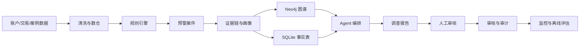
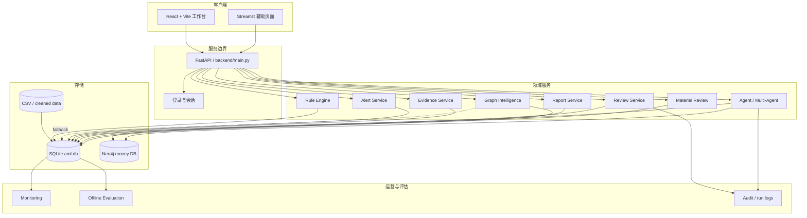

# 链鉴 AML

## 反洗钱证据链审查平台系统技术设计

| 状态 | 负责人 | 最后更新 |
|---|---|---|
| Draft：演示版技术设计 | 链鉴 AML 项目组 | 2026-08-06 |

| 项目 | 内容 |
|---|---|
| 作者 | 链鉴 AML 项目组 |
| 评审人 | 待指定：产品、后端、风控、运维负责人 |
| 相关文档 | [README](../../README.md)、[PRD](../PRD.md)、[总体架构](aml-overall-architecture.md)、[图谱智能分析方案](链鉴AML_图谱智能分析方案.md)、[自迭代 SOP](../operations/自迭代SOP.md) |
| 设计范围 | 数据导入、数仓、规则预警、证据链、图谱、解释、Agent、审核、报告和监控 |

## 1. 摘要

链鉴 AML 是一个面向反洗钱调查人员的证据链审查平台。系统从合成交易数据中生成规则预警，将预警关联到账户、交易、资金路径、账户画像和风险因素，并通过 Agent 编排形成结构化调查报告，最终由人工审核人员确认、驳回或要求补充调查。

本设计的核心原则是：**所有可见风险结论必须能够回溯到系统查询得到的交易、规则、账户或图谱事实；模型只能组织和解释事实，不能补造事实或自动执行账户处置。**

当前版本是华为黑客松演示版，主链路为 React + Vite、FastAPI、SQLite，Neo4j 为可选图谱依赖。系统不接入真实银行核心系统，不自动冻结账户、拒绝交易、限额或提交监管报告。

### 1.1 工作负载与约束

- 演示数据集来自 IBM AML-Data `HI-Small` 子集，manifest 记录 4,756 笔交易、3,157 个账户和 6 个案例；
- 规则和图谱查询以可解释、可复核为优先，不以通用图指标或黑盒模型作为唯一依据；
- Agent 调查属于耗时任务，需记录任务状态、工具调用和失败原因；
- Neo4j 不可用时，部分路径查询可以使用 SQLite 交易事实降级，但降级结果必须明确标识；
- `labels.csv` 只用于离线评估，不得进入在线规则、图谱或 Agent 推理路径；
- 当前代码仍有测试收集和模块导入问题，本设计不把“全量测试通过”作为现状事实。

### 1.2 不解决的问题

- 真实客户身份识别、客户尽职调查和真实银行核心交易接入；
- 自动冻结、拒付、限额、账户处置和监管报送；
- 生产级多租户、复杂权限、跨地域部署和灾备；
- 以合成数据评估结果推断真实业务效果；
- 仅依靠大模型完成风险判断或法律定性。

## 2. 目标与非目标

| 目标 | 非目标 |
|---|---|
| 对账户和交易运行规则并生成可追溯预警 | 不自动认定洗钱或执行账户处置 |
| 将预警关联到关键交易、规则和资金路径 | 不把测试标签用于在线推理 |
| 提供分项风险解释和反事实分析 | 不承诺生产级模型准确率 |
| 支持人工审核、审计留痕和报告生成 | 不把 Agent 输出当作最终审核结论 |
| Neo4j 不可用时维持有限演示链路 | 不保证降级模式具备完整图谱能力 |
| 为后续评估、监控和规则迭代保留数据 | 不在本版本实现完整自动化自迭代发布 |

## 3. 背景与问题陈述

传统规则系统可以发现单点异常，但调查人员仍需在多个页面中拼接交易、账户、规则和审核记录。对拆分转账、循环转账、归集再发散和多跳资金转移等行为，单笔交易通常无法说明完整风险链路。

如果不建立统一的证据链，系统会出现以下问题：

- 预警可以生成，但调查人员无法快速解释为什么命中；
- 报告中的金额、账户或路径与原始交易难以核对；
- Agent 可能在工具失败时生成无法验证的文本；
- 审核意见和处置状态无法形成可追溯记录；
- 规则、评分和模型变更后缺少可重复的评估和回滚依据。

### 3.1 系统边界

系统内部负责事实存储、规则检测、证据组织、调查辅助和审核留痕；外部真实银行系统、监管系统、身份系统和生产级消息平台不在当前范围内。

## 4. 提议架构

### 4.1 总体架构

### 4.2 核心组件

| 组件 | 职责 | 主要存储或依赖 | 失败行为 |
|---|---|---|---|
| 数据清洗与数仓 | 校验 CSV、标准化字段、构建 ODS/DWD/DWS/ADS | `data/cleaned/`、SQLite | 清洗失败则不应替换现有基线 |
| Rule Engine | 识别循环、拆分、归集、多跳和快速转移等模式 | SQLite、Neo4j 可选 | 记录规则失败，不生成未经验证的预警 |
| Alert Service | 将规则结果聚合成案件、证据和风险分 | SQLite | 事务失败则保留原案件状态 |
| Evidence/Explainability | 组织交易、规则、画像和评分证据 | SQLite、Neo4j 查询结果 | 工具失败需显式返回失败状态 |
| Graph Intelligence | 生成证据子图、时序路径、角色和传播结果 | Neo4j；SQLite 降级 | 降级时标记数据源和能力边界 |
| Agent 编排 | 按计划调用规则、图谱、交易和报告 Agent | SQLite 任务表、模型服务 | 任务进入 `FAILED`，不补造事实 |
| Report Service | 将结构化事实组织成报告草稿 | SQLite / 内存结果 | 返回可解释错误，不宣称已生成文件 |
| Review Service | 保存人工审核、状态转移和备注 | `review_record`、`audit_log` | 缺少审核人或备注返回校验错误 |
| Material Review | 文件质量检查、账户/金额交叉核验 | 本地文件、SQLite | 不确定结果进入人工复核 |
| Monitoring/Evaluation | 记录运行指标并计算离线指标 | SQLite、日志 | 指标缺失时标记数据不可用 |

### 4.3 关键不变量

1. 在线推理不得读取 `labels.csv` 或 `ods_evaluation_labels_raw` 的标签字段；
2. 报告中的账户、交易、金额和路径必须来自工具返回的事实；
3. 规则命中、风险评分、证据和审核状态必须能通过案件 ID 关联；
4. 人工审核是处置闭环的最终闸门，Agent 不得绕过审核执行账户操作；
5. Neo4j 降级时不得把 SQLite 的有限路径伪装成完整图谱结果；
6. 运行库重建必须可识别数据批次，不能无审计地覆盖生产基线。

## 5. 请求与任务生命周期

### 5.1 预警生成

1. 客户端调用 `POST /alerts/generate`，或由数据重建/同步流程触发；
2. 服务加载当前 SQLite 数仓和可用图谱配置；
3. 规则引擎读取交易、账户特征和图谱关系，输出标准化规则命中；
4. Alert Service 按账户或案件聚合规则命中，计算风险评分和等级；
5. 预警、规则命中和证据在同一持久化边界内写入；
6. API 返回案件列表，前端通过 `GET /alerts` 和 `GET /alerts/{alert_id}` 展示；
7. 监控记录规则命中量、案件量、失败数和运行时间。

### 5.2 调查 Agent

1. 客户端提交预警 ID 和调查问题到 `POST /agent/investigate` 或 `POST /agent/multi-investigate`；
2. 服务校验案件是否存在，并生成调查任务或追踪记录；
3. Planner 确定规则、交易、图谱、风险和报告步骤；
4. 各 Agent 通过受限工具读取事实数据；
5. 工具调用结果写入任务状态和调查追踪；
6. 若配置模型，则把受限事实上下文交给模型组织文本；否则使用确定性模板；
7. 任务以 `COMPLETED` 或 `FAILED` 结束，前端通过任务查询接口读取结果；
8. 任何工具失败都必须进入失败或部分失败状态，并保留失败原因。

### 5.3 人工审核

1. 前端从案件详情页提交审核人、动作和备注；
2. API 校验身份、案件状态、动作值和必填备注；
3. Review Service 写入审核记录，并记录原状态、新状态和时间；
4. Audit Service 写入审计事件；
5. 报告读取最新审核状态，但不得覆盖历史审核记录；
6. 审核结果通过 `GET /alerts/{alert_id}/reviews` 可追溯。

### 5.4 材料审查

1. 客户端通过 `POST /alerts/{alert_id}/materials` 上传材料；
2. 服务执行格式、分辨率、清晰度、曝光、账户和金额等检查；
3. 交叉核验结果标记为 `passed` 或 `warning`；
4. 存在不一致时进入人工决定接口，不自动改变案件风险结论。

## 6. API 与数据契约

### 6.1 主要 API

| 方法 | 路径 | 用途 | 状态 |
|---|---|---|---|
| GET | `/health` | 服务健康检查 | 已实现 |
| POST | `/alerts/generate` | 运行规则并生成案件 | 已实现 |
| GET | `/alerts` | 查询预警列表 | 已实现 |
| GET | `/alerts/{alert_id}` | 查询案件详情 | 已实现 |
| GET | `/alerts/{alert_id}/explainability` | 查询风险和证据解释 | 已实现 |
| GET | `/alerts/{alert_id}/counterfactual` | 查询反事实结果 | 已实现 |
| GET | `/alerts/{alert_id}/graph-intelligence` | 查询图谱智能分析 | 已实现 |
| GET | `/graph/{account_id}` | 查询账户图谱 | 已实现 |
| POST | `/agent/investigate` | 单 Agent 调查 | 已实现 |
| POST | `/agent/multi-investigate` | 多 Agent 调查 | 已实现 |
| GET | `/agent/multi-investigate/{alert_id}/tasks` | 查询调查任务 | 已实现 |
| GET | `/reports/{alert_id}` | 获取报告内容 | 已实现 |
| POST | `/alerts/{alert_id}/review` | 提交人工审核 | 已实现 |
| GET | `/alerts/{alert_id}/materials` | 查询案件材料 | 已实现 |
| POST | `/alerts/{alert_id}/materials` | 上传案件材料 | 已实现 |
| GET | `/monitoring/metrics` | 查询运行指标 | 已实现 |
| GET | `/evaluation/metrics` | 查询离线评估指标 | 已实现 |

### 6.2 预警案件契约

| 字段 | 类型 | 必填 | 说明 |
|---|---|---|---|
| `alert_id` | string | 是 | 案件稳定标识，供接口、审核和审计关联 |
| `account_id` | string | 是 | 主风险账户或案件主体 |
| `risk_score` | number | 是 | 当前评分，必须与解释分项一致 |
| `risk_level` | enum | 是 | `LOW`、`MEDIUM` 或 `HIGH`，具体阈值由版本配置决定 |
| `rule_hits` | array | 是 | 命中的规则及其证据引用 |
| `evidence` | array | 是 | 交易、路径、画像或材料证据摘要 |
| `status` | enum | 是 | 案件当前处理状态 |
| `created_at` | datetime | 是 | 案件生成时间，使用统一 ISO 8601 表示 |
| `source_batch_id` | string | 建议 | 生成案件的数据批次，支持重放和审计 |
| `rule_version` | string | 建议 | 规则和评分配置版本 |

### 6.3 调查任务契约

| 字段 | 类型 | 必填 | 说明 |
|---|---|---|---|
| `task_id` | string | 是 | 一次调查任务的唯一标识 |
| `alert_id` | string | 是 | 任务关联案件 |
| `run_id` | string | 建议 | 一次批量调查的批次标识；当前能力仍需完善 |
| `agent_name` | string | 是 | 当前执行 Agent |
| `status` | enum | 是 | `WAITING`、`RUNNING`、`COMPLETED`、`FAILED` |
| `input` | object | 是 | 预警 ID、问题和限制参数 |
| `output_summary` | string | 否 | 结构化结果摘要，不替代事实明细 |
| `error` | string | 否 | 失败原因和可重试性 |
| `created_at` / `finished_at` | datetime | 是/否 | 任务生命周期时间 |

### 6.4 契约保证

- 案件、任务、审核和审计必须使用稳定 ID 关联；
- 规则版本、数据批次和审核时间应被记录，便于解释和回放；
- 标签字段不属于在线事实契约；
- 报告是调查草稿和审核输入，不是监管报送系统的事实来源；
- API 变更应同步更新本文件、接口测试和前端调用。

## 7. 一致性、幂等性与回放

### 7.1 一致性

预警生成需要保证案件、规则命中和核心证据不会出现“案件已生成但完全没有来源”的状态。审核状态变更与审核记录应在同一 SQLite 事务中完成，审计日志至少记录状态变化和操作人。

### 7.2 幂等性

- 数据批次应通过导入批次 ID 或源文件校验值识别；
- 规则重新运行应使用稳定案件键，避免重复生成同一案件；
- 审核接口不能因为客户端重复提交而生成无法区分的重复状态迁移；
- Agent 重复调查允许产生新的任务记录，但不得篡改旧任务输出；
- 实时同步应以交易 ID 或业务唯一键进行去重。

### 7.3 部分失败

- Neo4j 失败：使用 SQLite 有限降级，并在结果中标识 `fallback`；
- 模型服务失败：使用确定性模板或返回明确失败，不伪造模型结论；
- 报告生成失败：保留调查任务和工具结果，允许人工查看事实；
- 审计写入失败：审核不得静默成功，应进入错误状态并告警；
- 数据清洗失败：不得覆盖上一份可用数据基线。

### 7.4 回放

回放至少需要保留：输入数据批次、规则版本、评分配置、案件 ID、工具查询结果、Agent 任务、审核状态和时间。当前项目已具备部分任务与审计记录，但完整 `run_id` 批次隔离和任务取消仍是后续工作。

## 8. 安全与隐私

### 8.1 身份与权限

当前演示版包含基础登录接口，但尚不能视为生产级权限体系。生产化至少需要：

- 调查、审核、运维和管理员角色分离；
- 案件、材料、报告和审计日志的最小权限；
- 所有审核和管理操作记录操作人；
- 高影响规则、评分和报告口径变更需要审批。

### 8.2 数据最小化

- 演示数据应保持合成或脱敏；
- Agent 只接收当前案件所需的最小事实集合；
- 日志不得记录 API Key、密码和不必要的敏感材料原文；
- 材料上传应限制文件类型、大小和保存期限；
- 报告导出应保留案件权限校验。

### 8.3 密钥与依赖

Neo4j 密码、模型 API Key、登录密钥和外部服务凭证只能通过环境变量或受控密钥存储注入，不得提交到 Git。模型服务地址和模型名应记录在部署配置中，但不记录秘密值。

### 8.4 管理和调试工具

数据重建、规则生成、批量调查、回放和数据库替换命令默认只允许运维人员执行，并应在执行前确认环境、数据目录和备份状态。调试模式不得绕过审核或标签隔离边界。

### 8.5 留存与删除

生产化前需要由业务和合规负责人确定交易、材料、报告、任务和审计日志的留存期限、删除方式、导出权限和地域要求。当前演示版不承诺满足生产监管留存要求。

## 9. 运营就绪性

### 9.1 监控指标

| 信号 | 目标或告警 | 责任人 | 上线门槛 |
|---|---|---|---|
| 服务健康 | `/health` 可用；连续失败需告警 | 后端/运维 | 必须 |
| 规则运行成功率 | 成功、失败、耗时可追踪 | 风控/后端 | 必须 |
| 预警量波动 | 相对基线的异常波动需诊断 | 风控 | 必须 |
| Agent 工具成功率 | 按工具和任务记录，不用总体平均掩盖失败 | Agent 负责人 | 推荐 |
| 图谱降级率 | 记录 Neo4j 失败和 SQLite fallback 次数 | 图谱负责人 | 必须 |
| 审核积压 | 待审核量和处理时长持续监控 | 合规运营 | 推荐 |
| 数据质量 | 缺失率、重复率、时间范围和批次状态 | 数据负责人 | 必须 |
| 离线指标 | Precision、Recall、F1 与版本绑定 | 评估负责人 | 必须 |
| 审计完整性 | 审核状态变化可重建 | 后端/合规 | 必须 |

### 9.2 发布与回滚

发布前必须完成：

1. 从 `chainjian-aml` 目录执行 `python -m pytest -q`；
2. 执行前端构建和接口冒烟；
3. 对规则、评分、提示词或数据变更运行离线评估；
4. 保存旧版本配置、数据批次和回滚方案；
5. 在演示或灰度环境验证 Neo4j 不可用时的降级行为；
6. 明确本次发布的版本号和变更范围。

当前代码测试尚未通过，因此不能把本设计视为已达到发布门槛。

### 9.3 灾备与恢复

演示版使用本地 SQLite，不具备生产级高可用。生产化需要补充：数据库备份、恢复演练、Neo4j 备份、文件材料备份、审计日志保护和恢复点目标。恢复后必须校验案件、审核和审计记录的一致性。

## 10. 方案取舍

| 方案 | 考虑原因 | 未选或当前限制 |
|---|---|---|
| SQLite | 单机演示简单、可追踪、部署成本低 | 不适合高并发和生产高可用 |
| PostgreSQL | 适合生产事务和并发 | 当前 MVP 引入成本和部署复杂度更高 |
| Neo4j | 适合多跳资金关系查询 | 需要额外服务；当前必须保留 SQLite 降级 |
| 纯 SQLite 图查询 | 减少依赖、演示可用 | 多跳路径表达和性能有限 |
| 规则优先 + Agent 辅助 | 可解释、可审计、便于人工复核 | 覆盖新型模式能力依赖规则和图谱建设 |
| 端到端大模型判断 | 交互自然、实现看似简单 | 难以保证证据完整性和可审计性，不能作为当前核心路径 |
| React 主前端 | 适合当前工作台和交互演示 | 需要额外构建和接口冒烟验证 |
| Streamlit 主前端 | 原型开发快 | 与当前 React 工作台存在重复维护，保留为辅助页面 |

## 11. 待决问题

1. 生产环境最终使用 PostgreSQL、Neo4j 还是两者组合？
2. 案件、交易、材料和审计日志的正式留存期限分别是多少？
3. 目标部署是否必须在昇腾 NPU 本地完成模型推理？对应模型、量化方案和性能指标是什么？
4. 多租户和机构级数据隔离是否属于下一版本，还是上线前置条件？
5. 当前基础登录接口是否替换为统一身份认证和细粒度 RBAC？
6. `/legal/search`、`legal-basis` 和 `sar-draft` 等合规接口是否进入正式演示范围？若进入，数据来源、审查责任和输出边界如何定义？
7. Agent 的 `run_id`、取消、重试和并发上限由谁负责审批和运营？
8. PDF 导出、报告签名和报告版本管理是否是比赛验收项？

## 12. 决策与下一步

### 12.1 推荐决策

采用“React + FastAPI + SQLite 为演示主链路、Neo4j 可选增强、规则和事实查询优先、Agent 只做受限解释与编排、人工审核作为最终闸门”的方案。

### 12.2 实施里程碑

| 里程碑 | 交付物 | 退出标准 |
|---|---|---|
| M1：工程基线修复 | 修复模块导入、缩进和测试收集问题 | `python -m pytest -q` 可重复运行并有明确结果 |
| M2：演示链路验证 | 数据重建、规则预警、图谱、解释、报告、审核 | 至少一个完整案件从生成到审核可回放 |
| M3：质量与降级验证 | Neo4j/模型失败、重复请求、报告失败和审核失败测试 | 所有失败均可观察且不产生虚假事实 |
| M4：有限发布 | React 工作台、监控、演示脚本和数据说明 | 前端构建、接口冒烟、核心回归全部通过 |
| M5：生产化评估 | 权限、留存、备份、昇腾部署和性能测试 | 完成独立安全、合规和运维评审后再扩大范围 |

### 12.3 首个交付建议

首个可交付版本应只承诺本地合成数据演示：完成工程基线修复、统一 README/PRD/技术设计、验证一条案件闭环，并在界面和报告中明确“调查辅助、合成数据、人工审核”的边界。未完成测试、权限、留存和部署评审前，不应将系统描述为生产级反洗钱平台。
