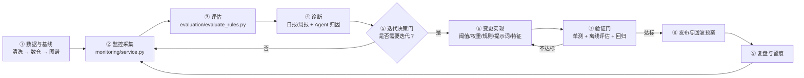

# 链鉴 AML 自迭代 SOP

> 版本：v1.0 | 生效日期：2026-08-06 | 维护人：
> 适用范围：链鉴 AML 反洗钱智能审查系统（规则引擎、风险评分、图谱分析、Agent 调查、报告生成、审核闭环）
> 关联文档：[模型运行日报月报模板](模型运行日报月报模板.md)、[上线监控指标表](上线监控指标表.md)、[PRD](../../docs/PRD.md)、[审核与评估说明](../../docs/review-and-evaluation.md)

---

## 1. 目的

让系统在**数据漂移、规则失效、审核反馈、LLM 质量波动**面前，能按固定节奏自主完成「监控 → 评估 → 诊断 → 迭代 → 验证 → 发布 → 复盘」的闭环，同时保持三个不可逾越的红线：

1. **标签不进入推理路径**：`data/labels.csv` / `ods_evaluation_labels_raw` 只用于离线评估，禁止传入规则、Neo4j 查询或 Agent 工具（见 [PRD](../../docs/PRD.md) §6）；
2. **人审留痕**：每次迭代必须有记录、有审批门、可回滚，禁止"悄悄改参数"；
3. **合规辅助定位**：迭代只调整检测与解释能力，不改变"系统不自动冻结/报送"的产品边界。

---

## 2. 自迭代闭环总览



对应到代码仓库：

| 环节 | 落点 |
|------|------|
| ① 数据基线 | `backend/core/data_cleaning.py`、`backend/core/warehouse.py --replace`、`graph/build_graph.py` |
| ② 监控采集 | `monitoring/service.py`（PSI、数据质量、规则命中、审核统计），落表 `monitoring_snapshot` |
| ③ 离线评估 | `evaluation/evaluate_rules.py`，接口 `GET /evaluation/metrics` |
| ④ 诊断 | `docs/operations/模型运行日报月报模板.md`、`docs/operations/上线监控指标表.md`、Agent 归因分析 |
| ⑥ 变更落点 | `rules/*`、`app/risk_score.py`、`agent/prompt.py`、`agents/*`、数据分箱与特征 |
| ⑦ 验证 | `tests/`、`evaluation/`、回归对比（旧版本 vs 新版本） |

---

## 3. 角色与职责

| 角色 | 职责 | 在流程中的门 |
|------|------|-------------|
| 技术/运维 | 跑监控、评估、实现变更、发布回滚 | ⑥⑦⑧ |
| 合规审核人员 | 日常确认/驳回预警，为迭代提供反馈标签 | ③（间接）、⑨ |
| 合规负责人 | 审批**高影响迭代**（改权重、加规则、改报告结论口径） | ⑤、⑧ |
| Agent（辅助） | 自动生成监控摘要、归因分析与迭代提案草案 | ④（辅助） |

**自迭代的"自"体现在**：②③④ 全自动产出；⑤ 给出**带数据支撑的提案**（改什么、预期收益、风险）；只有决策门与发布门保留人工审批。

---

## 4. 触发信号与阈值（进入迭代诊断的判据）

每个迭代周期开始时，先对照下表逐项检查。任一指标达到 **黄线** 即进入诊断，达到 **红线** 立即响应。

### 4.1 数据质量（来自 `monitoring/service.py`）

| 指标 | 绿线 | 黄线 | 红线 |
|------|------|------|------|
| 缺失字段率 | 0 | >0 且持续 2 期 | >0 且影响核心字段 |
| 重复交易数 | 0 | >0 | 持续增长 |
| 交易/账户量级 | 与基线±10% | ±10%~30% | >±30% |

### 4.2 分布漂移

| 指标 | 绿线 | 黄线 | 红线 |
|------|------|------|------|
| 风险评分 PSI | <0.10 | 0.10~0.25 | ≥0.25 |
| 金额分位数（P90/P99） | 与基线±10% | ±10%~30% | >±30% |

### 4.3 规则与预警

| 指标 | 黄线（触发诊断） | 红线（立即响应） |
|------|------------------|------------------|
| 单规则命中量 | 环比 ±30% | 环比 >100% 或归零 |
| 预警总量 | 环比 ±20% | 环比 >50% |
| 高风险占比 | 环比 ±5pp | 环比 ±10pp |

### 4.4 审核反馈（最有价值的迭代信号）

| 指标 | 黄线 | 红线 |
|------|------|------|
| 预警驳回率（REJECT） | >30% | >50% |
| 确认率（CONFIRM） | <40% | <25% |
| 待审积压 | 超过 3 个工作日处理量 | 超过 5 个工作日 |

### 4.5 离线评估（每轮迭代必跑）

| 指标 | 达标线 | 说明 |
|------|--------|------|
| Overall Precision / Recall / F1 | 不劣于上一版本 | 由 `evaluation/evaluate_rules.py` 输出 |
| Cycle / Fan-in / Fan-out 分项指标 | 不劣于上一版本 | 与标签模式对齐的分项 |
| 幻觉率（LLM 报告抽评） | <2% | 见日报模板模块八 |
| 工具调用成功率 | ≥99% | 同上 |

---

## 5. 迭代流程（九步）

### S1 数据与基线（每轮迭代起点）

```powershell
# 1. 清洗与重建数仓（首次或数据变更时）
python backend/core/data_cleaning.py
python backend/core/warehouse.py --replace

# 2. 导入 Neo4j 图谱
$env:NEO4J_PASSWORD = "<your-password>"
python graph/build_graph.py --data-dir data/cleaned
```

- 记录基线快照：交易笔数、账户数、时间范围、数据版本号（如 `d2026Q3`）。
- **数据变更必须升版本号**，否则监控对比失真。

### S2 监控采集（自动，每周期一次）

```powershell
python -m monitoring.service
```

- 输出写入 `monitoring_snapshot` 表；对比上一快照计算环比与 PSI。
- 建议接入定时任务（Windows 任务计划程序 / Linux cron），周期：日更数据则每日，否则每周。

### S3 评估（自动，每周期一次）

```powershell
python -m evaluation.evaluate_rules
```

- 输出 Overall 与分项 Precision / Recall / F1，追加到迭代台账。
- 同时拉取审核统计：`SELECT action, count(*) FROM review_record GROUP BY action`，计算驳回率/确认率。

### S4 诊断（自动产出 + 人工确认）

1. 对照 §4 阈值表，把**触发的指标**整理成问题清单；
2. 对每条问题做归因：
   - 数据漂移 → 检查数据源、导入批次；
   - 规则命中暴涨/暴跌 → 检查对应规则参数与上游数据字段；
   - 驳回率高 → 抽查 10~20 条驳回预警，看是阈值过宽、特征无效还是报告误导；
   - PSI 超标 → 定位漂移特征，看是否需要对分箱/基线重校准。
3. Agent 可辅助生成诊断草稿，但**结论必须由人复核**。

### S5 迭代决策门（人工审批）

基于诊断结果，选择迭代类型并评估影响：

| 迭代类型 | 变更落点 | 影响等级 | 审批人 |
|----------|----------|----------|--------|
| 规则阈值微调 | `rules/behavior_rule.py` 等构造参数 | 低 | 技术负责人 |
| 新增规则 | `rules/*` 新增类 + 注册到 `rule_engine.py` | 高 | 技术负责人 + 合规负责人 |
| 评分权重调整 | `app/risk_score.py` `RULE_WEIGHTS` | 高 | 技术负责人 + 合规负责人 |
| 风险等级阈值 | `app/risk_score.py` `risk_level()` | 高 | 合规负责人 |
| 提示词 / 报告口径 | `agent/prompt.py`、`agents/report_agent.py` | 中 | 技术负责人（报告结论口径变更需合规确认） |
| 特征/分箱 | 数据清洗、特征计算 | 中 | 技术负责人 |
| 标签/评估集 | `evaluation/` | 中 | 技术负责人（禁止反向流入推理） |

**产出物**：一张《迭代提案单》（见 §8 模板），记录：触发信号、诊断结论、变更方案、预期收益、影响范围、回滚方案。

### S6 变更实现

- 所有变更走 Git 分支 + PR，禁止直接改 `main`；
- 遵守现有代码风格与中文注释惯例；
- 改阈值/权重时**保留旧值注释或放版本说明**，便于回滚与对比；
- 每次只做"一个迭代主题"，避免多变更混在一个 PR 里无法归因。

### S7 验证门（不达标不得发布）

1. **单元/回归测试**：从 `chainjian-aml` 目录执行 `python -m pytest -q`，必须以本轮实际输出为准；当前版本存在测试收集失败，不能沿用历史的“全部通过”结论；
2. **离线评估对比**：`evaluation/evaluate_rules.py` 新旧版本指标对比，Overall 与分项均**不劣于**旧版本；
3. **回归抽查**：对旧版本产生的高分预警，确认新版本结论合理（抽样 ≥20 条）；
4. **LLM 质量抽评**：变更提示词/报告时，抽评 ≥10 份报告，幻觉率 <2%、工具成功率 ≥99%；
5. 不达标 → 回到 S6 调整，禁止通过放宽测试或注释掉断言"绕过"验证。

### S8 发布与回滚

- 发布 = 合入 `main` + 重启服务（从项目目录执行 `python -m uvicorn main:app --app-dir backend`）；
- 每次发布记录**版本号**（如 `v1.1.0-rules`），并在 `monitoring_snapshot` 标注基线；
- 回滚预案（提前写进迭代提案单）：
  - 规则/权重 → `git revert` 对应 commit 后重启（分钟级）；
  - 数据 → 重跑 S1 恢复旧数据版本；
  - LLM 提示词 → 切回旧 prompt 文件版本。

### S9 复盘与留痕

- 在《迭代台账》（见 §8）登记：触发信号 → 变更 → 验证结果 → 上线效果；
- 迭代后 1~2 个监控周期内，**验证指标是否回到绿线**，未回到则重新进入 S4；
- 月度复盘：哪些信号最常触发迭代、哪些变更收益最大，沉淀为后续迭代优先级依据。

---

## 6. 节奏与值班

| 周期 | 动作 | 责任人 |
|------|------|--------|
| 每日 | 监控采集 + 日报（若数据日更） | 技术/运维 |
| 每周 | 评估 + 审核反馈统计 + 周诊断 | 技术/运维 + 合规审核人员 |
| 每两周 | 决策门例会，评审迭代提案单 | 技术负责人 + 合规负责人 |
| 每月 | 月报 + 月度复盘（对齐日报月报模板 §2） | 全角色 |

---

## 7. 自迭代自动化落地建议（将"自"做实）

当前 SOP 中 ②③ 已可脚本化，④⑤ 依赖人工。建议分三步把循环自动化：

**阶段一（当前即可做）**：把 S2/S3 封装为 `scripts/iteration_cycle.py`，一次执行输出：
- 监控指标环比表（含 PSI、驳回率、规则命中）
- 离线评估指标表
- 自动对比阈值表（§4），列出**触发项清单**

**阶段二**：让 Agent（复用 `agents/supervisor_agent.py` 的编排思路）读触发项清单，自动生成《迭代提案单》草稿（归因分析 + 建议变更 + 预估影响），人工审批后进入实现。

**阶段三**：接入 CI/定时任务，每周自动跑阶段一脚本并把结果推送到工作台/日报，实现"机器监测、机器提案、人审批、机器验证"的闭环。

---

## 8. 模板

### 8.1 迭代提案单

```markdown
# 迭代提案单

- 提案编号：IT-2026-XXX | 日期：____ | 提出人：____
- 触发信号：□ 数据质量  □ PSI漂移  □ 规则命中异常  □ 驳回率过高  □ 离线评估下滑  □ LLM质量
- 触发指标数值：____（对照阈值：绿/黄/红）

## 一、诊断结论
根因：____
证据（抽样/数据）：____

## 二、变更方案
- 类型：□ 阈值微调  □ 新增规则  □ 评分权重  □ 风险等级  □ 提示词  □ 特征/分箱
- 变更文件：____
- 具体内容（含旧值→新值）：____
- 预期收益：____

## 三、影响与风险
- 影响预警范围：____
- 审批人：____ | 是否批准：□ 是  □ 否

## 四、回滚预案
- 回滚方式：□ git revert commit  □ 数据版本回退  □ prompt 版本切换
- 回滚触发条件：____

## 五、验证结果（S7 完成后填写）
- 单测：□ 通过  □ 失败（原因：____）
- 离线评估：Overall P/R/F1 新旧对比：____ / ____
- 回归抽查：____
- 结论：□ 可发布  □ 需调整
```

### 8.2 迭代台账（建议 `docs/operations/iteration-log.md`）

| 日期 | 提案编号 | 触发信号 | 变更内容 | 版本 | 验证结果 | 上线后效果 | 是否回滚 |
|------|----------|----------|----------|------|----------|-----------|----------|
| 2026-08-06 | IT-2026-001 | 驳回率42% | 下调 NEAR_THRESHOLD 窗口 3h→2h | v1.1.0 | F1 0.71→0.74 | 待观察 | 否 |

---

## 9. 附录：命令速查

```powershell
# 数据基线
python backend/core/data_cleaning.py
python backend/core/warehouse.py --replace
$env:NEO4J_PASSWORD="<password>"; python graph/build_graph.py --data-dir data/cleaned

# 监控与评估
python -m monitoring.service
python -m evaluation.evaluate_rules

# 测试
python -m pytest

# 服务
python -m uvicorn main:app --app-dir backend --host 0.0.0.0 --port 8000
```

---

## 10. 红线清单（违反即视为流程事故）

1. 把 `labels.csv` / `ods_evaluation_labels_raw` 传入规则引擎、图谱查询或 Agent 工具；
2. 未经审批发布"高影响"变更（新增规则、权重、风险等级、报告口径）；
3. 变更不记录版本、不留痕、无回滚预案；
4. 用放宽测试或注释代码的方式让验证"通过"；
5. 一次 PR 混入多个迭代主题导致无法归因。
